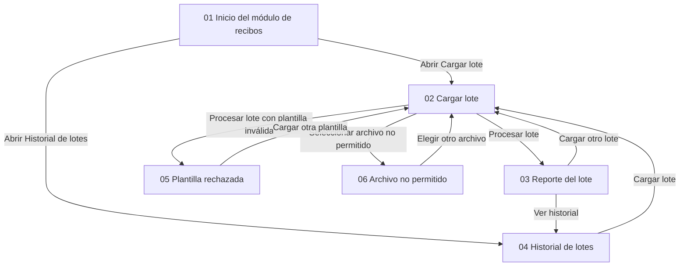

# Recorrido del usuario — Migración del módulo de recibos por lote

- Generado por el boceto visual de Discovery el 2026-11-25 (reabierto a pedido del usuario)
- Fuentes: `vision-document.md` (Funcionalidades IN 1, 7 y 8), historias US-02, US-03 a US-05, US-12 y US-13, y `api-contract.md`
- Respuestas: `interview/visual/visual-answers-history.md`
- Maquetas: `mockups/index.html` (escritorio en `mockups/desktop/`, móvil en `mockups/mobile/`)

## Persona: Profesional de Admisiones, Registro y Control (ARC)

Texto equivalente: desde el inicio del módulo, ARC abre "Cargar lote" o el "Historial de lotes". En "Cargar lote" selecciona la plantilla y la procesa. El camino normal termina en el reporte del lote, que muestra los estudiantes que se subieron y los que no, con el motivo; desde ahí puede cargar otro lote o ver el historial. Hay dos caminos alternos: si la plantilla no tiene el formato vigente, aparece "Plantilla rechazada"; si el archivo no es un `.xls` o pasa del tamaño máximo, aparece "Archivo no permitido". Los dos regresan a "Cargar lote".

## Pantallas

| N.º | Pantalla | Archivo (en `mockups/desktop/` y `mockups/mobile/`) | Historias |
|---|---|---|---|
| 01 | Inicio del módulo de recibos | `01-inicio-modulo.html` | US-01 |
| 02 | Cargar lote | `02-cargar-lote.html` | US-02 |
| 03 | Reporte del lote | `03-reporte-lote.html` | US-12 |
| 04 | Historial de lotes | `04-historial-lotes.html` | US-13 |
| 05 | Plantilla rechazada | `05-plantilla-rechazada.html` | US-03, US-04, US-05 |
| 06 | Archivo no permitido | `06-archivo-no-permitido.html` | US-02 |
