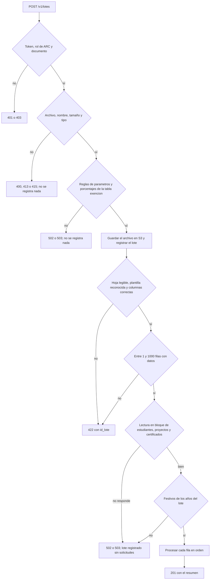
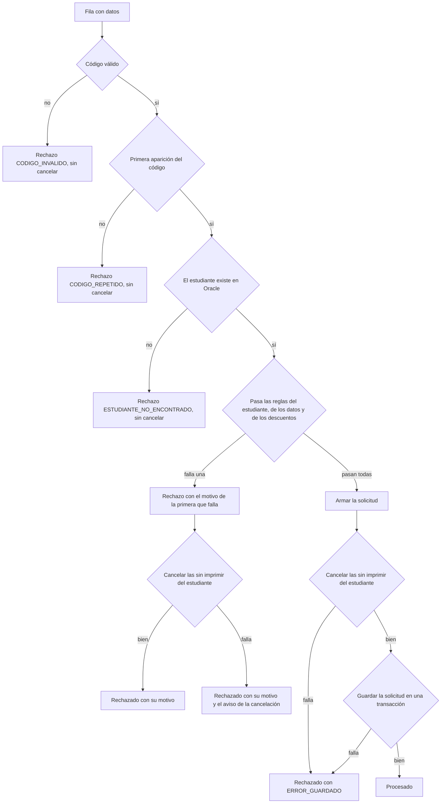

# Modelo de la lógica de negocio — U1 `recibos_service`

- Etapa: CONSTRUCTION → U1 `recibos_service` → Functional Design (2026-11-25)
- Fuentes: `business-rules.md` (reglas BR-…), `domain-entities.md`, `inception/application-design/services.md` (UC-01 a UC-03) y `component-methods.md`
- Alcance: qué hace el servicio y en qué orden, sin tecnología. Los nombres de los módulos son los de `components.md`. El pseudocódigo describe la lógica; no es el código final
- Actualizado el 2026-11-25 en U1 NFR Requirements: límite propio del lote (BR-L16, N3) y bloqueo por estudiante (BR-T05, N5)
- Actualizado el 2026-11-25 en U1 NFR Design: el límite cuenta desde que llega la petición y se revisa antes de cada sentencia de MySQL (BR-L16), presupuesto de la fase previa (DN-03), corte por MySQL (BR-T04, N20), guardado de una fila (§4.9) y dos propiedades nuevas (§9)

## 1. Visión general

| Caso de uso | Entrada | Salida | Historias |
|---|---|---|---|
| UC-01 Procesar lote | `POST /v1/lotes` con el archivo `.xls` | 201 con el resumen, o un error del lote | US-02 a US-12, US-15 |
| UC-02 Consultar lotes | `GET /v1/lotes?limit&offset` | 200 con una página de lotes | US-13 |
| UC-03 Autorizar usuario | El token de cada petición a `/v1/*` | Sigue la petición, o 401 / 403 | US-01 |
| Auditoría | Cada petición a `/v1/*` | Un registro JSON | US-14 |

Todo UC-01 ocurre en la misma petición (C-2). Las reglas del dominio no conocen HTTP ni bases de datos: reciben datos y devuelven una solicitud o un rechazo.

## 2. UC-01: flujo del lote



Texto equivalente:
1. Se valida el token, el rol de ARC y el documento del usuario (BR-A01 a BR-A03). Si falla: 401 o 403.
2. Se valida el archivo: campo, nombre, tamaño y tipo real (BR-L01 a BR-L03). Si falla: 400, 413 o 415, y no se registra nada.
3. Se leen las reglas de "parametros" y los porcentajes de las exenciones de la tabla `exencion` (BR-L04, BR-L05). Si falla: 502 o 503, y no se registra nada.
4. Se guarda el archivo en S3 y se registra el lote (BR-L06, BR-L07). Desde aquí, todo error deja el lote registrado.
5. Se lee la hoja, se identifica la plantilla y se validan sus columnas (BR-L08 a BR-L10). Si falla: 422 con `id_lote`.
6. Se extraen las filas con datos; deben ser de 1 a 1000 (BR-L11). Si no: 422.
7. Se leen en bloque los estudiantes, sus proyectos y sus certificados electorales (BR-L12), y los festivos de los años que necesita el lote (BR-L13). Si falla: 502 o 503, con el lote registrado y sin solicitudes.
8. Se procesa cada fila en el orden de la plantilla (§3). Si el lote llega a su límite propio de 90 s, contado desde que llegó la petición, las filas que faltan salen con `TIEMPO_AGOTADO` y no cancelan nada (BR-L16). Si MySQL falla por la conexión en 5 filas seguidas, las que faltan salen con `ERROR_GUARDADO` y no cancelan nada (BR-T04).
9. Se responde 201 con el resumen (BR-L15).

## 3. Procesamiento de una fila



Texto equivalente:
1. Si el código no es válido (BR-F01), la fila se rechaza con `CODIGO_INVALIDO` y no se cancela nada.
2. Si el código ya apareció en una fila anterior (BR-F02), la fila se rechaza con `CODIGO_REPETIDO`, no se procesa y no se cancela nada.
3. Si el estudiante no existe en Oracle (BR-E01), la fila se rechaza con `ESTUDIANTE_NO_ENCONTRADO` y no se cancela nada.
4. Se aplican, en orden, las reglas del estudiante (BR-E02 a BR-E07), las de los datos de la plantilla (BR-D01 a BR-D05) y la de los descuentos (BR-X02). La primera que falla da el motivo.
5. Si todas pasan, se arma la solicitud: exenciones, conceptos, cuotas y fechas (BR-X03 a BR-X07, BR-C01 a BR-C02, BR-Q01 a BR-Q04, BR-S01 a BR-S04).
6. En los dos casos se cancelan, en una transacción propia, las solicitudes sin imprimir del estudiante, de cualquier periodo (BR-T01).
7. Una fila rechazada termina con su motivo; si la cancelación falló, el mensaje lo avisa (BR-T02).
8. Una fila válida cuya cancelación falló termina con `ERROR_GUARDADO` y no se guarda (BR-T02).
9. Una fila válida con la cancelación hecha se guarda en una transacción. Si se guarda, queda como procesada; si falla, queda con `ERROR_GUARDADO`, y la cancelación se mantiene (BR-T03).

## 4. Algoritmos

### 4.1 UC-01 completo

```text
procesar_lote(comando):
    plazo_lote = Plazo(comando.recibida_en + limite_lote)                     # BR-L16: cuenta desde que llegó la petición
    plazo_previo = Plazo(reloj.segundos() + presupuesto_previo).hasta(plazo_lote)   # DN-03: 30 s para lo que va antes de las filas
    reglas = fuente_reglas.obtener(plazo_previo)                              # BR-L04: en paralelo, 10 s como máximo
    plazo_previo.exigir(peor_caso_mysql)                                      # una llamada de tiempo fijo solo empieza si le cabe su peor caso
    reglas = reglas.con_porcentajes(repositorio.porcentajes_exencion(reglas.ids_de_los_mapas()))   # BR-L05
    nombre_interno = "lotes/{aaaa}/{mm}/{uuid}.xls"
    plazo_previo.exigir(peor_caso_s3)
    almacenamiento.guardar(comando.contenido, nombre_interno)                  # BR-L06
    plazo_previo.exigir(peor_caso_mysql)
    id_lote = repositorio.registrar_lote(NuevoLote(comando.usuario.documento, comando.nombre_original,
                                                    nombre_interno, comando.ip, reloj.ahora()))   # BR-L07
    hoja = lector.leer(comando.contenido)                                      # BR-L08
    espec = plantillas.identificar(hoja); plantillas.validar_formato(hoja, espec)   # BR-L09, BR-L10
    filas = plantillas.extraer_filas(hoja, espec)                              # BR-L11: sin filas vacías
    si filas está vacía o tiene más de max_filas: error 422 con id_lote

    resultado = {}                                                              # fila → Procesado o Rechazo
    primera_fila = {}                                                           # código → fila de su primera aparición
    para cada fila en filas:
        codigo = validacion_filas.validar_codigo(fila)                          # BR-F01
        si codigo es Rechazo: resultado[fila] = codigo
        si no, si codigo está en primera_fila: resultado[fila] = Rechazo(CODIGO_REPETIDO, fila=primera_fila[codigo])   # BR-F02
        si no: primera_fila[codigo] = fila.numero

    a_procesar = filas sin resultado, en orden
    estudiantes = academico.estudiantes(códigos de a_procesar, plazo_previo)   # BR-L12; cada consulta usa lo que queda
    contextos = academico.contextos_carrera(proyectos de esos estudiantes, reglas.evento_periodo,
                                            reglas.evento_terminacion, plazo_previo)
    certificados = academico.con_certificado_electoral(códigos de a_procesar, plazo_previo)
    festivos = festivos_del_lote(a_procesar, espec, reglas, plazo_previo)      # BR-L13
    hoy = reloj.ahora().fecha()
    # si plazo_previo se acaba en cualquiera de los pasos anteriores: 503, sin procesar filas

    fallas_seguidas = 0                                                         # BR-T04: fallas de conexión a MySQL seguidas
    con repositorio.filas(plazo_lote) como sesion:                              # una conexión de MySQL para todas las filas
        para cada fila en a_procesar:
            si no plazo_lote.vigente(): resultado[fila] = Rechazo(TIEMPO_AGOTADO); continuar          # BR-L16, sin cancelar
            si fallas_seguidas >= corte_mysql: resultado[fila] = Rechazo(ERROR_GUARDADO); continuar   # BR-T04, sin cancelar
            estudiante = estudiantes.get(codigo de la fila)
            si estudiante no existe: resultado[fila] = Rechazo(ESTUDIANTE_NO_ENCONTRADO); continuar   # sin cancelar
            contexto = contextos.get(estudiante.codigo_carrera)
            salida = validacion_estudiante.validar(fila, estudiante, contexto, espec.tipo, reglas)
            si salida es ninguna:
                salida = generador_solicitud.generar(fila, espec, estudiante, contexto, reglas, festivos, hoy,
                                                     tiene_certificado = codigo en certificados)   # Solicitud o Rechazo
            resultado[fila], falla_de_conexion = guardar_fila(sesion, fila, estudiante.codigo, salida)   # §4.9
            fallas_seguidas = fallas_seguidas + 1 si falla_de_conexion, si no 0

    registrar en la auditoría los ids creados y cancelados                       # BR-U02
    registrar el evento lote_terminado: totales, filas con TIEMPO_AGOTADO, corte y duración   # NFR-O05
    devolver ResumenLote(id_lote, espec.tipo, len(filas), procesados en orden, rechazados en orden)   # BR-R01
```

### 4.2 Lectura de celdas

| Valor | Cómo se lee | Inválido si |
|---|---|---|
| Código (columna 1) | Texto sin espacios al inicio y al final; una celda numérica con valor entero se toma como ese entero | Vacío con otros datos en la fila; algo que no sea de 1 a 15 dígitos |
| Entero (cuotas, día, mes, año, porcentajes) | Igual que el código | Decimal, texto con otros caracteres o fracción (por ejemplo, una celda con formato de porcentaje) |
| Créditos | Entero de 1 a 999 | Vacío, 0, negativo, decimal o texto |
| SMLV | Número mayor que 0 y hasta 999,99, con coma o punto y hasta 2 decimales; se guarda con punto y sin ceros sobrantes | Vacío, 0, negativo, más de 2 decimales o texto |
| Fecha (día, mes, año) | Tres enteros que forman una fecha que existe, con año de 4 cifras | Falta alguno, la fecha no existe (por ejemplo, 31 de abril) o el año no tiene 4 cifras |
| Marca (concepto o exención) | La celda tiene contenido | Una celda con solo espacios no está marcada |

### 4.3 Validación del estudiante (BR-E01 a BR-E07)

```text
validar(fila, estudiante, contexto, tipo, reglas):
    si no estudiante.tiene_valor_matricula: devolver SIN_VALOR_MATRICULA           # BR-E02
    si estudiante.estado no está en reglas.estados_permitidos: devolver ESTADO_NO_PERMITIDO(estado)   # BR-E03
    si contexto es ninguno o no contexto.activa: devolver CARRERA_INACTIVA          # BR-E04
    si contexto.terminacion_activa y estudiante.estado no está en reglas.estados_terminacion:
        devolver NO_TERMINACION_MATERIAS                                            # BR-E05
    si contexto.periodo es ninguno: devolver SIN_PERIODO_VIGENTE                    # BR-E06
    si tipo es PREGRADO y contexto.nivel != reglas.nivel_pregrado: devolver NIVEL_NO_CORRESPONDE        # BR-E07
    si tipo es de posgrado y contexto.nivel no está en reglas.niveles_posgrado: devolver NIVEL_NO_CORRESPONDE
    devolver ninguno
```

La existencia (BR-E01) se revisa antes, en el caso de uso, porque decide si se cancela.

### 4.4 Datos de la fila y cuotas (BR-D01 a BR-D05, BR-Q01 a BR-Q03)

```text
pregrado:
    ordinaria = fecha(terna de D1)                                   # BR-D03: falta, no existe o es anterior a hoy → FECHA_INVALIDA
    cuotas = [Cuota(1, 100, FechasPago(ordinaria, extraordinaria(ordinaria)))]            # BR-Q01

posgrado:
    n = entero(columna 3) en 1..3, si no CUOTAS_INVALIDAS                                  # BR-D01
    unidad = créditos o SMLV de la columna 2, si no UNIDAD_INVALIDA                        # BR-D02
    para i de 1 a n:
        ordinaria[i] = fecha(terna i); si falta, no existe, es anterior a hoy
            o (i > 1 y ordinaria[i] <= ordinaria[i - 1]): FECHA_INVALIDA de la cuota i     # BR-D03
    para i de 1 a n:
        porcentaje[i] = vacío o entero de 0 a 100, si no PORCENTAJE_INVALIDO de la cuota i # BR-D04
    porcentaje[i] vacío → reglas.porcentajes_por_defecto[n][i]                            # BR-Q03
    si la suma != 100: PORCENTAJES_NO_SUMAN_100 con la suma                               # BR-D05
    cuotas = [Cuota(i, porcentaje[i], FechasPago(ordinaria[i], extraordinaria(ordinaria[i]))) para i de 1 a n]   # BR-Q02
```

### 4.5 Fecha extraordinaria (BR-Q04)

```text
extraordinaria(ordinaria):
    fecha = ordinaria + reglas.dias_fecha_extraordinaria días calendario
    mientras fecha está en festivos: fecha = fecha + 1 día
    devolver fecha
```

Los festivos son las fechas de la tabla de weboffice. Un sábado o un domingo que no esté en la tabla no mueve la fecha (F10). Ejemplo: ordinaria jueves 2027-01-07 → +8 días = viernes 2027-01-15, que no es festivo → extraordinaria 2027-01-15. Ejemplo con festivo: ordinaria 2027-01-03 → +8 = lunes 2027-01-11; si la tabla trae ese día (Reyes, trasladado al lunes), la extraordinaria es el martes 2027-01-12.

Los años que se revisan en BR-L13 son los años de cada fecha ordinaria más 8 días. Las fechas que no se pueden leer no cuentan para el rango; esas filas se rechazan después por BR-D03.

### 4.6 Exenciones (BR-X01 a BR-X06)

```text
seleccionar(fila, espec, reglas, tiene_certificado):
    ids = [reglas.exencion_de_columna(espec.tipo, c) para cada columna de exención c marcada]   # BR-X01
    votacion_marcada = reglas.id_exencion_votacion está en ids
    secretaria = reglas.id_exencion_secretaria está en ids
    descuentos = ids sin la votación ni la Secretaría
    si hay más de un descuento: devolver Rechazo(DESCUENTOS_NO_ACUMULABLES)                     # BR-X02
    descuento = el único descuento, o ninguno
    votacion = votacion_marcada o (tiene_certificado y (descuento o secretaria))                # BR-X03, BR-X04
    si votacion y descuento y porcentaje(descuento) + porcentaje(votacion) > 100: votacion = falso   # BR-X05
    devolver [votación si votacion] + [descuento si lo hay] + [Secretaría si secretaria]        # BR-X06
```

Tabla de decisión (posgrado; votación al 10%). La última columna dice qué registra hoy el PHP:

| Votación marcada | Descuento | Secretaría | Certificado | Exenciones registradas | Hoy |
|---|---|---|---|---|---|
| No | — | No | Sí | Ninguna | Igual |
| Sí | — | No | — | Votación | Igual |
| No | 50% | No | Sí | Votación, 50% | Igual |
| No | 50% | No | No | 50% | Igual |
| Sí | 90% | No | — | Votación, 90% (suma 100) | Igual |
| Sí | 100% | No | — | 100% | Cambio: hoy registra las dos |
| No | 100% | No | Sí | 100% | Igual |
| No | — | Sí | Sí | Votación, Secretaría | Igual (F15) |
| Sí | 30% | Sí | — | Votación, 30%, Secretaría | Igual en el conjunto; cambia el orden |
| No | 30% | Sí | Sí | Votación, 30%, Secretaría | Cambio: hoy no agrega la votación (F14) |
| No | 100% | Sí | Sí | 100%, Secretaría | Igual |
| — | Dos descuentos | — | — | Rechazo `DESCUENTOS_NO_ACUMULABLES` | Cambio: hoy registra todos |

En pregrado no hay Secretaría. Con la votación marcada y un descuento de las columnas 8 a 13, hoy la votación se quita siempre; ahora solo si la suma pasa de 100 (C2, C7).

### 4.7 Conceptos (BR-C01, BR-C02)

```text
seleccionar(fila, espec, reglas):
    conceptos = [reglas.concepto_matricula]
    si espec.tipo es PREGRADO: agregar reglas.concepto_exclusivo_pregrado
    para cada columna de concepto c, en orden: si fila.marcada(c): agregar reglas.concepto_de_columna(espec.tipo, c)
    devolver conceptos
```

### 4.8 Cancelación y guardado (BR-T01 a BR-T03)

| Fila | Cancelación | Guardado | Resultado en el resumen |
|---|---|---|---|
| Válida | Bien | Bien | Procesado |
| Válida | Bien | Falla | `ERROR_GUARDADO`; la cancelación se mantiene |
| Válida | Falla | No se intenta | `ERROR_GUARDADO` |
| Rechazada, estudiante conocido | Bien | No se intenta | Su motivo |
| Rechazada, estudiante conocido | Falla | No se intenta | Su motivo, con el aviso de la cancelación |
| `CODIGO_INVALIDO`, `CODIGO_REPETIDO` o `ESTUDIANTE_NO_ENCONTRADO` | No se intenta | No se intenta | Su motivo |
| Estudiante conocido, sin el bloqueo a tiempo | No se intenta | No se intenta | Como si fallara la cancelación (BR-T05) |
| Cualquiera, después del límite propio | No se intenta | No se intenta | `TIEMPO_AGOTADO` (BR-L16) |
| Fila a medias cuando llega el límite, sin la cancelación confirmada | Se revierte | No se intenta | `TIEMPO_AGOTADO` (BR-L16) |
| Fila a medias cuando llega el límite, con la cancelación confirmada | Bien | Se revierte o no se intenta | `ERROR_GUARDADO`; la cancelación se mantiene (BR-L16) |
| Cualquiera, después de 5 fallas de conexión seguidas a MySQL | No se intenta | No se intenta | `ERROR_GUARDADO` (BR-T04) |

La cancelación pasa de 0 a 2 todas las solicitudes sin imprimir del estudiante, de cualquier periodo (C8). Devuelve los ids cancelados para la auditoría (AD-25). El guardado escribe `solicitudRecibo` en estado 0, sus cuotas, sus exenciones en el orden de BR-X06 y sus conceptos en el orden de BR-C02, todo en una transacción.

### 4.9 Guardado de una fila (BR-T01 a BR-T05, BR-L16)

```text
guardar_fila(sesion, fila, codigo, salida):                                   # devuelve (resultado, falla_de_conexion)
    cancelo = falso
    intentar:
        con sesion.bloqueo_estudiante(codigo):                                  # BR-T05: GET_LOCK, 5 s como máximo
            sesion.cancelar_sin_imprimir(codigo); cancelo = verdadero           # BR-T01: transacción propia, ya confirmada
            si salida es Rechazo: devolver (salida, falso)
            sesion.guardar_solicitud(salida, usuario.documento, reloj.ahora())  # BR-T03: otra transacción
            devolver (Procesado(fila, codigo), falso)
    si PlazoVencido:                                                            # BR-L16: no salió ninguna sentencia más
        devolver (Rechazo(ERROR_GUARDADO) si cancelo, si no Rechazo(TIEMPO_AGOTADO), falso)
    si BloqueoNoObtenido, ErrorConexionBD u otro ErrorPersistencia:
        conexion = el error es ErrorConexionBD                                  # BR-T04: solo esta cuenta para el corte
        si no cancelo y salida es Rechazo: devolver (salida con el aviso de la cancelación, conexion)   # BR-T02, BR-T05
        devolver (Rechazo(ERROR_GUARDADO), conexion)                            # BR-T02, BR-T03: la cancelación hecha se mantiene
    # si falla al soltar el bloqueo, la fila conserva su resultado y la conexión se cierra: MySQL suelta el bloqueo
```

La sesión de filas revisa el plazo antes de cada sentencia. Si venció, no la envía: cierra la conexión, MySQL revierte la transacción abierta y suelta el bloqueo, y la sesión lanza `PlazoVencido`. Los detalles técnicos están en `construction/recibos_service/nfr-design/nfr-design-patterns.md` §3.3, §4.2 y §6.

## 5. Manejo de errores

| Situación | Respuesta | ¿Lote registrado? | ¿Solicitudes escritas o canceladas? |
|---|---|---|---|
| Token, rol o documento | 401 o 403 | No | No |
| Archivo, nombre, tamaño o tipo | 400, 413 o 415 | No | No |
| Regla de "parametros" o porcentaje de una exención | 502 o 503 | No | No |
| S3 o el registro del lote no responden | 503 | No | No |
| Hoja ilegible, plantilla no reconocida, columnas distintas, sin filas o más de 1000 | 422 con `id_lote` | Sí | No |
| Oracle no responde, o un año sin festivos | 502 o 503 | Sí | No |
| Se acaba el presupuesto de 30 s de la fase previa (DN-03) | 503 | Según el momento | No |
| MySQL deja de responder a mitad del lote | 201; cada fila que lo intenta queda con su motivo, y después de 5 fallas de conexión seguidas las que faltan quedan con `ERROR_GUARDADO` sin intentar (BR-T04) | Sí | Las anteriores sí |
| El lote llega a su límite propio | 201; las filas que faltan quedan con `TIEMPO_AGOTADO` | Sí | Las anteriores sí |
| Error inesperado | 500 con un mensaje genérico | Según el momento | Las transacciones abiertas se revierten |

Toda llamada a una dependencia tiene manejo de error explícito y libera sus recursos en caso de falla. Ninguna falla deja pasar una fila sin validar ni deja una solicitud a medias (SECURITY-15).

## 6. UC-02: consultar lotes

1. UC-03 autoriza la petición.
2. Se validan `limit` (1 a 100, por defecto 20) y `offset` (0 o más, por defecto 0). Otro valor da 400 (BR-H01).
3. Se leen los lotes de `solicitudLote`, del más reciente al más antiguo, con el total (BR-H02).
4. Se responde 200 con la página en `Data` y `total`, `limit` y `offset` en `Metadata`. Sin lotes, `Data` es una lista vacía (BR-H03).

## 7. UC-03: autorizar usuario

1. Sin token, o con un token que `/oauth2/userinfo` rechaza: 401 (BR-A01).
2. Sin el rol de ARC: 403 (BR-A02).
3. Sin `documento`: 403 (BR-A03).
4. Nada de la petición cambia el rol ni los permisos (BR-A04).

## 8. Auditoría

| Momento | Qué se registra |
|---|---|
| Toda petición a `/v1/*`, también las rechazadas | Los campos de `utils_oas/auditoria`; `sql_statement` sin valores; `ip_user` según AD-29 (BR-U01) |
| `POST /v1/lotes` | En `data`: tipo de plantilla, tamaño, `id_lote`, totales e ids de las solicitudes creadas y canceladas con el cambio 0 → 2 (BR-U02) |
| Nunca | Tokens, códigos ni nombres de estudiantes (BR-U03) |

## 9. Propiedades comprobables (PBT-01)

Cada propiedad se convierte en una prueba basada en propiedades en Code Generation. Las de tipo invariante quedan cubiertas por PBT-03 y las de ida y vuelta por PBT-02, que son bloqueantes en el modo parcial.

| Componente | Propiedad | Categoría | Reglas |
|---|---|---|---|
| `plantillas.extraer_filas` | Ninguna fila devuelta está vacía; los números de fila crecen y no se repiten | Invariante | BR-L11 |
| `plantillas.extraer_filas` | Agregar filas vacías o celdas con solo espacios no cambia el resultado | Invariante | BR-L11, F4 |
| `plantillas.validar_formato` | Una hoja armada con la especificación de un tipo se acepta; cambiar un encabezado la rechaza | Invariante | BR-L10 |
| `validacion_filas` (lectura de celdas) | Leer el código, un entero o la unidad dos veces da lo mismo que leerlo una vez | Idempotencia | BR-F01, BR-D02 |
| `validacion_filas` (unidad SMLV) | Para todo decimal mayor que 0 con hasta 2 decimales: leer(escribir(d)) = d | Ida y vuelta | BR-D02 |
| `validacion_filas` (código) | Todo texto de 1 a 15 dígitos, con o sin espacios alrededor, se acepta y da el mismo entero; todo texto con otro carácter se rechaza | Invariante | BR-F01 |
| `validacion_filas` (fechas) | Toda fecha que existe, con año de 4 cifras y no anterior a hoy, se acepta; toda terna que no forma una fecha se rechaza | Invariante | BR-D03 |
| `validacion_estudiante` | El motivo es el de la primera condición que falla en un modelo simple que evalúa BR-E02 a BR-E07 en orden | Oráculo | BR-E02 a BR-E07 |
| `fechas` | La extraordinaria es al menos 8 días posterior a la ordinaria, no es festivo, y todos los días entre ordinaria + 8 y ella son festivos | Invariante | BR-Q04 |
| `fechas` | Sin festivos, la extraordinaria es la ordinaria + 8 | Invariante | BR-Q04 |
| `fechas` | Para toda fecha: fecha(timestamp de su medianoche en America/Bogota) = la misma fecha | Ida y vuelta | BR-S04 |
| `cuotas` | Hay N cuotas numeradas de 1 a N; sus porcentajes suman 100; un vacío toma el valor de su posición; en posgrado las fechas ordinarias crecen; en pregrado hay una sola cuota al 100% | Invariante | BR-Q01 a BR-Q03, BR-D03, BR-D05 |
| `exenciones` | Hay como máximo un descuento; la votación aparece como máximo una vez; descuento + votación no pasa de 100; el orden es votación, descuento y Secretaría; nunca aparece "Reingreso" | Invariante | BR-X02 a BR-X07 |
| `exenciones` | El resultado coincide con la tabla de decisión de §4.6 | Oráculo | BR-X01 a BR-X06 |
| `exenciones` | La votación automática solo aparece si hay certificado y está marcado un descuento o la Secretaría | Invariante | BR-X04 |
| `conceptos` | La matrícula va primero; el exclusivo de pregrado solo aparece en pregrado y va segundo; no hay repetidos; los demás siguen el orden de las columnas | Invariante | BR-C01, BR-C02 |
| `generador_solicitud` | `unidad` es "0" si y solo si la plantilla es de pregrado; `cuota` es igual al número de cuotas; el periodo es el del contexto | Invariante | BR-S01 a BR-S03 |
| `procesar_lote` (con dobles en memoria) | Procesados + rechazados = filas con datos, y cada fila aparece una vez | Invariante | BR-R01 |
| `procesar_lote` | Solo la primera aparición de un código se procesa; nunca se cancela por una fila con `CODIGO_INVALIDO`, `CODIGO_REPETIDO` o `ESTUDIANTE_NO_ENCONTRADO`; una fila rechazada nunca guarda solicitud | Invariante | BR-F02, BR-T01 a BR-T03 |
| `procesar_lote` (con un reloj de prueba) | Si el límite se alcanza antes de la fila k, las filas desde k tienen `TIEMPO_AGOTADO` y ninguna cancela ni guarda; procesados más rechazados sigue siendo igual a las filas con datos | Invariante | BR-L16, BR-R01 |
| `procesar_lote` (con un repositorio de prueba que falla por la conexión) | Después de 5 fallas de conexión seguidas, ninguna fila siguiente llega a MySQL y todas salen con `ERROR_GUARDADO`; una falla que no es de conexión vuelve la cuenta a cero; procesados más rechazados sigue siendo igual a las filas con datos | Invariante | BR-T04, BR-R01 |
| `presupuesto.Plazo` (con un reloj de prueba) | El tiempo que da a una llamada nunca es negativo ni mayor que el pedido ni que lo que queda; un plazo vencido no da tiempo a ninguna llamada | Invariante | BR-L16, DN-03 |
| `procesar_lote` (dos lotes en paralelo, con dobles en memoria) | Con el bloqueo por estudiante, cada estudiante queda con una solicitud en estado 0 como máximo | Con estado (PBT-06, orientativa) | BR-T05 |
| `procesar_lote` | Después del lote, cada estudiante procesado tiene como máximo una solicitud en estado 0, la nueva; las que tenía en 0 pasan a 2; las de estado 1 no cambian | Con estado (PBT-06, orientativa) | BR-T01, BR-T03 |
| `consultar_lotes` | Una página trae como máximo `limit` lotes, ordenados del más reciente al más antiguo | Invariante | BR-H01, BR-H02 |
| `parametros/fuente_reglas` (conversión) | Para listas, enteros y JSON generados: convertir(escribir(v)) = v | Ida y vuelta | BR-L04 |
| `schemas/lotes` | Para todo resumen: leer(JSON(resumen)) = resumen | Ida y vuelta | BR-R01 |
| IP del cliente (AD-29) | Con N proxies de confianza, agregar entradas a la izquierda de `X-Forwarded-For` no cambia la IP | Invariante | AD-29 |

Componentes sin propiedades: los middlewares de cabeceras y CORS, los adaptadores de S3, SSM, WSO2, Oracle y MySQL, el lector de `.xls`, el reloj y los controllers. No tienen lógica propia: pasan datos entre el dominio y una dependencia. Se prueban con pruebas de ejemplo y con dobles (PBT-10, orientativa).

Generadores (PBT-07, se construyen en Code Generation): filas de cada plantilla con marcas al azar, incluidas celdas con solo espacios; códigos válidos e inválidos; fechas con fin de mes, 29 de febrero y cambio de año; porcentajes vacíos, 0, 100 y decimales; reglas coherentes con las especificaciones; conjuntos de festivos con días seguidos; estados y contextos de Oracle. La semilla se registra en CI (PBT-08, en Build and Test). El framework es Hypothesis, que se confirma en NFR Requirements (PBT-09).
