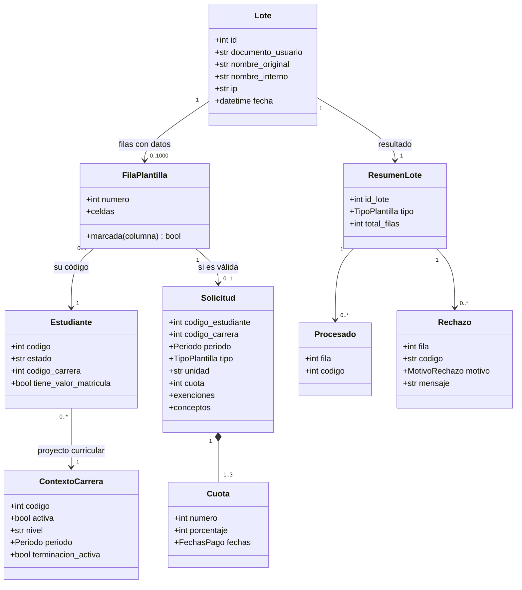
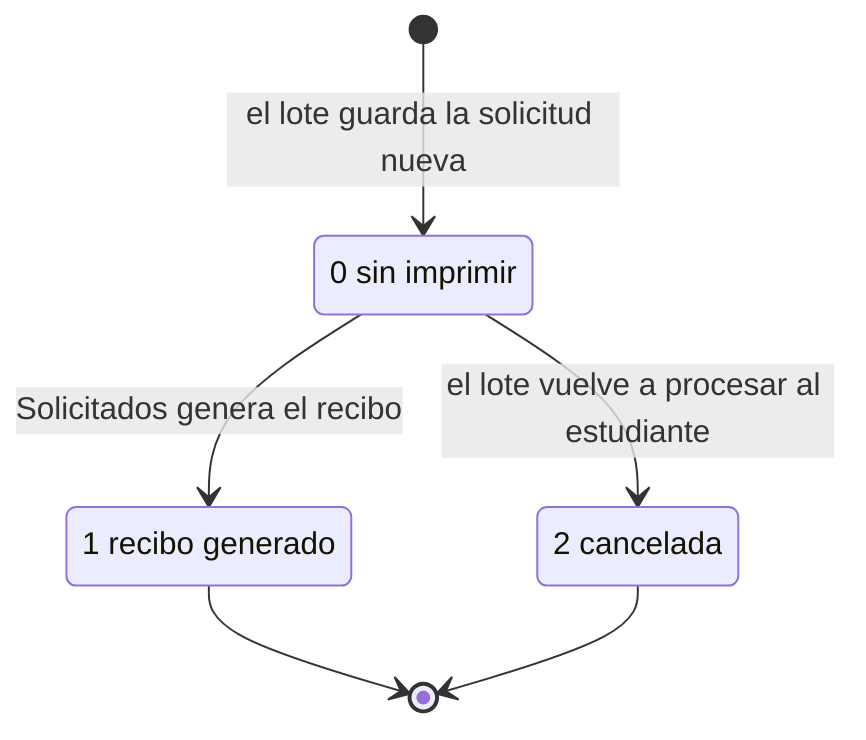

# Entidades del dominio — U1 `recibos_service`

- Etapa: CONSTRUCTION → U1 `recibos_service` → Functional Design (2026-11-25)
- Fuentes: `inception/application-design/component-methods.md` (tipos de diseño), `requirements.md` (RF-01 a RF-16 y §4.A), `stories.md` (US-01 a US-15), aclaraciones C1 a C8 y respuestas F1 a F15 (`construction/plans/`)
- Alcance: el modelo de negocio, sin tecnología. Los nombres de los tipos son los de `component-methods.md`, que esta etapa completa. Code Generation puede cambiar nombres internos, pero no el significado ni las reglas
- Reglas con su identificador (BR-…): `business-rules.md`. Algoritmos y flujos: `business-logic-model.md`
- Actualizado el 2026-11-25 en U1 NFR Requirements: motivo `TIEMPO_AGOTADO` (N3) y `trace_id` de la auditoría (N14)

## 1. Mapa del modelo

Texto equivalente: un lote trae hasta 1000 filas con datos. Cada fila con un código válido corresponde a un estudiante, y cada estudiante pertenece a un proyecto curricular con su contexto (activo, nivel, periodo vigente y evento de terminación de materias). Una fila válida produce una solicitud con 1 a 3 cuotas, sus exenciones y sus conceptos. El lote termina con un resumen que tiene, por cada fila con datos, un procesado o un rechazo.

## 2. Entidades y objetos de valor

### 2.1 `Usuario` (objeto de valor)
| Campo | Tipo | Regla |
|---|---|---|
| `documento` | texto | Claim `documento` de `/oauth2/userinfo`; obligatorio (BR-A03). Se guarda como `id_usuario` (A8) |
| `sub` | texto | Identificador del usuario en WSO2; va en la auditoría |
| `roles` | conjunto de textos | Debe incluir el rol configurado de ARC (BR-A02) |

### 2.2 `Lote` y `NuevoLote` (entidad; tabla `solicitudLote`)
| Campo | Tipo | Regla |
|---|---|---|
| `id` | entero | Lo genera la base al registrar el lote |
| `documento_usuario` | texto | `Usuario.documento` |
| `nombre_original` | texto | Nombre del archivo que subió el usuario, sin rutas ni caracteres de control, hasta la longitud de la columna (BR-L01, D4) |
| `nombre_interno` | texto | `lotes/{aaaa}/{mm}/{uuid}.xls`; nunca se deriva del nombre original |
| `ip` | texto | La que agrega el último proxy de confianza en `X-Forwarded-For` (AD-29, D13) |
| `fecha` | fecha y hora | Momento del registro, en America/Bogota |

Invariantes: el lote se registra antes de validar el formato, así que los lotes rechazados por formato también quedan (P-9, BR-L07). No guarda totales ni motivos (RF-12 CA3). `NuevoLote` es el mismo registro antes de tener `id`.

### 2.3 `EspecificacionPlantilla` (objeto de valor fijo en el dominio)
| Atributo | Pregrado (tipo 1) | Posgrado por créditos (tipo 2) | Posgrado SMLV (tipo 3) |
|---|---|---|---|
| Texto de A1 | `PLANTILLA GENERAL PREGRADOS` | `PLANTILLA GENERAL POSTGRADOS CREDITOS` | `PLANTILLA GENERAL POSTGRADOS SALARIOS MINIMOS LEGALES` |
| Fila inicial de datos | 4 | 5 | 5 |
| Número de columnas | 13 más las 3 de la fecha ordinaria, sin "Reingreso" (D1) | 29 | 29 (A6, hasta D2) |
| Código del estudiante | 1 | 1 | 1 |
| Unidad (créditos o SMLV) | — (`unidad` = "0") | 2 | 2 |
| Número de cuotas | — (siempre 1) | 3 | 3 |
| Conceptos | 2 a 4 | 4 a 6 | 4 a 6 |
| Exenciones | 5 a 13 (votación en la 5) | 7 a 17 (votación en la 7; Secretaría de Educación en la 16) | Igual que créditos |
| Fecha ordinaria | Una terna día, mes y año; posición según D1 (F8) | Ternas (18, 19, 20), (21, 22, 23) y (24, 25, 26) | Igual que créditos |
| Fecha extraordinaria | Se calcula (F8) | Se calcula | Se calcula |
| Porcentajes de cuota | — (100) | 27, 28 y 29 | 27, 28 y 29 |

Los encabezados oficiales de cada columna también forman parte de la especificación; los de pregrado salen de D1 y los de SMLV de D2. La plantilla de pregrado anterior, con la columna "Reingreso", se reconoce por sus encabezados y se rechaza con un mensaje propio (C-3).

### 2.4 `HojaPlantilla` y `FilaPlantilla` (objetos de valor)
| Tipo | Campo | Regla |
|---|---|---|
| `HojaPlantilla` | `celdas` | (fila, columna) → texto. Solo celdas con contenido distinto de espacios: una celda con solo espacios no existe para el dominio (F4) |
| `HojaPlantilla` | `num_columnas` | Última columna con encabezado |
| `FilaPlantilla` | `numero` | Número de fila de Excel (base 1); es el que ve ARC en el reporte |
| `FilaPlantilla` | `celdas` | Columna → texto, ya sin las celdas vacías |
| `FilaPlantilla` | `marcada(columna)` | Verdadero si la celda tiene contenido (BR-X01, BR-C01) |

Invariante: toda `FilaPlantilla` que entrega la extracción tiene al menos una celda con contenido. Las filas vacías se omiten (BR-L11).

### 2.5 `Estudiante` (objeto de valor, Oracle)
| Campo | Tipo | Regla |
|---|---|---|
| `codigo` | entero | `ACEST.est_cod` |
| `estado` | texto de una letra | `ACEST.est_estado_est` |
| `codigo_carrera` | entero | `ACEST.est_cra_cod` |
| `tiene_valor_matricula` | booleano | Existe la fila en `V_ACESTMATBRUTO` (BR-E02) |

Un estudiante "existe" si está en `ACEST`. Un estudiante "conocido" es el de una fila con código válido que existe en Oracle; solo a él se le cancelan solicitudes (BR-T01).

### 2.6 `ContextoCarrera` (objeto de valor, Oracle, uno por proyecto curricular del lote)
| Campo | Tipo | Regla |
|---|---|---|
| `codigo` | entero | `ACCRA.cra_cod` |
| `activa` | booleano | `cra_estado = 'A'` y el código no está en `proyectos_excluidos` [0, 999] (BR-E04) |
| `nivel` | texto | `ACTIPCRA.tra_nivel` por `ACCRA.cra_tip_cra` (BR-E07, F5) |
| `periodo` | `Periodo` o ninguno | Año y periodo del evento `evento_periodo` [80]. Ninguno si no hay o si hay más de uno (A13, BR-E06) |
| `terminacion_activa` | booleano | El evento `evento_terminacion` [82] está activo para el proyecto (BR-E05) |

### 2.7 `Periodo` (objeto de valor)
`anio` (entero de 4 cifras) y `numero` (entero). Se guardan en `solicitudRecibo.anno` y `periodo`.

### 2.8 `ReglasLiquidacion` (objeto de valor, una instantánea por lote)
Se arma una vez al inicio de cada lote con las reglas de "parametros" (lista completa en `business-rules.md` §11) y los porcentajes de las exenciones de la tabla `exencion` (F11). Invariante: está completa. Si falta una regla o el porcentaje de una exención de los mapas, el lote no empieza (BR-L04, BR-L05).

### 2.9 `Festivos` (objeto de valor, uno por lote)
Conjunto de fechas de la tabla de festivos de weboffice (F9, D5) para el rango que necesita el lote. Invariante: cada año del rango tiene al menos un festivo; si no, el lote se detiene (BR-L13).

### 2.10 `DatosPosgrado` (objeto de valor)
| Campo | Tipo | Regla |
|---|---|---|
| `numero_cuotas` | entero de 1 a 3 | Columna 3 (BR-D01) |
| `unidad` | texto | Columna 2 normalizada: entero en créditos; hasta dos decimales con punto en SMLV (BR-D02) |
| `fechas_ordinarias` | N fechas | Una por cuota, de las ternas de día, mes y año (BR-D03) |
| `porcentajes` | N enteros o vacíos | Columnas 27 a 29; un vacío toma el valor por defecto de su posición (BR-Q03) |

### 2.11 `FechasPago` (objeto de valor)
`ordinaria` y `extraordinaria`. Invariantes: la extraordinaria es al menos 8 días posterior a la ordinaria y no es festivo (BR-Q04).

### 2.12 `Cuota` (objeto de valor)
| Campo | Tipo | Regla |
|---|---|---|
| `numero` | entero de 1 a 3 | Consecutivo desde 1 |
| `porcentaje` | entero de 0 a 100 | Pregrado 100; posgrado de la plantilla o por defecto (BR-Q02, BR-Q03) |
| `fechas` | `FechasPago` | BR-Q04 |

Invariantes de las cuotas de una solicitud: los porcentajes suman 100, los números van de 1 a N sin saltos y, en posgrado, cada fecha ordinaria es posterior a la anterior (BR-D03).

### 2.13 Exenciones de una solicitud (tupla ordenada de ids)
Como máximo tres: la votación, un descuento y la Secretaría de Educación, en ese orden (BR-X06). Invariantes: un solo descuento; la votación una sola vez; el porcentaje del descuento más el de la votación no pasa de 100, y la Secretaría no entra en esa suma (BR-X05, F14).

### 2.14 Conceptos de una solicitud (tupla ordenada de ids)
Matrícula primero, el concepto exclusivo de pregrado después (solo en pregrado) y luego seguro, carnet y sistematización si su columna está marcada, en el orden de las columnas (BR-C01, BR-C02). Sin repetidos.

### 2.15 `Solicitud` (entidad; tablas `solicitudRecibo`, `solicitudCuota`, `solicitudExencion`, `solicitudConcepto`)
| Campo | Tipo | Regla |
|---|---|---|
| `codigo_estudiante` | entero | Código normalizado de la fila (BR-F01) |
| `codigo_carrera` | entero | `Estudiante.codigo_carrera` |
| `periodo` | `Periodo` | El vigente del proyecto (BR-E06) |
| `tipo` | `TipoPlantilla` | 1, 2 o 3 |
| `unidad` | texto | "0" en pregrado (RE-07); en posgrado, la columna 2 normalizada (BR-D02) |
| `cuota` | entero | Número de cuotas: 1 en pregrado, N en posgrado (A15) |
| `cuotas` | 1 a 3 `Cuota` | BR-Q01 a BR-Q04 |
| `exenciones` | tupla de ids | BR-X01 a BR-X06 |
| `conceptos` | tupla de ids | BR-C01 y BR-C02 |

Invariantes: una solicitud nueva se guarda completa o no se guarda (BR-T03) y nace en estado 0.

### 2.16 `MotivoRechazo` (enumeración)
| Motivo | Cuándo | Regla |
|---|---|---|
| `CODIGO_INVALIDO` | El código no es un número de 1 a 15 cifras, o la fila tiene datos y no tiene código | BR-F01 |
| `CODIGO_REPETIDO` | El código ya apareció en una fila anterior del lote | BR-F02 |
| `ESTUDIANTE_NO_ENCONTRADO` | El código no está en Oracle | BR-E01 |
| `SIN_VALOR_MATRICULA` | No hay fila en `V_ACESTMATBRUTO` | BR-E02 |
| `ESTADO_NO_PERMITIDO` | El estado no está en `estados_permitidos` | BR-E03 |
| `CARRERA_INACTIVA` | El proyecto no está activo o es un código excluido | BR-E04 |
| `NO_TERMINACION_MATERIAS` | Evento de terminación activo y estado fuera de `estados_terminacion` | BR-E05 |
| `SIN_PERIODO_VIGENTE` | El proyecto no tiene periodo vigente o tiene más de uno | BR-E06 |
| `NIVEL_NO_CORRESPONDE` | El nivel del proyecto no es el de la plantilla | BR-E07 |
| `CUOTAS_INVALIDAS` | Posgrado: el número de cuotas falta o no va de 1 a 3 | BR-D01 |
| `UNIDAD_INVALIDA` | Posgrado: créditos o SMLV faltan o no son válidos | BR-D02 |
| `FECHA_INVALIDA` | Una fecha ordinaria falta, no existe, es anterior al día de la carga o no sigue el orden de las cuotas | BR-D03 |
| `PORCENTAJE_INVALIDO` | Un porcentaje de cuota no es un entero de 0 a 100 | BR-D04 |
| `PORCENTAJES_NO_SUMAN_100` | Los porcentajes, ya completados, no suman 100 | BR-D05 |
| `DESCUENTOS_NO_ACUMULABLES` | Hay más de un descuento marcado | BR-X02 |
| `TIEMPO_AGOTADO` | El lote llegó a su límite propio antes de esta fila | BR-L16 |
| `ERROR_GUARDADO` | Falló la cancelación de una fila válida, no se obtuvo el bloqueo del estudiante o falló el guardado de la solicitud | BR-T02, BR-T03, BR-T05 |

### 2.17 `Rechazo` y `Procesado` (objetos de valor)
| Tipo | Campo | Regla |
|---|---|---|
| `Procesado` | `fila`, `codigo` | Fila de Excel y código normalizado de una solicitud guardada |
| `Rechazo` | `fila` | Fila de Excel |
| `Rechazo` | `codigo` | Texto original de la celda, sin espacios al inicio y al final y recortado a 30 caracteres; ninguno si la fila no tiene código |
| `Rechazo` | `motivo` | `MotivoRechazo` |
| `Rechazo` | `mensaje` | Texto final para ARC (`business-rules.md` §10) |

### 2.18 `ResumenLote` (objeto de valor)
`id_lote`, `tipo`, `total_filas`, `procesados` y `rechazados`, los dos en el orden de las filas. Invariantes: `total_filas` = procesados + rechazados, y cada fila con datos aparece exactamente una vez (BR-R01). No se guarda: solo va en la respuesta (RF-12 CA3).

### 2.19 `Pagina[Lote]` (objeto de valor)
`elementos`, `total`, `limite` (1 a 100) y `desplazamiento` (0 o más). Invariante: hay como máximo `limite` elementos (BR-H01).

### 2.20 Registro de auditoría (objeto de valor)
Los campos del contrato de `utils_oas/auditoria`: `app_name`, `agent`, `data`, `date`, `host`, `ip_user`, `method`, `path`, `query`, `schema`, `sql_statement`, `status`, `trace_id` y `user`. En un lote, `data` lleva el tipo de plantilla, el tamaño del archivo, `id_lote`, los totales y los ids de las solicitudes creadas y canceladas con su cambio de estado. Nunca lleva códigos ni nombres de estudiantes (BR-U01 a BR-U03). `trace_id` lleva el identificador de la petición (`request_id`); en el MVP no hay trazas de X-Ray (N14).

## 3. Estados de `solicitudRecibo`

Texto equivalente: el lote crea cada solicitud en estado 0 (sin imprimir). Si después el lote vuelve a procesar al mismo estudiante, en cualquier periodo, la pasa a 2 (cancelada), aunque la fila nueva se rechace (RE-02, C8). "Solicitados" pasa a 1 las solicitudes que convierte en recibo. El lote nunca toca las solicitudes en estado 1 ni en 2.

| Estado | Significado | Lo escribe | Lo lee |
|---|---|---|---|
| 0 | Sin imprimir | El lote, al guardar (BR-T03) | "Solicitados" y la cancelación del lote |
| 1 | Recibo generado | "Solicitados" | Nadie en el lote |
| 2 | Cancelada | El lote, al cancelar (BR-T01) | Ningún código del workspace (RE-21) |

## 4. Correspondencia con las tablas que lee "Solicitados"

| Tabla | Columna | Valor | Regla |
|---|---|---|---|
| `solicitudLote` | `id_usuario`, `nombreOriginal`, `nombreInterno`, `ip`, `fecha` | Los campos de `Lote`; `fecha` como timestamp Unix | BR-L07 |
| `solicitudRecibo` | `id_usuario` | `Usuario.documento` | A8 |
| `solicitudRecibo` | `codigo_est`, `id_carrera` | `codigo_estudiante`, `codigo_carrera` | — |
| `solicitudRecibo` | `estado` | 0 | BR-T03 |
| `solicitudRecibo` | `anno`, `periodo` | `periodo.anio`, `periodo.numero` | BR-E06 |
| `solicitudRecibo` | `fecha` | Momento de creación, timestamp Unix | — |
| `solicitudRecibo` | `cuota` | 1 en pregrado; N en posgrado | A15 |
| `solicitudRecibo` | `tipoPlantilla` | 1, 2 o 3 | — |
| `solicitudRecibo` | `unidad` | "0" en pregrado; columna 2 normalizada en posgrado | RE-07, BR-D02 |
| `solicitudCuota` | `cuota`, `porcentaje` | `Cuota.numero`, `Cuota.porcentaje` | BR-Q01 a BR-Q03 |
| `solicitudCuota` | `fecha_ordinaria`, `fecha_extra` | Timestamp Unix de la medianoche en America/Bogota | A10, AD-15 |
| `solicitudExencion` | `id_exencion` | Una fila por exención, en el orden de BR-X06 | BR-X06 |
| `solicitudConcepto` | `id_concepto` | Una fila por concepto, en el orden de BR-C02 | BR-C02 |

El lote no escribe valores en pesos: "Solicitados" los calcula al generar el recibo (RF-16 CA3, RE-22). Por eso importa el orden de las filas de exenciones y conceptos: "Solicitados" las lee sin `ORDER BY` y usa su posición (RE-24, TD-22).

## 5. Datos que se leen

| Dato | Origen | Modo | Regla |
|---|---|---|---|
| Identidad y roles del usuario | WSO2 IS, `/oauth2/userinfo` | Cada petición | BR-A01 |
| Reglas del lote | "parametros", `GET /v1/parametro/{id}` | Al inicio de cada lote | BR-L04 |
| Porcentajes de las exenciones | Tabla MySQL `exencion` | Solo lectura, al inicio de cada lote | BR-L05, F11 |
| Estudiantes, valor de matrícula | `ACEST`, `V_ACESTMATBRUTO` | Solo lectura, en bloque | BR-L12 |
| Proyectos, nivel, periodo y eventos | `ACCRA`, `ACTIPCRA`, `ACASPERI`, `ACASPERIEVENTOS`, `fua_verifica_evento` | Solo lectura, por proyecto | BR-L12 |
| Certificado electoral | `ACCERELECTORAL` (`cer_estado = 'A'`) | Solo lectura, en bloque | BR-X04 |
| Festivos | Tabla de festivos de weboffice (D5) | Solo lectura, una vez por lote | BR-L13, F9 |
| Solicitudes sin imprimir | `solicitudRecibo` con estado 0 | Lectura y actualización a 2 | BR-T01 |
| Historial | `solicitudLote` | Solo lectura, paginado | BR-H01 |
