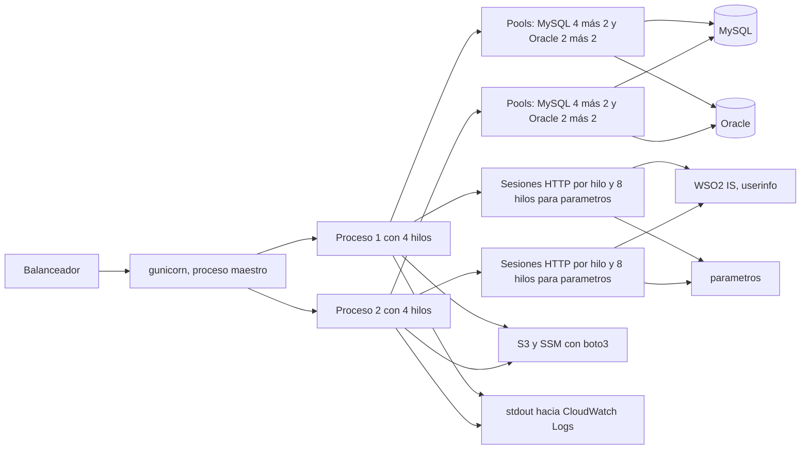
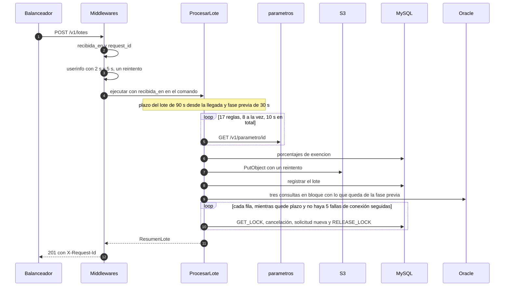

# Componentes lógicos — U1 `recibos_service`

- Etapa: CONSTRUCTION → U1 `recibos_service` → NFR Design (2026-11-25)
- Fuentes: `nfr-design-patterns.md` (los patrones y sus valores), `nfr-requirements/tech-stack-decisions.md` y `inception/application-design/components.md`
- No hay colas, cachés, circuit breakers ni procesos en segundo plano (`nfr-design-patterns.md` §4.4). Los componentes de este documento viven dentro de cada tarea de ECS

## 1. Vista de una tarea

Texto equivalente:
1. El balanceador envía las peticiones al proceso maestro de gunicorn de la tarea.
2. El maestro reparte las conexiones entre 2 procesos, cada uno con 4 hilos.
3. Cada proceso tiene sus propios pools de conexiones: hasta 6 a MySQL (4 fijas y 2 de reserva) y hasta 4 a Oracle (2 y 2).
4. Cada hilo tiene su sesión HTTP para WSO2 IS y "parametros". Cada proceso tiene un grupo de 8 hilos para leer las reglas de "parametros" en paralelo.
5. Los procesos usan boto3 para S3 y SSM, y escriben sus registros en stdout, que llegan a CloudWatch Logs.

## 2. Componentes

| Componente | Dónde | Responsabilidad | Configuración |
|---|---|---|---|
| Servidor de aplicación | `gunicorn.conf.py` | Procesos, hilos, parada ordenada, reciclado y registro de accesos | §2.1 |
| Aplicación Flask | `api.py`, `conf/conf.py` | Límites del cuerpo y del formulario, IP del cliente, validación de la configuración al arrancar | §2.2 |
| Contexto de la petición (nuevo) | `app/interfaces/middlewares/contexto_peticion` | Primer middleware: guarda `recibida_en` con `Reloj.segundos()` y fija `request_id` en una `ContextVar`; agrega `X-Request-Id` a la respuesta | `request_id` según `nfr-design-patterns.md` §7.3 |
| Presupuesto de tiempo (nuevo) | `app/application/presupuesto` | `Plazo`: el plazo del lote y el de la fase previa; cuánto tiempo le queda a cada llamada; `PlazoVencido` | Plazo del lote, de configuración; fase previa de 30 s y reglas de 10 s, constantes |
| Cliente HTTP (nuevo) | `app/infrastructure/http` | Una sesión de requests por hilo, con un reintento si falla la conexión y sin seguir redirecciones; una sola función hace las llamadas y traduce los errores | §2.3 |
| Motores de base de datos | `app/infrastructure/db/motores` | Motores de SQLAlchemy para Oracle y MySQL, con TLS, tiempos de espera y pools | §2.4 |
| Sesión de filas (nuevo) | `app/infrastructure/mysql/repositorio_solicitudes` | Una conexión de MySQL para todas las filas de un lote; bloqueo por estudiante, cancelación y guardado; no envía sentencias después del plazo; separa las fallas de conexión de los demás errores | `nfr-design-patterns.md` §3.3, §4.2 y §6 |
| Repositorio académico | `app/infrastructure/oracle/repositorio_academico` | Tres consultas en bloque por lote; `call_timeout` antes de cada llamada, con lo que quede del plazo | Bloques de hasta 1000 códigos y `arraysize` de 1000 |
| Lectura de reglas | `app/infrastructure/parametros/fuente_reglas` | Las 17 reglas en paralelo en un grupo de 8 hilos por proceso, creado la primera vez que se usa; espera 10 s como máximo | Los ids de las reglas, de configuración (D6) |
| Almacenamiento | `app/infrastructure/s3/almacenamiento_s3` | `PutObject` en el bucket privado | Cliente de boto3 por proceso: 2 s para conectar, 5 s de respuesta, modo `standard` con 2 intentos |
| Secretos | `app/infrastructure/config/ssm` | Lee las contraseñas al arrancar cada proceso y las guarda como `SecretStr` | Cliente de boto3 de arranque: modo `standard` con 3 intentos |
| Registro (nuevo) | `app/infrastructure/registro` | Formateador JSON, filtro que agrega `request_id` y configuración de los registros de la aplicación y de gunicorn | Nivel INFO; `nfr-design-patterns.md` §8 |

### 2.1 gunicorn (`gunicorn.conf.py`)

| Ajuste | Valor | Por qué |
|---|---|---|
| `bind` | `0.0.0.0:` + `RECIBOS_SERVICE_PORT` (8080) | NFR-M06 |
| `worker_class` | `gthread` | Los lotes pasan casi todo el tiempo esperando a las bases |
| `workers` | `RECIBOS_SERVICE_WORKERS` (2) | 8 peticiones a la vez por tarea con 4 hilos |
| `threads` | `RECIBOS_SERVICE_HILOS` (4) | Igual |
| `timeout` | 120 | Latido del proceso; no corta peticiones |
| `graceful_timeout` | 110 | Más que la petición más larga (unos 100 s) |
| `keepalive` | 125 | Más que el tiempo de inactividad del balanceador (120 s) |
| `max_requests` y `max_requests_jitter` | 1000 y 100 | Recicla los procesos poco a poco, con parada ordenada |
| `worker_tmp_dir` | `/dev/shm` | El latido no escribe en el disco del contenedor, que puede ser de solo lectura |
| `preload_app` | `False` | Cada proceso crea sus pools y lee SSM después de nacer; las conexiones no se comparten entre procesos |
| `accesslog` y `errorlog` | `-` | stdout y stderr, hacia CloudWatch Logs |
| `logconfig_dict` | El formateador JSON de `infrastructure/registro` | Un solo formato para todos los registros |
| `access_log_format` | Método, ruta, código, duración y `X-Request-Id` de la respuesta | NFR-O02 |
| Límites de la petición (`limit_request_line`, `limit_request_fields`, `limit_request_field_size`) | Los de gunicorn: 4094, 100 y 8190 | Alcanzan para la API |
| Cabecera `Server` | `gunicorn.http.wsgi.SERVER = ""` al cargar el archivo | Contrato de cabeceras de `utils_oas` (AD-36) |

### 2.2 Flask y Werkzeug (`api.py` y `conf/conf.py`)

| Ajuste | Valor |
|---|---|
| `DEBUG` | `False` |
| `MAX_CONTENT_LENGTH` | 2 162 688 bytes: 2 MB del archivo más 64 KB del sobre multipart |
| `MAX_FORM_PARTS` | 4 |
| `MAX_FORM_MEMORY_SIZE` | 16 384 bytes |
| `ProxyFix` | `x_for` = `RECIBOS_SERVICE_PROXIES_CONFIANZA` (AD-29); los demás en 0 |
| Validación al arrancar | Variables presentes y dentro de sus límites (§4); secretos de SSM leídos. Si algo falla, el proceso no arranca y deja el error en el registro, sin valores |

### 2.3 Cliente HTTP (`infrastructure/http`)

| Ajuste | Valor |
|---|---|
| Sesión | Una `requests.Session` por hilo (`threading.local`), porque una sesión no es segura entre hilos |
| Reintentos | `Retry(total=1, connect=1, read=0, status=0, other=0, allowed_methods={"GET"})` montado en un `HTTPAdapter` |
| Tiempos | Los de cada llamada (`nfr-design-patterns.md` §3.2), recortados con `Plazo` cuando la llamada es de la fase previa |
| Redirecciones | No se siguen (`allow_redirects=False`): el token no sale hacia otro destino |
| Certificados | Verificados siempre |
| Errores | Sin respuesta o vencido: `DependenciaNoDisponible` (503). Respuesta con código o cuerpo inválido: `RespuestaInvalida` (502) |

### 2.4 Motores de base de datos (`infrastructure/db/motores`)

| Ajuste | MySQL (`mysql+pymysql`) | Oracle (`oracle+oracledb`, modo thin) |
|---|---|---|
| TLS | `ssl_ca` con la CA de D14, `ssl_verify_cert=True`, `ssl_verify_identity=True` | DSN con `protocol=tcps`, `ssl_context` con la CA de D14 y `ssl_server_dn_match` |
| Conectar | `connect_timeout=3` | `tcp_connect_timeout=5` |
| Leer y escribir | `read_timeout=10`, `write_timeout=10` | `call_timeout` antes de cada llamada: 20 s o lo que quede de la fase previa |
| Al abrir cada conexión | `SET SESSION innodb_lock_wait_timeout = 5`; `charset=utf8mb4` | — |
| Pool por proceso | `pool_size` = hilos (4), `max_overflow=2` | `pool_size=2`, `max_overflow` = hilos menos 2 (2) |
| Espera por una conexión del pool | `pool_timeout=5` | `pool_timeout=5` |
| Conexiones viejas | `pool_pre_ping=True`, `pool_recycle=1800` | `pool_pre_ping=True`, `pool_recycle=1800` |
| Aislamiento | El de la base | El de la base (solo lectura) |
| Captura del SQL | Listener `before_cursor_execute` de `db/captura_sql` (AD-10) | Igual |

Los pools abren las conexiones cuando hacen falta; al arrancar no se conecta a ninguna base (`nfr-design-patterns.md` §7.5).

## 3. Capacidad de conexiones (NFR-C05, insumo D16)

| | Por proceso | Por tarea (2 procesos) | Test (1 tarea) | Producción (2 tareas) | Producción durante un despliegue (hasta 4 tareas) |
|---|---|---|---|---|---|
| Peticiones a la vez | 4 | 8 | 8 | 16 | 32 |
| Conexiones a MySQL, como máximo | 6 | 12 | 12 | 24 | 48 |
| Conexiones a Oracle, como máximo | 4 | 8 | 8 | 16 | 32 |
| Hilos para "parametros" | 8 | 16 | 16 | 32 | 64 |

- Un despliegue en test sube a 2 tareas: 24 conexiones a MySQL y 16 a Oracle.
- En uso normal hay muchas menos: un lote usa una conexión de MySQL durante sus filas y una de Oracle solo durante la fase previa.
- El DBA confirma que las bases aceptan estos máximos (D16). Si no, se bajan `RECIBOS_SERVICE_HILOS` o la reserva de los pools, y se recalcula NFR-C02.

## 4. Configuración

Variables nuevas de esta etapa. Las demás `RECIBOS_SERVICE_*` siguen como están en el diseño.

| Variable | Por defecto | Permitido | Para qué |
|---|---|---|---|
| `RECIBOS_SERVICE_LIMITE_LOTE_S` | 90 | 10 a 90 | Plazo del lote (BR-L16) |
| `RECIBOS_SERVICE_MAX_FILAS` | 1000 | 1 a 1000 | Máximo de filas (BR-L11) |
| `RECIBOS_SERVICE_MAX_ARCHIVO_BYTES` | 2 097 152 | 1024 a 2 097 152 | Tamaño máximo del archivo (BR-L02) |
| `RECIBOS_SERVICE_CORTE_MYSQL` | 5 | 1 a 20 | Fallas de conexión seguidas antes del corte (BR-T04) |
| `RECIBOS_SERVICE_WORKERS` | 2 | 1 a 4 | Procesos de gunicorn; cambia las cuentas de §3 |
| `RECIBOS_SERVICE_HILOS` | 4 | 2 a 8 | Hilos por proceso; el pool de MySQL tiene una conexión fija por hilo |
| `RECIBOS_SERVICE_PROXIES_CONFIANZA` | 0 | 0 a 3 | Proxies de confianza para la IP (AD-29, D13) |

Un valor fuera de su rango detiene el arranque. Las variables pueden bajar los límites del lote, pero no subirlos, para no romper la cadena de tiempos de espera.

Constantes en `conf/conf.py`, con nombre: fase previa de 30 s, reglas de 10 s, 8 hilos para "parametros", los tiempos de `nfr-design-patterns.md` §3.2, la espera del bloqueo (5 s), `innodb_lock_wait_timeout` (5 s), `pool_timeout` (5 s), `pool_recycle` (1800 s) y los límites del formulario.

## 5. Permisos que necesita la tarea (insumo para Infrastructure Design, SECURITY-06)

| Recurso | Permiso | Notas |
|---|---|---|
| S3 | `s3:PutObject` en `arn:aws:s3:::{bucket}/lotes/*` | Sin lectura, listado ni borrado: el servicio nunca vuelve a leer los archivos |
| SSM | `ssm:GetParameters` en `arn:aws:ssm:{región}:{cuenta}:parameter/{ruta de D7}/*` | Solo las rutas de `recibos_service` |
| KMS | `kms:Decrypt` en la llave de los parámetros, solo si es una llave propia | Con la llave que administra AWS para SSM no hace falta en la política del rol; Infrastructure Design lo confirma |
| CloudWatch Logs | Ninguno en el rol de la tarea | El driver `awslogs` usa el rol de ejecución, que solo crea flujos y escribe eventos en el grupo del servicio; no puede borrar (NFR-S09) |
| MySQL | `SELECT` e `INSERT` en `solicitudLote`; `SELECT`, `INSERT` y `UPDATE` en `solicitudRecibo`; `INSERT` en `solicitudCuota`, `solicitudExencion` y `solicitudConcepto`; `SELECT` en `exencion`; `SELECT` en la tabla de festivos si está en MySQL (D5) | Sin `DELETE` ni cambios de tablas. `GET_LOCK` no pide permisos |
| Oracle | `SELECT` en los objetos de `component-dependency.md` §4 y `EXECUTE` en `fua_verifica_evento` | Solo lectura |

## 6. Conexiones de red que necesita la tarea (insumo para Infrastructure Design, SECURITY-07)

| Hacia | Puerto | Notas |
|---|---|---|
| Oracle | El de TCPS (D14) | Solo desde las tareas de U1 |
| MySQL | El de MySQL con TLS (D14) | Solo desde las tareas de U1 |
| WSO2 IS (`/oauth2/userinfo`) | 443 | — |
| "parametros" | 443 | — |
| S3 y SSM | 443 | Por endpoints de VPC si Infrastructure Design los define |

Entrada: solo desde el balanceador, al puerto del servicio (8080).

## 7. Arranque
1. gunicorn carga `gunicorn.conf.py`, que deja vacía la cabecera `Server`.
2. Cada proceso llama a `create_app()`: valida las variables, lee los secretos de SSM, arma los motores sin conectar y registra los middlewares y las rutas.
3. Si algo falla, el proceso termina con el error en el registro, sin valores, y gunicorn se detiene; ECS vuelve a intentar con otra tarea.
4. `GET /health` responde sin consultar bases ni dependencias (NFR-A05); con eso el balanceador empieza a enviarle tráfico.

## 8. Un lote con sus plazos

Texto equivalente:
1. Llega `POST /v1/lotes`. El primer middleware guarda la hora de llegada y el `request_id`.
2. El middleware de autenticación valida el token en `/oauth2/userinfo`, con 2 s para conectar, 5 s de respuesta y un reintento si falla la conexión.
3. El caso de uso recibe la hora de llegada en el comando. El plazo del lote es de 90 s desde esa hora, y la fase previa tiene 30 s.
4. Lee las 17 reglas de "parametros", 8 a la vez y con 10 s en total.
5. Lee los porcentajes de la tabla `exencion`, guarda el archivo en S3 con un reintento y registra el lote.
6. Hace las tres consultas en bloque a Oracle, cada una con lo que queda de la fase previa.
7. Procesa las filas una por una con la misma conexión de MySQL, mientras quede plazo y no haya 5 fallas de conexión seguidas.
8. Responde 201 con el resumen y la cabecera `X-Request-Id`.
