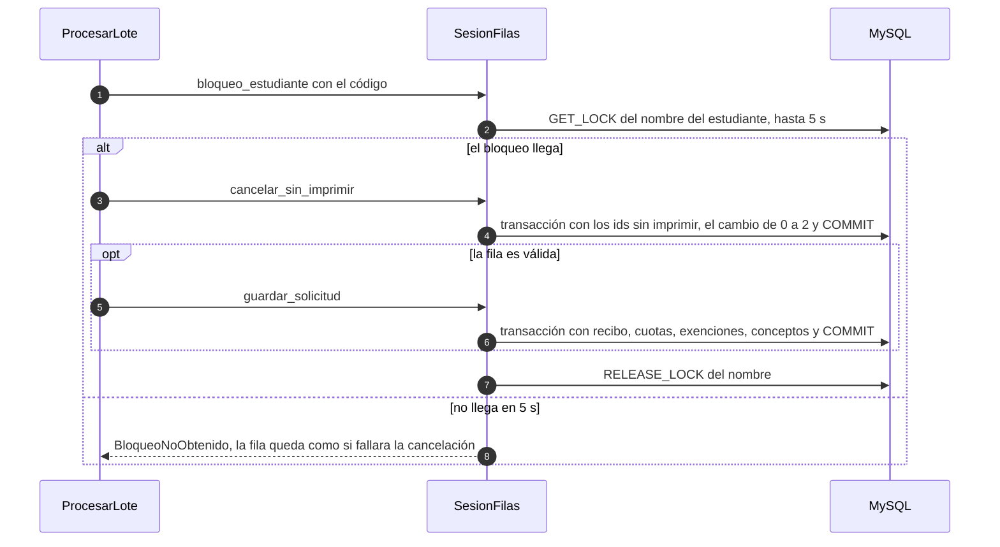

# Patrones de diseño de los requisitos no funcionales — U1 `recibos_service`

- Etapa: CONSTRUCTION → U1 `recibos_service` → NFR Design (2026-11-25)
- Fuentes: `nfr-requirements/nfr-requirements.md` y `nfr-requirements/tech-stack-decisions.md` (aprobados el 2026-11-25T18:44:18Z); el diseño funcional de U1; AD-01 a AD-36; el plan `construction/plans/recibos_service-nfr-design-plan.md`
- Respuestas: N18 = A (las contraseñas nuevas se toman con un despliegue; el usuario aclara que hoy los DBA no las cambian); N19 = A (índice por `codigo_est` y `estado` si no existe); N20 = A (el lote deja de intentar después de 5 fallas de conexión seguidas a MySQL)
- Componentes lógicos, su configuración y la capacidad de conexiones: `logical-components.md`
- Extensiones: seguridad, con todas sus reglas bloqueantes (§11). PBT parcial: la extensión no asigna reglas a esta etapa. Resiliencia desactivada (N17 = b)

## 1. Resumen

| Patrón | Qué hace | Requisitos |
|---|---|---|
| Plazo del lote | Ninguna fila empieza y ninguna sentencia de MySQL sale después de los 90 s, contados desde que llega la petición | NFR-P04, NFR-U02, BR-L16 |
| Presupuesto de la fase previa | Lo que va antes de las filas tiene 30 s; cada llamada usa lo que queda o no empieza | NFR-P06, DN-03 |
| Tiempo de espera en cada llamada | Valores fijos por dependencia y una cadena que crece de adentro hacia afuera | NFR-P05, NFR-P06 |
| Lecturas en bloque y en paralelo | Tres consultas a Oracle por lote; las 17 reglas de "parametros" en paralelo | NFR-P01, NFR-P02 |
| Una conexión de MySQL por lote | Todas las filas usan la misma conexión; no se abre una por fila | NFR-C05, NFR-P01 |
| Bloqueo por estudiante | `GET_LOCK` en MySQL desde antes de cancelar hasta después de guardar | NFR-R02, NFR-S12, BR-T05 |
| Una transacción para cancelar y otra para guardar | Ninguna solicitud queda a medias | NFR-R01, BR-T03 |
| Un solo reintento, donde es seguro | Lecturas HTTP y escritura del archivo en S3 | NFR-R03 (ajustado) |
| Corte por MySQL caído | Después de 5 fallas de conexión seguidas, el lote deja de intentar | BR-T04, NFR-A07 |
| Falla cerrada | Una dependencia que falla antes de las filas detiene el lote | NFR-R04, NFR-A07 |
| Capacidad fija | 2 procesos de 4 hilos por tarea y pools con tope | NFR-C01, NFR-C02, NFR-C06 |
| Parada ordenada | El desregistro y la parada duran más que la petición más larga | NFR-A03, NFR-A04 |
| Cadena de middlewares | Identificador, CORS, autenticación, auditoría, errores y cabeceras | NFR-S03, NFR-O01, NFR-O02 |
| Secretos al arrancar | SSM al iniciar cada proceso; un cambio de contraseña se toma con un despliegue | NFR-S11, N18 |
| Registro estructurado | JSON con `request_id`, sin datos personales ni valores de SQL | NFR-O01, NFR-S08 |

## 2. Rendimiento

### 2.1 Tiempo de un lote (NFR-P01, NFR-P02)
Se mide dentro del servicio, desde que llega la petición hasta que sale la respuesta. Para 1000 filas válidas:

| Fase | Qué hace | Tiempo normal | Máximo |
|---|---|---|---|
| Middlewares | Valida el token en `/oauth2/userinfo` | Menos de 0,5 s | 9 s (§3.2) |
| Fase previa | Reglas, porcentajes, S3, registro del lote, lectura de la hoja, Oracle y festivos | 1 a 4 s | 30 s (§2.2) |
| Filas | Bloqueo, cancelación y solicitud de cada fila | 15 a 35 s | Hasta el plazo de 90 s (§3.3) |
| Respuesta | Resumen, auditoría y evento `lote_terminado` | Menos de 0,5 s | — |

Cálculo de las filas:
- Una fila válida hace unas 11 idas y vueltas a MySQL: tomar el bloqueo, leer los ids que se cancelan, cancelarlos, confirmar, cuatro inserciones, confirmar y soltar el bloqueo. Una fila rechazada con estudiante conocido hace 5.
- Las bases están en AWS (Discovery). Entre ECS y una base de la misma región, una ida y vuelta tarda entre 1,5 y 3 ms, así que 1000 filas tardan entre 15 y 35 s.
- Supuesto que se confirma en test: si la ida y vuelta a MySQL pasa de unos 5 ms, 1000 filas no caben en 60 s. La auditoría guarda `duracion_ms` de cada lote y la alarma de p95 avisa (§8.2).

Un lote de 10 filas (NFR-P02) gasta casi todo su tiempo en la fase previa: menos de 5 s.

### 2.2 Fase previa (DN-03)
- Tiene 30 s desde que empieza el caso de uso, sin pasar del plazo del lote.
- Las llamadas HTTP a "parametros" y las consultas a Oracle usan como tiempo de espera el menor entre su valor propio (§3.2) y lo que queda.
- S3 y MySQL tienen tiempos fijos, así que una llamada solo empieza si le cabe su peor caso: 15 s para S3 y 13 s para una sentencia de MySQL. Una consulta a Oracle solo empieza si quedan al menos 5 s, lo que puede tardar en conectar.
- Así la fase nunca pasa de 30 s. Si no queda tiempo, el lote termina con 503 y no procesa filas. Antes de registrar el lote no queda nada guardado; después, queda el lote registrado sin solicitudes, como cualquier falla de esa fase (`business-logic-model.md` §5).

### 2.3 Lecturas en bloque y en paralelo
- Oracle: tres consultas por lote (AD-06), en bloques de hasta 1000 códigos, con `arraysize` de 1000 para traer cada bloque en una sola ida y vuelta.
- Tabla `exencion` de MySQL: una consulta con los ids de los mapas.
- "parametros": las 17 reglas en paralelo, con un grupo de 8 hilos por proceso; todas juntas tienen 10 s. Si una falla o no llega a tiempo, el lote no empieza (BR-L04). Las reglas se siguen leyendo en cada lote, sin caché (AD-20).
- Festivos: una consulta por el rango de años del lote (BR-L13).

### 2.4 Filas en MySQL
- Las filas se procesan una tras otra, en el orden de la plantilla (F2, BR-T05).
- Todas usan la misma conexión de MySQL (NFR-C05). Si la conexión se pierde, la fila siguiente toma otra del pool.
- Las cuotas, las exenciones y los conceptos se insertan con una sentencia cada uno: PyMySQL convierte `executemany` en un solo `INSERT` de varias filas.
- Índice de `solicitudRecibo` (N19 = A): la cancelación busca por `codigo_est` y `estado`, como el PHP. Si el DDL (D4) muestra que no hay un índice que empiece por esas columnas, el DBA crea uno no único por (`codigo_est`, `estado`) antes de producción (insumo D17). No cambia columnas ni datos, ni lo que lee "Solicitados". Con el índice, la cancelación bloquea solo las filas del estudiante y no recorre la tabla. El servicio no tiene permisos para cambiar tablas.

### 2.5 Historial (NFR-P03)
`GET /v1/lotes` hace dos consultas: la página, ordenada por la llave primaria de forma descendente con `LIMIT` y `OFFSET`, y el total con `COUNT(*)`. `solicitudLote` crece con unos pocos lotes por periodo, así que no necesita índices nuevos para responder en menos de 2 s.

## 3. Tiempos de espera

### 3.1 Cadena (NFR-P05)
Cada eslabón espera más que el anterior. Así el reporte siempre le llega a ARC (NFR-U02).

| Eslabón | Valor | Por qué |
|---|---|---|
| Plazo del lote (`RECIBOS_SERVICE_LIMITE_LOTE_S`) | 90 s desde que llega la petición | NFR-P04: después no empieza ninguna fila ni sale ninguna sentencia de MySQL (§3.3) |
| Petición más larga | Unos 100 s | El plazo más la sentencia de MySQL que estaba en curso, que dura 10 s como máximo |
| Parada ordenada de gunicorn (`graceful_timeout`) | 110 s | Más que la petición más larga |
| Desregistro en el balanceador (`deregistration_delay.timeout_seconds`) | 110 s | Igual: las peticiones en curso terminan antes de que ECS detenga la tarea |
| Parada de la tarea en ECS (`stopTimeout`) | 120 s | Más que la parada de gunicorn; es el máximo que permite ECS |
| Balanceador (`idle_timeout.timeout_seconds`) | 120 s | Más que la petición más larga |
| Worker de gunicorn (`timeout`) | 120 s | En los workers de hilos solo vigila que el proceso siga vivo; no corta peticiones largas |
| Keep-alive de gunicorn (`keepalive`) | 125 s | Más que el balanceador: el balanceador cierra primero las conexiones inactivas y nunca reutiliza una que gunicorn ya cerró, lo que daría un 502 |
| WSO2 AM (tiempo de espera del endpoint) | 130 s | Más que el balanceador |
| `recibos_mf` en `POST /v1/lotes` | 150 s | Más que WSO2 AM; lo aplica U2 |

Cambio frente al plan: la parada ordenada de gunicorn y el desregistro pasan de 100 a 110 s. El plan contaba con peticiones de 90 s; con la sentencia de MySQL que puede quedar en curso al llegar el plazo, una petición puede durar unos 100 s, y esos dos valores deben ser mayores.

### 3.2 Tiempo de cada llamada (NFR-P06)

| Llamada | Conectar | Respuesta | Reintentos | Peor caso | Cómo se configura |
|---|---|---|---|---|---|
| WSO2 IS `/oauth2/userinfo` | 2 s | 5 s | 1, si falla la conexión | 9 s | requests: `timeout=(2, 5)` y `Retry(connect=1)` |
| "parametros", cada regla | 2 s | 3 s | 1, si falla la conexión | 7 s; las 17 juntas, 10 s | Igual; el tope de 10 s lo pone la espera del grupo de hilos |
| S3 `PutObject` | 2 s | 5 s | 1 | 15 s: dos intentos de 7 s y hasta 1 s de espera entre ellos | boto3: `connect_timeout=2`, `read_timeout=5`, reintentos en modo `standard` con `max_attempts=2` |
| SSM `GetParameters` | 2 s | 5 s | Los de boto3 en modo `standard` (3 intentos) | — | Solo al arrancar cada proceso; si falla, el proceso no arranca |
| Oracle | 5 s | 20 s por ida y vuelta, o lo que quede de la fase previa | No | — | `tcp_connect_timeout=5`; `call_timeout` en cada llamada |
| MySQL | 3 s | 10 s para leer y 10 s para escribir | No | 13 s por sentencia | PyMySQL: `connect_timeout`, `read_timeout`, `write_timeout` |
| MySQL, espera por bloqueos de filas | — | 5 s | No | — | `SET SESSION innodb_lock_wait_timeout = 5` al abrir cada conexión |
| Bloqueo por estudiante | — | 5 s | No | — | `GET_LOCK(nombre, 5)` |
| Tomar una conexión del pool | — | 5 s | No | — | SQLAlchemy: `pool_timeout=5`. Con los tamaños de `logical-components.md` §3 no debería esperar |

El tiempo de lectura de MySQL (10 s) es mayor que las dos esperas de bloqueo (5 s), para que una espera normal no se confunda con una conexión perdida.

### 3.3 Plazo del lote, fila por fila (BR-L16)
- El primer middleware (`contexto_peticion`) lee el reloj monotónico (`Reloj.segundos`) al empezar la petición y lo guarda como `recibida_en`. El controller lo pasa en `CargarLoteComando`. Así el plazo incluye la validación del token y la subida del archivo; antes contaba desde el inicio del caso de uso.
- Antes de cada fila: si pasó el plazo, esa fila y las siguientes salen con `TIEMPO_AGOTADO` y no cancelan nada.
- Antes de cada sentencia de MySQL de una fila: si pasó el plazo, la sentencia no sale. La conexión se cierra y MySQL revierte la transacción abierta y suelta el bloqueo. La fila sale con `TIEMPO_AGOTADO` si todavía no había confirmado la cancelación, o con `ERROR_GUARDADO` si ya la había confirmado; en ese caso la cancelación se mantiene (BR-T02, BR-T03).
- Una sentencia que ya salió termina o vence por su tiempo de lectura de 10 s. Por eso una petición dura unos 100 s como máximo (§3.1).

## 4. Resiliencia

### 4.1 Reintentos (NFR-R03, ajustado)

| Dependencia | ¿Se reintenta? | Cuándo | Por qué |
|---|---|---|---|
| WSO2 IS `/oauth2/userinfo` | Una vez | Falla la conexión | Es una lectura: repetirla no cambia nada |
| "parametros" | Una vez | Falla la conexión | Es una lectura |
| S3 `PutObject` | Una vez | Falla la conexión, vence el tiempo de respuesta o S3 responde con un error temporal (500, 503 o limitación) | Es una escritura, pero va a un nombre nuevo de cada lote (BR-L06): repetirla deja el mismo archivo. *Ajusta NFR-R03*, que no reintentaba ninguna escritura |
| Oracle | No | — | La fase previa tiene su presupuesto; si Oracle falla, el lote termina con 503 y ARC lo vuelve a cargar |
| MySQL | No | — | Repetir a ciegas una cancelación o una inserción puede duplicar datos; la fila queda con su motivo y ARC vuelve a cargar a ese estudiante |

### 4.2 Corte por MySQL caído (BR-T04, N20 = A)
- El lote cuenta las filas seguidas cuyo intento en MySQL falló por la conexión.
- Falla de conexión: no se pudo conectar, la conexión se perdió o no hubo respuesta en el tiempo de lectura. En MySQL son los errores 2003, 2006, 2013 y 2055, que SQLAlchemy marca como desconexión.
- No cuentan, y vuelven la cuenta a cero porque muestran que MySQL responde: el bloqueo que no llega a tiempo, la espera por bloqueos de filas (1205), un interbloqueo (1213) y cualquier otro error de la base.
- Las filas que no llegan a MySQL (`CODIGO_INVALIDO`, `CODIGO_REPETIDO`, `ESTUDIANTE_NO_ENCONTRADO`) no cambian la cuenta. Una fila rechazada por sus datos no cuenta por ese rechazo; si su cancelación falla por la conexión, cuenta esa falla.
- Con 5 fallas seguidas (`RECIBOS_SERVICE_CORTE_MYSQL`), las filas que faltan salen con `ERROR_GUARDADO` ("Error al guardar la solicitud. Vuelva a cargar a este estudiante."), no se validan ni cancelan nada, y el servicio responde 201 con el reporte.
- El corte llega en pocos segundos si MySQL rechaza las conexiones, y en unos 50 s como máximo si deja de responder (5 filas por 10 s de lectura). El plazo del lote sigue mandando.
- El evento `lote_terminado` marca el corte (`corte_mysql`), y de ahí sale una alarma (§8.2).

### 4.3 Dependencias caídas (NFR-A07)

| Momento | Dependencia | Resultado |
|---|---|---|
| Middleware de autenticación | WSO2 IS no responde | 503: la petición no sigue (falla cerrada). Un token inválido es 401 |
| Fase previa | "parametros", `exencion`, S3, registro del lote, Oracle o festivos | 503 si no responde o se acaba el presupuesto; 502 si responde con datos inválidos (`business-logic-model.md` §5) |
| Filas | MySQL | Cada fila queda con su motivo (BR-T02, BR-T03); con 5 fallas de conexión seguidas, el corte de §4.2 |
| Siempre | — | Los health checks siguen respondiendo, porque no consultan las bases (NFR-A05) |

### 4.4 Lo que no se usa

| Componente | Por qué no |
|---|---|
| Colas o procesos en segundo plano | El procesamiento es síncrono (C-2) |
| Caché del token o de las reglas | El token se valida en cada petición (AD-09); las reglas se leen en cada lote para tomar los cambios sin desplegar (AD-20) |
| Circuit breaker | Con 3 lotes en el pico y un tiempo de espera en cada llamada, una dependencia caída se nota en segundos; el corte de §4.2 cubre a MySQL a mitad del lote |
| Antivirus para los archivos | El archivo va a un bucket privado, nadie lo descarga y xlrd no ejecuta macros ni fórmulas |
| Autoescalado | NFR-C06: número fijo de tareas |
| Daemon de X-Ray | Sin trazas en el MVP (AD-33) |

### 4.5 Despliegue y parada ordenada (NFR-A03, NFR-A04)
1. ECS arranca la tarea nueva, que recibe tráfico cuando su health check responde. Infrastructure Design fija el intervalo y los umbrales.
2. ECS saca la tarea vieja del grupo de destino. El balanceador deja de enviarle peticiones nuevas y espera hasta 110 s a las que están en curso; un lote termina aquí, porque dura unos 100 s como máximo.
3. ECS envía SIGTERM. gunicorn deja de aceptar conexiones y espera hasta 110 s a que sus procesos terminen.
4. A los 120 s, ECS detiene el contenedor si sigue vivo.

Si una tarea recibe SIGTERM sin pasar por el paso 2, por ejemplo cuando AWS retira la máquina, los pasos 3 y 4 bastan para terminar el lote en curso. Los procesos de gunicorn se reciclan cada 1000 peticiones, con la misma parada ordenada.

## 5. Capacidad (NFR-C01, NFR-C02, NFR-C05, NFR-C06)
- Cada tarea corre gunicorn con 2 procesos de 4 hilos: 8 peticiones a la vez. El pico es de 3 lotes, más el historial y los health checks, así que una tarea sola lo atiende si la otra falla (NFR-C02).
- Cada hilo usa como máximo una conexión de cada base a la vez. Por proceso, el pool de MySQL tiene 4 conexiones fijas y 2 de reserva, y el de Oracle 2 y 2. Las cuentas están en `logical-components.md` §3; el DBA confirma que las bases las permiten (insumo D16).
- Si las 8 peticiones de una tarea están ocupadas, los health checks esperan un hilo libre. Lo evitan el throttling por usuario (§7.6) y que `recibos_mf` no deja enviar un segundo lote mientras procesa. Infrastructure Design fija cuántos health checks fallidos sacan una tarea.
- No hay autoescalado. Si la auditoría muestra más de 3 lotes a la vez, se agregan tareas; no se agregan hilos, para no pasar los límites de conexiones de D16.

## 6. Concurrencia e integridad (NFR-R01, NFR-R02, NFR-S12)

### 6.1 Bloqueo por estudiante (BR-T05, AD-32)

Texto equivalente:
1. Antes de cancelar, la sesión de filas pide a MySQL el bloqueo con el nombre del estudiante y espera hasta 5 s.
2. Si lo obtiene, cancela en una transacción las solicitudes sin imprimir del estudiante y la confirma.
3. Si la fila es válida, guarda la solicitud nueva en otra transacción y la confirma.
4. Al final suelta el bloqueo.
5. Si el bloqueo no llega en 5 s, la fila queda como si fallara la cancelación (BR-T02).

Detalles:
- Nombre del bloqueo: `recibos_service:est:{codigo}`. MySQL acepta hasta 64 caracteres; con un código de 15 dígitos son 35.
- El bloqueo, las dos transacciones y la liberación van por la misma conexión: un bloqueo con nombre pertenece a la sesión que lo tomó.
- El bloqueo no es transaccional: sigue tomado después del `COMMIT` o el `ROLLBACK` de la fila. Se suelta con `RELEASE_LOCK` en un `finally`. Si la conexión se perdió o se cerró por el plazo, MySQL lo suelta al terminar la sesión.
- Con dos lotes que traen al mismo estudiante, el segundo espera hasta 5 s y queda la solicitud del que guarda de último (NFR-R02). Funciona con varias tareas, porque el bloqueo vive en MySQL.
- "Solicitados" no toma este bloqueo. Si imprime una solicitud justo cuando el lote la cancela, queda impresa, como hoy (NFR-R05, riesgo aceptado).

### 6.2 Transacciones (NFR-R01, BR-T01 a BR-T03)
- Cancelación: `SELECT ... FOR UPDATE` de los ids sin imprimir del estudiante, `UPDATE` de esos ids de estado 0 a 2 y `COMMIT`. Los ids van a la auditoría (AD-25).
- Solicitud nueva: `INSERT` del recibo, de sus cuotas, de sus exenciones y de sus conceptos, y `COMMIT`. Con cualquier error, `ROLLBACK` o cierre de la conexión, y la fila queda con `ERROR_GUARDADO`; la cancelación ya confirmada se mantiene.
- Aislamiento: el que tenga la base por defecto, como el PHP. No se cambia a `READ COMMITTED` porque MySQL lo rechaza si el registro binario está en formato `STATEMENT`, y no se conoce esa configuración.
- Las tablas `solicitud*` deben ser InnoDB. Con MyISAM no hay transacciones ni bloqueos de filas, y BR-T03 no se cumple. Se revisa con el DDL (insumo D17).

## 7. Seguridad

### 7.1 Orden de los middlewares (NFR-S03, SECURITY-08)
Antes de la ruta, en este orden:
1. `contexto_peticion`, en todas las rutas: guarda `recibida_en` y fija `request_id` (§7.3).
2. CORS (flask-cors), con la lista de orígenes de AD-14. Responde las peticiones `OPTIONS` del navegador sin pedir token.
3. `autenticacion`, solo en `/v1/*`: exige `Authorization: Bearer`, valida el token en `/oauth2/userinfo` y revisa el rol de ARC y el documento. Responde 401, 403 o 503 (§4.3).
4. `auditoria`, solo en `/v1/*`: inicia la captura del texto SQL.

Después de la ruta:
5. `errores`: convierte cualquier excepción en el sobre institucional, sin detalles internos (SECURITY-15).
6. `cabeceras_seguridad`, en todas las respuestas, también las de error (§7.2).
7. `auditoria`: escribe la línea JSON de cada petición a `/v1/*`, también de las rechazadas con 401 o 403 (BR-U01).

### 7.2 Cabeceras (SECURITY-04, SECURITY-09)
- Las 10 cabeceras del contrato de `utils_oas/security/security_headers.go` (`technical-environment.md`), en todas las respuestas.
- `Server` vacía. gunicorn siempre agrega `Server: gunicorn` y no tiene una opción para quitarla; sus mantenedores la rechazaron ([gunicorn #3006](https://github.com/benoitc/gunicorn/issues/3006)). `gunicorn.conf.py` cambia el valor que usa gunicorn (`gunicorn.http.wsgi.SERVER = ""`) y una prueba unitaria revisa la cabecera, para que una versión nueva que lo rompa no pase el pipeline. Esto resuelve el riesgo de `application-design.md` §7 (AD-36).
- El balanceador pone su propia cabecera `Server` en las respuestas que genera él, como un 502 o un 504. Infrastructure Design la quita con el atributo del listener `routing.http.response.server.enabled` ([AWS](https://docs.aws.amazon.com/elasticloadbalancing/latest/application/enable-header-modification.html)).
- `Cache-Control: no-store` en `/v1/*`: el reporte trae códigos de estudiantes y no debe quedar en cachés del navegador ni de intermediarios (AD-36).
- `X-Request-Id` en todas las respuestas (NFR-O02).

### 7.3 Entradas (SECURITY-05)
- `MAX_CONTENT_LENGTH`: 2 MB más 64 KB para el sobre multipart (2 162 688 bytes). Werkzeug responde 413 sin leer un cuerpo más grande.
- `MAX_FORM_PARTS` = 4 y `MAX_FORM_MEMORY_SIZE` = 16 KB (Flask 3.1): el formulario solo trae el campo `archivo`.
- El controller revisa que el archivo pese 2 MB como máximo (413), su extensión y su firma OLE2 (415) y su nombre (400) (BR-L01 a BR-L03).
- `request_id`: se toma la parte `Root` de `X-Amzn-Trace-Id` solo si tiene el formato del balanceador (`1-`, 8 dígitos hexadecimales, `-` y 24 dígitos hexadecimales); si no, se genera un UUID. Un cliente puede elegir su `Root`, así que el identificador sirve para buscar en los registros y no prueba nada.
- IP del cliente: `ProxyFix(x_for=N)` con N = `RECIBOS_SERVICE_PROXIES_CONFIANZA` (AD-29). Vale 0 hasta tener D13; con 0 se usa la dirección de la conexión.
- SQL: parámetros enlazados de SQLAlchemy; el código del estudiante se valida como número antes de consultarlo.

### 7.4 Conexiones cifradas (NFR-S01, SECURITY-01)

| Destino | Cómo |
|---|---|
| Oracle | `protocol=tcps` en el DSN; `ssl_context` con la CA de D14; comprobación del nombre del servidor activa (`ssl_server_dn_match`, por defecto); TLS 1.2 o 1.3 |
| MySQL | `ssl_ca` con la CA de D14, `ssl_verify_cert=True` y `ssl_verify_identity=True`. Si el servidor no acepta TLS, la conexión falla |
| S3 y SSM | HTTPS de boto3, por endpoints de VPC si Infrastructure Design los define. El bucket rechaza las peticiones sin TLS (NFR-S02) |
| WSO2 IS y "parametros" | HTTPS con verificación del certificado, que requests hace por defecto. Nunca `verify=False` |

Los certificados de las CA son públicos. Infrastructure Design decide si van en la imagen o en un archivo montado.

### 7.5 Secretos (NFR-S11, SECURITY-12, N18 = A)
- Al arrancar, cada proceso lee de SSM las contraseñas de Oracle y MySQL (`SecureString`, `WithDecryption`). Quedan en memoria como `SecretStr` de pydantic, que no aparece en los registros ni en los mensajes de error.
- Si falta una variable o un secreto, el proceso no arranca y lo deja en el registro, sin el valor.
- El servicio no se conecta a las bases al arrancar. Si una base está caída, arranca igual: los health checks responden y los lotes fallan con 503. NFR-A01 mide la disponibilidad propia del servicio.
- Cambio de una contraseña, si alguna vez hace falta:
  1. El DBA cambia la contraseña en la base.
  2. Infraestructura actualiza el parámetro en SSM.
  3. Infraestructura fuerza un despliegue nuevo; las tareas se reemplazan una a una, sin cortar el servicio (NFR-A03).
- Entre el paso 1 y el 3, las conexiones abiertas siguen sirviendo, pero las nuevas fallan; el pool renueva cada conexión a los 30 minutos. Por eso los tres pasos se hacen seguidos. Si la base permite conservar la contraseña anterior durante el cambio, el DBA la conserva hasta el paso 3.
- Hoy los DBA no cambian las contraseñas (aclaración del usuario en N18). La línea base de seguridad no exige cambiarlas cada cierto tiempo: SECURITY-12 pide un gestor de secretos y que no haya credenciales en el código, y eso se cumple. El procedimiento queda para cuando haga falta, por ejemplo si se sospecha que una contraseña se filtró.

### 7.6 Limitación de tráfico (NFR-S07, SECURITY-11)
Propuesta para Arquitectura (D12): una política de WSO2 AM por usuario, con 5 peticiones por minuto a `POST /v1/lotes` y 60 por minuto a `GET /v1/lotes`. ARC carga pocos lotes por periodo, así que esos valores no le estorban y frenan un script. Se suman a los máximos de tamaño y de filas y al plazo del lote.

### 7.7 Casos de abuso de esta etapa (SECURITY-11)
Se suman a los de `business-rules.md` §13.

| Caso | Control |
|---|---|
| Un usuario envía muchos lotes a la vez para ocupar los hilos de las tareas | Throttling por usuario (§7.6); 8 peticiones a la vez por tarea; plazo de 90 s por lote |
| Un cliente manda un `X-Amzn-Trace-Id` inventado para confundir los registros | Solo se acepta el formato del balanceador; el valor no autoriza nada |
| Un formulario con miles de partes o con campos enormes | `MAX_FORM_PARTS` y `MAX_FORM_MEMORY_SIZE` |
| MySQL lento a propósito o por una falla, para que ARC se quede sin reporte | Plazo por sentencia (§3.3) y corte por fallas de conexión (§4.2) |

## 8. Observabilidad

### 8.1 Registro de la aplicación (NFR-O01, NFR-O02, NFR-S08)
- `logging` de Python con un formateador JSON propio, de la biblioteca estándar, hacia stdout y de ahí a CloudWatch Logs.
- Campos: `timestamp` (ISO 8601 en UTC), `level`, `message`, `module`, `request_id` y, cuando aplica, `evento`.
- `request_id` llega a cada registro por una `ContextVar` que fija `contexto_peticion`. Los hilos de "parametros" reciben una copia del contexto (`contextvars.copy_context`), para que sus registros lo tengan.
- Errores de las bases: se registran el tipo de la excepción y el código del driver (`errno` de MySQL, `full_code` de Oracle), sin el mensaje, que puede traer valores como códigos de estudiantes.
- Registro de accesos de gunicorn a stdout: método, ruta, código, duración y `X-Request-Id` de la respuesta.

### 8.2 Eventos y alarmas (NFR-O05, SECURITY-14)
Evento `lote_terminado`, nivel INFO, al final de cada `POST /v1/lotes` que procesa filas: `id_lote`, `tipo`, `total_filas`, `procesados`, `rechazados`, `tiempo_agotado` (filas), `corte_mysql` (sí o no) y `duracion_ms`. No lleva códigos ni nombres de estudiantes.

| Alarma | Fuente | Umbral |
|---|---|---|
| Ninguna tarea sana durante 1 minuto | Métrica `HealthyHostCount` del balanceador | Infrastructure Design |
| Errores 500 | Código de respuesta en la auditoría y métrica `HTTPCode_Target_5XX_Count` | Infrastructure Design |
| p95 de `POST /v1/lotes` por encima de 60 s | `duracion_ms` de `lote_terminado` | 60 s |
| 401 o 403 repetidos | Código de respuesta en la auditoría | Infrastructure Design |
| Lotes con `TIEMPO_AGOTADO` | `tiempo_agotado` mayor que 0 en `lote_terminado` | Uno |
| Lotes cortados por MySQL (nueva, N20) | `corte_mysql` en `lote_terminado` | Uno |
| Reinicios de tareas | Eventos de ECS | Infrastructure Design |

## 9. Configuración
- Los valores están en un solo lugar: `conf/conf.py`, que valida la configuración al arrancar, y `gunicorn.conf.py`. Los tiempos de espera son constantes con nombre, no números sueltos en el código.
- La configuración puede bajar los límites del lote (plazo, filas, tamaño), pero no subirlos: si `RECIBOS_SERVICE_LIMITE_LOTE_S` pasa de 90, el proceso no arranca, porque rompería la cadena de §3.1. Los límites de cada variable están en `logical-components.md` §4.

## 10. Pruebas que salen de esta etapa
Son pruebas unitarias (NFR-T04) y se escriben en Code Generation:
- `Plazo` con un reloj de prueba: lo que da a una llamada nunca es negativo ni mayor que lo que queda. Es una propiedad nueva de `business-logic-model.md` §9.
- Corte por MySQL con dobles en memoria: después de 5 fallas de conexión seguidas, ninguna fila intenta MySQL y cada fila aparece una vez en el reporte. También es una propiedad nueva de §9.
- Plazo por sentencia: con un reloj de prueba, una fila a medias termina con `TIEMPO_AGOTADO` o `ERROR_GUARDADO` según si ya confirmó la cancelación.
- `request_id`: valores válidos, inválidos y ausentes de `X-Amzn-Trace-Id`.
- La cabecera `Server` vacía con la configuración de gunicorn cargada.
- Los límites del formulario y del cuerpo con el cliente de pruebas de Flask.
- Los reintentos de HTTP: uno si falla la conexión y ninguno si vence la respuesta.

## 11. Cumplimiento de las extensiones en esta etapa

| Regla | Estado | Cómo |
|---|---|---|
| SECURITY-01 | Cumple | §7.4: TLS hacia Oracle, MySQL, S3, SSM, WSO2 IS y "parametros", con verificación del certificado |
| SECURITY-02 | N/A en esta etapa | Los registros de acceso del balanceador y de WSO2 AM se configuran en Infrastructure Design (NFR-S09) |
| SECURITY-03 | Cumple | §8.1: JSON con fecha, nivel, mensaje y `request_id`; sin tokens, datos personales ni valores de SQL |
| SECURITY-04 | Cumple | §7.2: las 10 cabeceras en todas las respuestas, `Server` vacía y `Cache-Control: no-store`; el servicio no sirve HTML |
| SECURITY-05 | Cumple | §7.3: límites del cuerpo y del formulario, validación del archivo, `request_id` con formato fijo y parámetros enlazados |
| SECURITY-06 | N/A en esta etapa | Los permisos se crean en Infrastructure Design; la lista de lo que necesita la tarea está en `logical-components.md` §5, sin comodines |
| SECURITY-07 | N/A en esta etapa | La red se define en Infrastructure Design; las conexiones que necesita la tarea están en `logical-components.md` §6 |
| SECURITY-08 | Cumple | §7.1: autenticación en cada petición a `/v1/*`, rol en el servicio y CORS con lista explícita |
| SECURITY-09 | Cumple | gunicorn 27, la línea vigente; `Server` vacía; errores genéricos; sin documentación servida; `DEBUG` apagado |
| SECURITY-10 | Cumple | Esta etapa no agrega dependencias: el formateador JSON, los hilos y los reintentos usan la biblioteca estándar, requests y urllib3, que ya estaban |
| SECURITY-11 | Cumple | §7.6 y §7.7: throttling por usuario, plazos, límites y casos de abuso nuevos |
| SECURITY-12 | Cumple | §7.5: secretos en SSM, en memoria como `SecretStr`, sin credenciales en el código; procedimiento de cambio. El segundo factor sigue a cargo de WSO2 IS (lo confirma Seguridad) |
| SECURITY-13 | Cumple | §6: bloqueo por estudiante y auditoría de lo creado y cancelado; xlrd y pydantic como lectores seguros |
| SECURITY-14 | Cumple | §8.2: eventos y fuentes de las alarmas de seguridad y de operación; la retención y los permisos de los registros se configuran en Infrastructure Design |
| SECURITY-15 | Cumple | Toda llamada externa tiene tiempo de espera y manejo de error; falla cerrada (§4.3); el bloqueo, las conexiones y las transacciones se liberan en los caminos de error (§3.3, §6) |
| PBT | N/A en esta etapa | La extensión no asigna reglas a NFR Design. Se agregaron dos propiedades a `business-logic-model.md` §9 para Code Generation (§10) |
| Resiliencia | Desactivada | N17 = b; sus reglas no se aplican |

## 12. Cambios a documentos anteriores

| Documento | Cambio |
|---|---|
| `functional-design/business-rules.md` | BR-L16: el plazo cuenta desde que llega la petición y también se revisa antes de cada sentencia de MySQL. BR-T04: corte después de 5 fallas de conexión seguidas (N20) |
| `functional-design/business-logic-model.md` | Flujo (§2), pseudocódigo con `recibida_en`, el presupuesto de la fase previa y el corte (§4.1), guardado de una fila (§4.9 nueva), tablas de §4.8 y §5, dos propiedades nuevas (§9) |
| `inception/application-design/application-design.md` | AD-34 (plazos y tiempos de espera), AD-35 (una conexión por lote y corte por MySQL) y AD-36 (`Server` vacía y `Cache-Control`); riesgos de §7 actualizados y uno nuevo (tablas MyISAM) |
| `components.md` y `component-methods.md` | Componentes nuevos `presupuesto`, `http`, `registro` y `middlewares/contexto_peticion`; `SesionFilas`; `plazo` en los puertos de la fase previa; `CargarLoteComando.recibida_en`; errores de persistencia |
| `services.md` | Paso 3 en paralelo, paso 12 y reglas de la orquestación (plazo, presupuesto y corte) |
| `component-dependency.md` | §4: la tabla `exencion` sí se lee (F11) y la de festivos (D5); §5: tiempos de espera |
| `api-contract.md` | `Cache-Control: no-store`, tiempo máximo de `POST /v1/lotes` y el caso de 503 por tiempo |
| `nfr-requirements.md` | NFR-R03 (reintento en S3) y NFR-O05 (alarma de lotes cortados por MySQL) |
| `tech-stack-decisions.md` | gunicorn: la línea vigente es la 27.x (la 27.0.0 salió el 2026-11-10); decía 26.x |
| `requirements.md` | D16 y D17 en §8; §12.10 con las respuestas N18 a N20 |
| `unit-of-work-dependency.md` | D16 y D17 |
| `stories.md` | US-15 escenario 3 (tiempos de "parametros"), US-10 escenario 5 nuevo (MySQL cae a mitad del lote) y registro de cambios |

## 13. Insumos nuevos

| ID | Insumo | Responsable | Etapa |
|---|---|---|---|
| D16 | Cuántas conexiones puede abrir el servicio: hasta 24 a MySQL y 16 a Oracle en producción, y el doble durante un despliegue (`logical-components.md` §3) | DBA | U1 Infrastructure Design |
| D17 | Con el DDL (D4): que las tablas `solicitud*` sean InnoDB, la versión de MySQL (para TLS 1.2 y `GET_LOCK`) y si `solicitudRecibo` tiene un índice que empiece por (`codigo_est`, `estado`). Si no lo tiene, crearlo (N19) | DBA | Antes de U1 Code Generation del repositorio de MySQL; el índice, antes de producción |

## 14. Fuentes (revisadas el 2026-11-25)
- gunicorn: cabecera `Server` ([#3006](https://github.com/benoitc/gunicorn/issues/3006)), registro de cambios de la 27.0 ([news](https://github.com/benoitc/gunicorn/blob/master/docs/content/news.md)) y requisitos de instalación ([gunicorn.org](https://gunicorn.org/install/)).
- Flask 3.1: `MAX_CONTENT_LENGTH`, `MAX_FORM_MEMORY_SIZE` y `MAX_FORM_PARTS` ([configuración](https://flask.palletsprojects.com/en/stable/config/)).
- python-oracledb: `ssl_context`, `tcp_connect_timeout` y `ssl_server_dn_match` ([API del módulo](https://python-oracledb.readthedocs.io/en/latest/api_manual/module.html)).
- Balanceador de AWS: atributos de cabeceras del listener, incluido `routing.http.response.server.enabled` ([AWS](https://docs.aws.amazon.com/elasticloadbalancing/latest/application/enable-header-modification.html)).

El contenido de las fuentes se resumió con otras palabras, por las restricciones de licencia.
