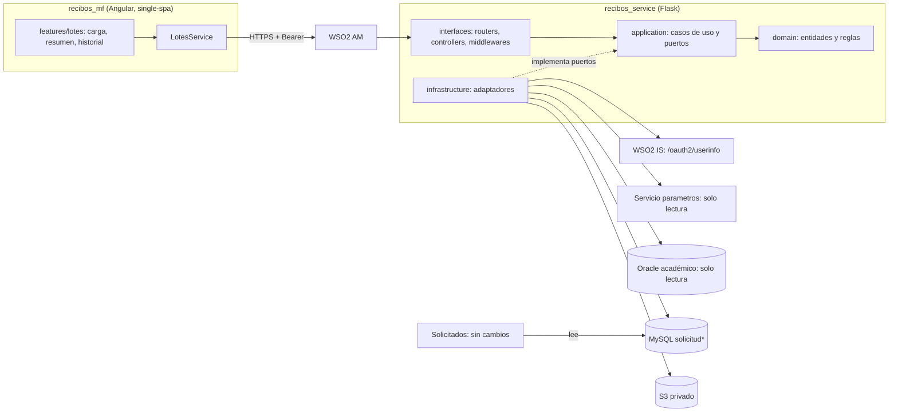

# Application Design — Migración del módulo de recibos por lote

- Etapa: INCEPTION → Application Design (profundidad estándar)
- Fecha: 2026-11-24
- Entradas: `requirements.md`, `user-stories/stories.md`, `plans/execution-plan.md`, `Product-Definition/technical-environment.md`, lineamientos OAS (`codigo-fuente/lineamientos_oas/`) y contratos de `codigo-fuente/utils_oas/`
- Estado: **aprobado 2026-11-24**. Ajustado el mismo día por la extensión de seguridad (§10); los ajustes se aprueban junto con Units Generation. Actualizado el 2026-11-25 con las decisiones de Reverse Engineering: AD-05 revisada, AD-29 y AD-30 nuevas, D13. Ajustado de nuevo el 2026-11-25 por las aclaraciones C1 a C5 (AD-16 y AD-27). Ajustado el 2026-11-25 en U1 NFR Design: AD-34 a AD-36 y riesgos de §7

## 1. Resumen

El sistema tiene dos piezas desplegables:
- `recibos_service`: API Flask con Clean Architecture.
- `recibos_mf`: microcliente Angular con single-spa.

El backend expone dos operaciones de negocio. `POST /v1/lotes` carga y procesa un lote en una sola petición. `GET /v1/lotes` consulta el historial. Las reglas de cálculo viven en `app/domain/`, sin dependencias externas. Oracle, MySQL, S3, WSO2 y "parametros" quedan detrás de puertos. Los insumos pendientes (D1–D12) solo cambian adaptadores o valores; ninguno cambia la forma de los componentes.

## 2. Vista general

Texto equivalente: el microcliente llama a la API a través de WSO2 AM con un token Bearer. En la API, las interfaces llaman a los casos de uso, y los casos de uso usan el dominio y los puertos. Los adaptadores de infraestructura implementan los puertos y hablan con Oracle (solo lectura), MySQL, S3, el servicio "parametros" (solo lectura) y WSO2 IS. "Solicitados" sigue leyendo MySQL sin cambios.



## 3. Estructura de `recibos_service`

```text
recibos_service/
+-- api.py                  # create_app(): arma dependencias, Blueprints y middlewares; expone app para gunicorn
+-- conf/conf.py            # variables de entorno RECIBOS_SERVICE_*; DEBUG=False por defecto
+-- swagger/swagger.yml     # Swagger 2.0: se publica en WSO2 AM; en local lo muestra Swagger UI (AD-13)
+-- gunicorn.conf.py        # procesos, hilos y tiempos de espera (nfr-design/logical-components.md)
+-- app/
|   +-- domain/             # Python puro: modelos, reglas, plantillas, validaciones, cuotas, exenciones, conceptos, fechas
|   +-- application/        # casos de uso, puertos, errores de aplicación y presupuesto de tiempo
|   +-- infrastructure/     # adaptadores: oracle, mysql, s3, xls, wso2, parametros, festivos, ssm, db, reloj, http, registro
|   +-- interfaces/         # routers, controllers, schemas pydantic, middlewares
+-- tests/                  # pytest e Hypothesis, espejo de app/
+-- Dockerfile
+-- docker-compose.yml
+-- sonar-project.properties
+-- pyproject.toml          # metadatos, dependencias directas y configuración de ruff, mypy, pytest y coverage
+-- requirements.txt        # producción: versiones exactas con hashes (pip-tools, AD-26)
+-- requirements-dev.txt    # pruebas y herramientas, con hashes
+-- .pre-commit-config.yaml # ruff y mypy antes de cada commit
+-- .drone.yml
+-- .gitignore
+-- .env.example            # nombres de las variables, sin valores
+-- README.md
```

## 4. Estructura de `recibos_mf`

```text
recibos_mf/                 # creado desde oas_cliente (feature/clientes_nuevos)
+-- src/app/
    +-- core/               # lo que trae oas_cliente: entorno, sesión y token del core (D9)
    +-- shared/             # mensajes de error, indicador de carga, lectura del sobre de respuesta
    +-- features/lotes/
        +-- pages/carga-lote/          # US-02, US-12
        +-- pages/historial-lotes/     # US-13
        +-- components/resumen-lote/   # tabla de rechazados (presentación)
        +-- services/lotes.service.ts  # único acceso a la API
        +-- models/                    # interfaces TypeScript del contrato
```

## 5. Decisiones de diseño

| ID | Decisión | Alternativa descartada | Motivo |
|---|---|---|---|
| AD-01 | Un solo endpoint síncrono `POST /v1/lotes` (multipart, campo `archivo`) que carga, procesa y devuelve el resumen; `GET /v1/lotes` para el historial | Separar carga y procesamiento en dos llamadas | C-2 fija el procesamiento síncrono; dos llamadas solo agregan estados intermedios |
| AD-02 | No hay `GET /v1/lotes/{id}` | Detalle por lote | `solicitudLote` no guarda resultados (P-9); no habría qué mostrar |
| AD-03 | Códigos: 201 lote procesado (aunque tenga rechazados), 400 parámetros inválidos, 401, 403, 413 tamaño, 415 tipo, 422 formato de plantilla, 502 una dependencia responde con datos inválidos, 503 una dependencia no responde, 500 error inesperado | 200 para todo con el error en `Data` | L31 exige códigos correctos; los rechazos de estudiantes son resultados del negocio, no errores HTTP |
| AD-04 | Sobre `{Success, Status, Message, Data}` con `Status` entero (formato MID de `utils_oas`), `Metadata` para la paginación (`APIResponseMeta`), mensajes por defecto en español (`getHttpStatusMessage`) y campos de `Data` en snake_case | `Status` como texto (formato CRUD de `customerrorv2`) | La API hace lógica de negocio como un MID; `APIResponseDTO` usa entero |
| AD-05 | Orden del procesamiento: tamaño y tipo → reglas de "parametros" → S3 → registro en `solicitudLote` → formato → datos académicos → por estudiante, la cancelación en su propia transacción y, si es válido, la solicitud nueva en otra (AD-30) | Registrar el lote antes de leer las reglas | Si "parametros" no responde, no queda un lote registrado que nunca se procesó; los lotes rechazados por formato sí se registran (P-9) |
| AD-06 | Lecturas a Oracle por lote, en bloque (estudiantes, certificados) y por proyecto curricular (periodo, evento 82, facultad), no por estudiante | Una consulta por estudiante, como el PHP | Con 1000 estudiantes, el PHP haría unas 5000 consultas; en bloque son decenas y el lote cabe en los tiempos de espera |
| AD-07 | SQLAlchemy 2.x Core para Oracle (`oracle+oracledb`, modo thin) y MySQL (`mysql+pymysql`); **PyMySQL** en vez de mysqlclient | mysqlclient | PyMySQL no necesita compilar librerías en la imagen; la diferencia de rendimiento no importa para 1000 estudiantes |
| AD-08 | **requests** como cliente HTTP para userinfo y "parametros", con una sola función que siempre pone el tiempo de espera y reutiliza las conexiones. *Cambiado el 2026-11-25 (N11): antes httpx* | httpx, que no publica versiones desde diciembre de 2024; httpx2, un fork nuevo | SECURITY-10 no permite dependencias abandonadas; requests la mantiene la PSF y ya estaba permitida en el entorno técnico |
| AD-09 | El backend autoriza con el claim `role` de `/oauth2/userinfo` comparado con el rol configurado (`RECIBOS_SERVICE_ROL_AUTORIZADO`). `configuracion_cliente` define la aplicación, el rol y el menú del microcliente. La autenticación se exige en todos los ambientes. El token se valida en `/oauth2/userinfo` en **cada petición, sin caché**. *Revisado por SECURITY-08 (2026-11-24): `utils_oas` guardaba la validación 60 minutos, así que un token vencido o revocado se seguía aceptando hasta una hora* | Consultar roles en un servicio de configuración | El claim ya llega en la validación del token; el API de `configuracion_cliente` no está documentado. Sin excepción por ambiente, un error de configuración no puede abrir la API |
| AD-10 | Auditoría: `sql_statement` por petición con un listener de SQLAlchemy (solo el texto SQL, sin valores); `data` sin datos personales (tipo de plantilla, tamaño, totales, id de lote); salida JSON a stdout → CloudWatch Logs | Copiar `utils_oas` (última consulta global; `data` con el cuerpo de la respuesta) | Corrige los dos defectos documentados en `auditoria.go` y cumple la Ley 1581 |
| AD-11 | Los health checks (`GET /`, `GET /health`) son públicos y **no se auditan**, como en `utils_oas` | Auditar también los health checks | El balanceador los consulta cada pocos segundos y llenaría el log. **Ajusta el escenario 1 de US-14** ("cualquier petición" pasa a "cualquier petición a `/v1/*`") |
| AD-12 | `GET /` → `{"status": "ok"}` (`apiStatusLib`) y `GET /health` → `{"status": "UP"}` (lineamiento Flask) | Una sola ruta | Cada lineamiento pide la suya; infraestructura elige cuál consulta |
| AD-13 | `swagger/swagger.yml`, en Swagger 2.0 como el ejemplo del lineamiento, es la fuente de la documentación y se publica en WSO2 AM. El servicio no sirve documentación en ningún ambiente; en local se ve con el contenedor oficial de Swagger UI en `docker-compose.yml`. *Cambiado el 2026-11-25 (N12): antes flasgger en local, que no publica versiones desde mayo de 2023* | flasgger en local; `/apidocs` público en test y prod | Beego solo sirve Swagger en dev; en test y prod la documentación la expone WSO2 AM; sin dependencias sin mantenimiento (SECURITY-10) |
| AD-14 | CORS con flask-cors: lista explícita de orígenes por ambiente (`RECIBOS_SERVICE_CORS_ORIGENES`), sin comodines en ningún ambiente, ni `*` ni `*.udistrital.edu.co`. *Revisado por SECURITY-08 (2026-11-24)*: los orígenes salen de D11 y quedan dentro de `udistrital.edu.co`, como pide L13; métodos GET, POST, OPTIONS; cabeceras Accept, Authorization, Content-Type, User-Agent, X-Amzn-Trace-Id; sin credenciales | Implementación manual | Librería mantenida y probada; el token va en cabecera, así que no hacen falta cookies |
| AD-15 | Las fechas se guardan como timestamp Unix de la medianoche en America/Bogota, como produce hoy `strtotime` (supuesto A10) | Medianoche UTC | Una diferencia de zona movería todas las fechas 5 horas y "Solicitados" podría mostrar otro día |
| AD-16 | La estructura de las plantillas (texto de A1, fila inicial, columnas, encabezados) está en el dominio como especificación de formato. Las reglas (IDs, porcentajes, mapas, estados, eventos, plazos) llegan todas de "parametros", incluidos los porcentajes de las exenciones (P-15 a). Desde el 2026-11-25 las fechas de pago de pregrado vienen de la plantilla, como en posgrado (C3), y ya no hay columnas que anulen la votación (C2). El tope de 100% del descuento más la votación es una constante del dominio, no un parámetro (C7) | Parametrizar también la estructura | La estructura cambia solo si cambia la plantilla oficial; las reglas cambian por periodo (meta: cero cambios de código por periodo) |
| AD-17 | Sin `entrypoint.sh`: el `Dockerfile` arranca gunicorn directamente, con `gunicorn.conf.py` (tiempo de espera, reciclado de workers y registro de accesos a stdout) | Conservar `entrypoint.sh` del ejemplo Flask | El lineamiento de CI/CD más reciente pide eliminarlo; el ejemplo Flask fija el puerto 5000 e ignora la configuración |
| AD-18 | El prefijo de las tablas MySQL (`$configuracion["prefijo"]` del PHP) es configurable | Nombres fijos | El PHP antepone un prefijo que no conocemos (D4) |
| AD-19 | El microcliente tiene una sola feature `lotes` con dos páginas (carga con resumen, e historial) y un único servicio HTTP | Una feature por pantalla | Solo hay tres vistas y un recurso de API |
| AD-20 | Cliente de "parametros": `GET {RECIBOS_SERVICE_PARAMETROS_URL}/v1/parametro/{id}`, una llamada por regla al inicio de cada lote, sin caché entre lotes. El id de cada regla está en configuración, no en el código. Reenvía el token del usuario, como `utils_oas/request` (A11). Exige `Success` verdadero, `Status` 2xx (el servicio lo envía como texto, formato CRUD: `"200"`), `Data.Id` igual al id pedido y `Data.Activo` verdadero (AD-22). El valor se toma según AD-21 | Leer todas las reglas en una sola llamada | Es la sintaxis que definió el usuario (2026-11-24). Leer por lote hace que un cambio de regla aplique desde el siguiente lote (US-15) |
| AD-21 | Mapeo de reglas en configuración: cada regla declara el `id` del parámetro en ese ambiente, el `campo` del objeto `Parametro` que tiene el valor (`CodigoAbreviacion`, `Nombre`, `Descripcion` o `NumeroOrden`) y el `formato` (entero, decimal, texto, lista separada por comas, fecha ISO o JSON). El adaptador entrega al dominio un `ReglasLiquidacion` ya convertido. El medio de configuración se define en Infrastructure Design | Fijar en el código el campo de cada regla | El objeto `Parametro` no tiene un campo de valor (ejemplo del usuario); el campo se decide con OATI/ARC (D6) y puede cambiar sin tocar el código. Los ids cambian entre ambientes. Los ids que se escriben en MySQL (exenciones, conceptos) vienen en un campo del parámetro, nunca de su `Id` |
| AD-22 | Si una regla no existe, tiene `Activo: false` o su valor no se puede convertir, el lote no se procesa (502) y el mensaje nombra la regla | Usar el valor aunque esté inactivo | En los servicios OAS `Activo: false` es el borrado lógico (L27); aplicar una regla borrada cambiaría el valor de los recibos |
| AD-23 | Limitación de tráfico con una política de throttling de WSO2 AM para la API (valores con Arquitectura, D12), además del tamaño máximo del archivo y del máximo de filas por lote (P-1). Los health checks no se publican en WSO2 AM: solo los consulta el balanceador dentro de la red | Sin límites | SECURITY-11. Toda petición a la API pasa por WSO2 AM, que aplica el throttling por suscripción |
| AD-24 | Registro de aplicación con `logging` de Python, en JSON a stdout (CloudWatch Logs): fecha, nivel, mensaje, módulo y `request_id` (el valor de `X-Amzn-Trace-Id` que agrega el balanceador, si tiene el formato esperado, o uno generado por petición; sin X-Ray en el MVP, AD-33). La línea de auditoría (AD-10) sale por el mismo mecanismo con nivel INFO. Nunca se registran tokens, la cabecera `Authorization`, ni códigos o nombres de estudiantes | `print` o registros sin estructura | SECURITY-03 |
| AD-25 | La auditoría de cada lote incluye los ids de las solicitudes creadas y de las canceladas, con el cambio de estado (0 → 2), el usuario y la fecha. Nunca incluye códigos de estudiante | Registrar solo `sql_statement` | SECURITY-13 pide registrar quién cambió qué, cuándo, y los valores antes y después. `solicitudRecibo` no guarda quién cancela una solicitud |
| AD-26 | Cadena de suministro: dependencias declaradas en `pyproject.toml` y bloqueadas con versiones exactas y hashes (pip-tools) en `requirements.txt` (producción) y `requirements-dev.txt` (pruebas y herramientas); la imagen instala solo `requirements.txt`, con `--require-hashes`; `package-lock.json` versionado en U2, instalado con `npm ci`; escaneo de dependencias (pip-audit) y SBOM (CycloneDX) en Drone; imágenes base con versión fija; sin dependencias que no se usen (se quita `cachetools`) | Versiones abiertas | SECURITY-10 y SECURITY-13. El pipeline institucional publica y despliega con la etiqueta `latest`; se pide a infraestructura desplegar con la etiqueta del commit, o se documenta la excepción (Infrastructure Design de U1 y U2) |
| AD-27 | Endurecimiento: imagen mínima (`python:3.15-slim` con la versión exacta fija, N1; compilación en una etapa aparte y sin herramientas de compilación en la imagen final; servidor estático mínimo en U2), contenedor con usuario sin privilegios, sin listado de directorios, sin páginas de ejemplo de `oas_cliente`, sin endpoint de documentación desplegado (AD-13) y solo versiones con soporte vigente | Usar la plantilla tal cual | SECURITY-09. Riesgo: si `oas_cliente` trae una versión de Angular sin soporte, U2 tiene que actualizarla (U2 NFR Requirements) |
| AD-28 | Requisitos de seguridad para el grupo de infraestructura, que se entregan en Infrastructure Design de U1 y U2: bucket S3 cifrado, con bloqueo de acceso público y una política que rechaza peticiones sin TLS (SECURITY-01); registros de acceso del balanceador y de WSO2 AM (SECURITY-02); roles de tarea con permisos mínimos y sin comodines (SECURITY-06); la API solo accesible a través de WSO2 AM y las bases solo desde las tareas de U1 (SECURITY-07); alarmas por 401 y 403 repetidos y por errores 5xx, retención de registros de al menos 90 días y sin permiso de borrado para la aplicación (SECURITY-14) | Dejar estos controles sin especificar | No hay CDK ni Terraform en el alcance; la infraestructura la administra ese grupo |
| AD-29 | La IP del cliente (`solicitudLote.ip` y `ip_user` de la auditoría) se toma de `X-Forwarded-For`, como decidió el usuario (RE-13). Se usa la dirección que agrega el último proxy de confianza: con N proxies de confianza delante del servicio (D13), la N-ésima entrada contando desde la derecha, con `werkzeug.middleware.proxy_fix.ProxyFix(x_for=N)` y N en `RECIBOS_SERVICE_PROXIES_CONFIANZA`. Sin la cabecera, o con menos entradas, se usa la dirección de la conexión | La primera entrada de `X-Forwarded-For`, como el PHP y Beego | El cliente puede escribir la primera entrada y falsear la IP del historial y de la auditoría (SECURITY-03, SECURITY-13) |
| AD-30 | Por cada fila con estudiante conocido, válida o rechazada, se cancelan en una transacción propia sus solicitudes sin imprimir de cualquier periodo (RE-02, C8). Después, solo si la fila es válida, la solicitud nueva se guarda en otra transacción. Si falla la solicitud nueva, la cancelación se mantiene; si falla la cancelación, no se guarda la solicitud nueva. Las cancelaciones de las filas rechazadas también van en la auditoría (AD-25) | Cancelación e inserción en la misma transacción (diseño anterior) | El usuario decidió que un rechazo por cualquier motivo cancela las solicitudes sin imprimir; con una sola transacción, la falla de la solicitud nueva revertía la cancelación |
| AD-31 | Límite propio del lote de 90 s, de configuración. Antes de cada fila se revisa el tiempo; al llegar al límite, las filas que faltan salen con `TIEMPO_AGOTADO`, no se validan y no cancelan nada. *Agregada en U1 NFR Requirements (N3, 2026-11-25)* | Dejar que un intermediario corte la conexión | ARC siempre recibe el reporte y sabe qué se subió (NFR-P04) |
| AD-32 | Bloqueo con nombre en MySQL por el código del estudiante, desde antes de la cancelación hasta después del guardado. *Agregada en U1 NFR Requirements (N5)* | Un solo lote a la vez; ningún control | Con dos lotes simultáneos queda la solicitud del lote que guarda de último; funciona aunque haya varias tareas, porque el bloqueo vive en la base (NFR-R02) |
| AD-33 | Sin trazas distribuidas en el MVP; las peticiones se siguen con `request_id`, que va en los registros, en `trace_id` de la auditoría y en la cabecera `X-Request-Id`. *Agregada en U1 NFR Requirements (N14)* | SDK de X-Ray; OpenTelemetry desde el MVP | El SDK y el daemon de X-Ray pierden el soporte el 2027-02-25 y el SDK no declara compatibilidad con Python 3.15. OpenTelemetry se agrega después |
| AD-34 | Plazos y tiempos de espera: el límite propio de 90 s cuenta desde que llega la petición y se revisa antes de cada fila y de cada sentencia de MySQL; la fase previa a las filas tiene 30 s y cada llamada usa lo que queda o no empieza; cada dependencia tiene su tiempo de espera y la cadena crece hacia afuera (gunicorn, balanceador, WSO2 AM y `recibos_mf`). Un reintento solo en las lecturas HTTP y al guardar en S3. *Agregada en U1 NFR Design (2026-11-25)* | Revisar el límite solo antes de cada fila | Con MySQL muy lento, una fila podría pasar del tiempo del balanceador y ARC se quedaría sin reporte (NFR-U02) |
| AD-35 | Una conexión de MySQL por lote para todas sus filas (`SesionFilas`), y corte del lote después de 5 fallas de conexión seguidas: las filas que faltan salen con `ERROR_GUARDADO` y no cancelan nada (BR-T04). *Agregada en U1 NFR Design (N20 = a)* | Una conexión por fila; intentar todas las filas hasta el límite | Menos idas y vueltas y menos conexiones; con MySQL caído, ARC recibe el reporte en segundos y no al final del plazo |
| AD-36 | Cabecera `Server` vacía desde `gunicorn.conf.py` y `Cache-Control: no-store` en `/v1/*`. *Agregada en U1 NFR Design* | Dejar `Server: gunicorn`; quitarla solo en el balanceador | gunicorn no tiene una opción para quitarla y el contrato de `utils_oas` la pide vacía; el reporte trae códigos de estudiantes y no debe quedar en cachés |

## 6. Insumos y supuestos nuevos

| ID | Qué falta | Quién | Se necesita en |
|---|---|---|---|
| D8 | Identificador exacto del rol ARC y confirmación de que `/oauth2/userinfo` lo devuelve en el claim `role` | Grupo de Arquitectura / WSO2 | U1 Code Generation (configuración) |
| D9 | Cómo entrega el core de `oas_cliente` el token y el usuario al microcliente (las guías no lo documentan) | Se verifica al clonar `oas_cliente` | U2 Functional Design |
| D6 (acotada) | Campo y formato del valor de cada regla dentro del objeto `Parametro`, id de cada regla por ambiente, URL base y autenticación. El formato del sobre ya se conoce (ejemplo del usuario, 2026-11-24) | Usuario / OATI | U1 Code Generation |
| P-15 | Resuelta (2026-11-24): todas las reglas se leen de "parametros", incluidos los porcentajes de las exenciones y las fechas por facultad | Usuario | — |
| D10 | Crear en "parametros" (dev y test) los parámetros de las reglas. Hoy no existen ahí: están en el código PHP y en la tabla `exencion` (las fechas por facultad ya no se usan, C3). U1 Functional Design entrega la lista de parámetros a crear | OATI / ARC | Antes de procesar lotes en test |
| A11 | La llamada a "parametros" reenvía el token del usuario (patrón de `utils_oas/request`). Requiere que la aplicación registrada en WSO2 AM esté suscrita a esa API | — | U1 Code Generation |
| D4 (ampliada) | Además del DDL: prefijo de las tablas MySQL y nombres de las llaves primarias (`solicitudLote`, `solicitudRecibo`) | DBA | U1 Code Generation |
| A10 | Las fechas se calculan en America/Bogota. Se verifica comparando con solicitudes existentes en la base de pruebas | — | U1 Functional Design |
| D11 | Origen (URL) desde el que el root institucional carga `recibos_mf` en cada ambiente, para la lista de CORS (AD-14) | Arquitectura / infraestructura | U1 Infrastructure Design |
| D12 | Política de throttling de la API en WSO2 AM (AD-23) | Arquitectura | U1 Infrastructure Design |
| D13 | Número de proxies de confianza delante de `recibos_service` que agregan `X-Forwarded-For` (AD-29) | Infraestructura / Arquitectura | U1 Infrastructure Design |

## 7. Riesgos de diseño

| Riesgo | Efecto | Mitigación |
|---|---|---|
| Dos lotes con el mismo estudiante al mismo tiempo | Pueden quedar dos solicitudes sin imprimir (el PHP tiene el mismo problema) | Resuelto con el bloqueo por estudiante en MySQL (AD-32; `construction/recibos_service/nfr-design/nfr-design-patterns.md` §6.1) |
| Falla el registro en MySQL después de subir el archivo a S3 | Queda un archivo sin lote | La política de retención de S3 lo elimina (D7); la petición queda en la auditoría |
| gunicorn sobrescribe la cabecera `Server` | No se cumple "Server vacío" del contrato de cabeceras | Resuelto en U1 NFR Design: `gunicorn.conf.py` deja el valor vacío y una prueba unitaria lo revisa (AD-36) |
| El claim `role` no trae el rol ARC (D8) | El backend no puede autorizar | Se confirma con Arquitectura antes de U1 Code Generation; la alternativa sería consultar el servicio de configuración |
| Los porcentajes de las exenciones se leen de "parametros" (P-15 a), pero "Solicitados" calcula el valor con la tabla MySQL `exencion` (confirmado con su código el 2026-11-25, RE-22) | Si un porcentaje cambia en un solo lugar, el tope de 100% del descuento más la votación (C7) se evalúa con un número distinto al que se cobra | Riesgo aceptado con P-15 (a): cada cambio de porcentaje se hace en los dos lugares; queda escrito en el README y en el manual de operación |
| Los parámetros de las reglas no están creados en "parametros" cuando empiecen las pruebas en test (D10) | No se puede procesar ningún lote en test | La lista de parámetros sale en U1 Functional Design para que OATI/ARC los creen mientras avanza la construcción |
| `oas_cliente` trae una versión de Angular sin soporte, o `single-spa-angular` no funciona con una versión con soporte | U2 no cumple SECURITY-09, o hay que actualizar la plantilla | Se revisa al empezar U2 (NFR Requirements, OQ-T-1) |
| El pipeline institucional despliega con la etiqueta `latest` | No se cumple SECURITY-10 en producción | Infraestructura despliega con la etiqueta del commit, o se documenta la excepción (AD-26) |
| La validación del token en cada petición agrega una llamada a WSO2 IS | Cada petición tarda un poco más | El tráfico de la API es bajo (unas pocas cargas por periodo y consultas del historial); se mide en NFR Requirements |
| Una fila rechazada cancela las solicitudes sin imprimir del estudiante (AD-30) | Un error en la plantilla, como una fecha faltante, deja al estudiante sin solicitud sin imprimir hasta que se vuelva a cargar | Decisión del usuario (RE-02). El resumen muestra el motivo de cada rechazo para corregir y volver a cargar, y la auditoría registra cada cancelación (AD-25) |
| D13 no se conoce a tiempo | La IP del historial puede quedar mal tomada | Hasta tener D13 se usa la dirección de la conexión; se fija en U1 Infrastructure Design |
| Alguna tabla `solicitud*` es MyISAM | No hay transacciones ni bloqueos de filas: BR-T03 y NFR-R01 no se cumplen | Se revisa con el DDL (D17) antes de escribir el repositorio de MySQL; si alguna lo es, se decide con el DBA |
| La ida y vuelta a MySQL pasa de unos 5 ms | 1000 filas no caben en 60 s (NFR-P01) | Se mide en test con `duracion_ms`; la alarma de p95 avisa (`nfr-design-patterns.md` §2.1) |

## 8. Artefactos

- `components.md`: componentes y responsabilidades de cada capa.
- `component-methods.md`: firmas de los métodos principales.
- `services.md`: casos de uso, orquestación y manejo de errores.
- `component-dependency.md`: reglas de dependencia, flujo de una carga y datos que se leen y escriben.
- `api-contract.md`: contrato de la API para U2.
- `design-answers-history.md`: respuestas del usuario en esta etapa.
- `unit-of-work.md`, `unit-of-work-dependency.md`, `unit-of-work-story-map.md`: unidades de trabajo (Units Generation).

## 9. Casos de abuso (SECURITY-11)

| Caso | Control |
|---|---|
| Un `.xls` malicioso o enorme (BIFF malformado, hoja con millones de filas) | Tamaño máximo (413), firma OLE2 (415), lectura en memoria con xlrd, máximo de filas (P-1), error controlado sin trazas (AD-03) |
| Un usuario autenticado sin el rol ARC llama la API directamente, sin pasar por la interfaz | 403 en cada petición; el control está en el backend, no en el menú (AD-09) |
| Alguien con el rol ARC carga el mismo archivo varias veces para cancelar solicitudes sin imprimir | Solo se cancela en el periodo vigente (P-7), y la auditoría registra qué se canceló, quién lo hizo y cuándo (AD-25). Con AD-30 una fila rechazada también cancela; el control es el mismo |
| SQL, HTML o fórmulas en las celdas o en el nombre del archivo | Parámetros enlazados, código de estudiante numérico, nombre de archivo con longitud y caracteres validados, escape por defecto de Angular |
| Llamadas masivas a la API | Throttling de WSO2 AM (AD-23) |
| Token robado, vencido o revocado | Validación en cada petición, sin caché (AD-09) |
| Una regla alterada en "parametros" (por ejemplo, una exención al 100%) | Fuera de este sistema: depende del control de acceso del servicio "parametros". La regla aplicada queda trazable porque cada lote lee las reglas al iniciar. Riesgo residual a cargo de OATI |

## 10. Ajustes por la extensión de seguridad (2026-11-24)

El usuario activó la extensión de seguridad en Units Generation, después de aprobar este diseño. Al revisar las 15 reglas contra el diseño aprobado aparecieron estos hallazgos bloqueantes; se corrigieron en el diseño en la misma etapa:

| Regla | Hallazgo | Corrección |
|---|---|---|
| SECURITY-08 | La validación del token se guardaba 60 minutos: un token vencido o revocado se seguía aceptando | AD-09: validación en cada petición, sin caché |
| SECURITY-08 | CORS aceptaba `*` en dev y `*.udistrital.edu.co` en los demás ambientes | AD-14: lista explícita de orígenes en todos los ambientes (D11) |
| SECURITY-04, SECURITY-09 | `/apidocs` (HTML con scripts) se servía en dev | AD-13: el servicio no sirve documentación; en local, Swagger UI en un contenedor aparte (N12) |
| SECURITY-11 | No había limitación de tráfico ni casos de abuso documentados | AD-23 y §9 |
| SECURITY-03 | No se definía el registro de aplicación (nivel, mensaje, id de petición) | AD-24 |
| SECURITY-13 | Las cancelaciones no dejaban quién, cuándo, ni el estado antes y después | AD-25 |
| SECURITY-10 | No se definían versiones exactas, archivos de bloqueo ni SBOM | AD-26 |
| SECURITY-09 | No se definía el endurecimiento de los contenedores | AD-27 |
| SECURITY-01, 02, 06, 07, 14 | Controles de infraestructura sin especificar | AD-28: requisitos para el grupo de infraestructura |
| SECURITY-05 | El nombre original del archivo no tenía límite de longitud ni de caracteres | `services.md`, UC-01 paso 2 |
| SECURITY-03, SECURITY-13 | Hallado en Reverse Engineering (RE-13, 2026-11-25): la IP del historial y de la auditoría se tomaba de la primera entrada de `X-Forwarded-For`, que el cliente controla | AD-29 (falta D13) |
