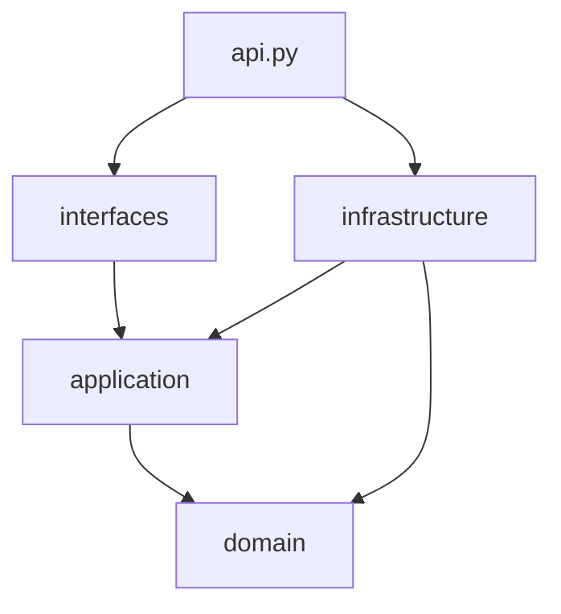
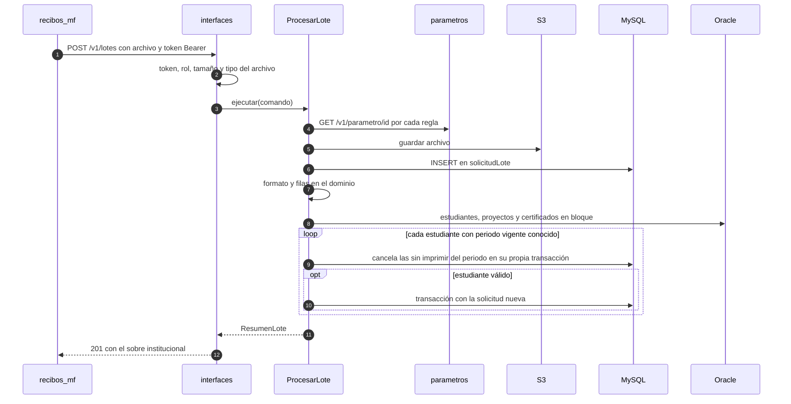

# Dependencias entre componentes

## 1. Reglas de dependencia

Texto equivalente: `interfaces` depende de `application`; `application` depende de `domain`; `infrastructure` depende de `application` (implementa sus puertos) y de `domain` (construye sus modelos). `domain` no depende de nadie.

| Capa | Puede importar | No puede importar |
|---|---|---|
| `domain` | Biblioteca estándar | Flask, pydantic, SQLAlchemy, boto3, httpx, xlrd, `application`, `infrastructure`, `interfaces` |
| `application` | `domain` | Flask, SQLAlchemy, boto3, httpx, xlrd, `infrastructure`, `interfaces` |
| `infrastructure` | `domain`, `application` (puertos), SQLAlchemy, oracledb, PyMySQL, boto3, httpx, xlrd, pydantic (para validar respuestas externas) | Flask, `interfaces` |
| `interfaces` | `application`, `domain`, Flask, flasgger, pydantic, flask-cors, aws-xray-sdk | `infrastructure` (los adaptadores llegan desde `api.py`) |
| `api.py` | Todo | — |

Code Generation agrega una prueba que falla si una capa importa lo que no debe.

## 2. Casos de uso → puertos

| Caso de uso | `LectorPlantilla` | `AlmacenamientoArchivos` | `RepositorioAcademico` | `RepositorioSolicitudes` | `FuenteReglas` | `FuenteFestivos` | `ProveedorIdentidad` | `Reloj` |
|---|---|---|---|---|---|---|---|---|
| UC-01 Procesar lote | ✓ | ✓ | ✓ | ✓ | ✓ | ✓ | — | ✓ |
| UC-02 Consultar lotes | — | — | — | ✓ | — | — | — | — |
| UC-03 Autorizar usuario | — | — | — | — | — | — | ✓ | — |

## 3. Flujo de una carga

## 4. Datos que se leen y escriben

| Sistema | Operación | Objetos | Adaptador |
|---|---|---|---|
| Oracle académico | Solo lectura | `ACEST`, `V_ACESTMATBRUTO`, `ACCRA`, `ACASPERI`, `ACASPERIEVENTOS`, `ACCERELECTORAL`, función `fua_verifica_evento` | `RepositorioAcademicoOracle` |
| MySQL | Lectura y escritura | `solicitudLote` (insertar, listar), `solicitudRecibo` (insertar, cancelar), `solicitudCuota`, `solicitudExencion`, `solicitudConcepto` (insertar) | `RepositorioSolicitudesMySQL` |
| S3 | Escritura | Bucket privado, prefijo `lotes/` | `AlmacenamientoS3` |
| "parametros" | Solo lectura | `GET /v1/parametro/{id}` | `ClienteParametros` |
| WSO2 IS | Lectura | `GET /oauth2/userinfo` | `ProveedorIdentidadWso2` |
| SSM | Lectura al arrancar | Credenciales de Oracle y MySQL, dirección del daemon de X-Ray | `LectorSsm` |
| CloudWatch Logs | Escritura | Auditoría JSON por stdout | `middlewares/auditoria` |

Ya no se usan porque sus reglas se eliminaron o no aplican al rol único: `mntac.fua_verifica_diferido` y `ACEST.est_diferido` (no hay pago diferido), `ACRANGOSPAGO`, y las consultas de carreras por coordinador o asistente (`carrerasCoordinador`, `consultarProyectosAsistente`). Con esto la cuenta de Oracle necesita menos permisos. Tampoco se leen las tablas MySQL `exencion`, porque sus datos pasan a "parametros" (P-15 a), ni `fechaPagoFacultad`, porque las fechas vienen de la plantilla (C3); tampoco hace falta la facultad del proyecto (`ACCRA.cra_dep_cod`); la cuenta de MySQL solo necesita permisos sobre las tablas `solicitud*`.

## 5. Comunicación

Toda la comunicación es síncrona:
- HTTPS entre el microcliente, WSO2 AM y la API, y entre la API, "parametros" y WSO2 IS.
- SQL sobre TLS hacia Oracle y MySQL.
- API de AWS hacia S3 y SSM.

No hay colas, eventos ni procesos en segundo plano (C-2).
