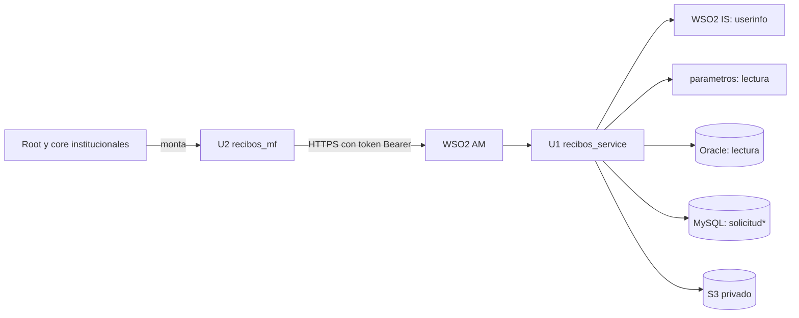

# Dependencias de las unidades

## 1. Entre unidades

| Desde \ Hacia | U1 `recibos_service` | U2 `recibos_mf` |
|---|---|---|
| U1 | — | Ninguna |
| U2 | Contrato de la API (`api-contract.md`) para construir; API publicada en WSO2 AM y su origen en la lista de CORS (D11) para funcionar | — |

U1 no depende de U2. U2 se puede construir apenas exista el contrato. Para funcionar en un ambiente necesita que U1 ya esté desplegada y publicada.

Texto equivalente del diagrama: el root institucional monta U2; U2 llama a U1 a través de WSO2 AM; U1 lee Oracle, "parametros" y WSO2 IS, y escribe en MySQL y S3.

## 2. Con sistemas externos

| Sistema | U1 | U2 | Tipo |
|---|---|---|---|
| Oracle académico | Lectura | — | SQL sobre TLS |
| MySQL (`solicitud*`) | Lectura y escritura | — | SQL sobre TLS, transacciones |
| S3 | Escritura | — | API de AWS |
| SSM Parameter Store | Lectura al arrancar | — | API de AWS |
| X-Ray | No en el MVP (N14, AD-33) | — | — |
| CloudWatch Logs | Auditoría y registros | Registros de acceso | stdout del contenedor |
| WSO2 IS | `/oauth2/userinfo` en cada petición | Inicio de sesión a través del core | HTTPS |
| WSO2 AM | Publica la API; throttling (D12) | Llama a la API a través de él | HTTPS |
| Servicio "parametros" | `GET /v1/parametro/{id}` al iniciar cada lote | — | HTTPS |
| Root y core institucionales | — | Lo montan y le entregan el token (D9) | single-spa |
| `configuracion_cliente` | — | Aplicación, rol y menú del microcliente | Registro manual |
| Plantilla `oas_cliente` | — | Base del código | Repositorio GitHub |
| Repositorio de assets | — | Estilos y logos institucionales | Repositorio GitHub |
| "Solicitados" | Lee lo que U1 escribe (sin cambios) | — | Base de datos compartida |

## 3. Insumos pendientes por unidad

| Insumo | Unidad | Se necesita en | Quién |
|---|---|---|---|
| D1 Archivo de la plantilla de pregrado sin Reingreso y con la fecha ordinaria (C3, F8) | U1 | Functional Design | ARC |
| D2 Plantilla de posgrado SMLV | U1 | Functional Design | ARC |
| D3 ~~Valor de `cuota` en pregrado y demás estados~~ resuelta el 2026-11-25 (RE-21, A15) | U1 | — | — |
| D4 DDL real, prefijo de tablas y llaves primarias | U1 | Code Generation | DBA |
| D5 Tabla de festivos de weboffice (F9; los fines de semana no cuentan, F10) | U1 | Code Generation (dependencia técnica) | DBA |
| D14 TLS de Oracle (servicio TCPS y puerto) y certificados de la CA de Oracle y MySQL (N9) | U1 | Infrastructure Design | DBA |
| D15 Canal y turnos de las alarmas 24/7 (N6, N16) | U1 | Infrastructure Design | Infraestructura |
| D16 Conexiones que puede abrir el servicio a Oracle y MySQL (U1 NFR Design) | U1 | Infrastructure Design | DBA |
| D17 Con el DDL: tablas InnoDB, versión de MySQL e índice (`codigo_est`, `estado`) de `solicitudRecibo` (N19) | U1 | Code Generation | DBA |
| ~~F14, F15~~ respondidas el 2026-11-25 (F14 = a, F15 = a) | U1 | — | — |
| D6 Campo del valor de cada regla e ids por ambiente | U1 | Code Generation | Usuario / OATI |
| D7 SSM, retención de registros, límites de S3 | U1, U2 | Infrastructure Design | Infraestructura / Seguridad |
| D8 Identificador del rol ARC | U1 | Code Generation | Arquitectura |
| D9 Cómo entrega el core el token | U2 | Functional Design | Se verifica en `oas_cliente` |
| D10 Crear los parámetros en "parametros" | U1 | Antes de las pruebas en test | OATI / ARC |
| D11 Origen de `recibos_mf` por ambiente (CORS) | U1, U2 | U1 Infrastructure Design | Arquitectura / infraestructura |
| D12 Throttling en WSO2 AM | U1 | Infrastructure Design | Arquitectura |
| D13 Proxies de confianza para la IP (AD-29) | U1 | Infrastructure Design | Infraestructura / Arquitectura |
| OQ-T-1 Versiones de Angular, TypeScript y Node | U2 | NFR Requirements | Se verifica en `oas_cliente` |
| Herramientas con las versiones vigentes (C4): Docker y Python 3.14 ya están; Node LTS con soporte antes de U2 | U1, U2 | Antes de U1 Code Generation | Usuario |
| P-1, P-2, P-6, P-10 (P-14 ya no aplica, C2) | U1 | Functional Design | Usuario / ARC |
| ~~C6, C7, C8~~ respondidas el 2026-11-25 (C6 = b, C7 = a, C8 = a) | U1 | — | — |

## 4. Orden de despliegue en cada ambiente

1. U1: imagen en ECR, servicio en ECS, API publicada en WSO2 AM y suscrita por la aplicación del microcliente.
2. U2: imagen en ECR, servicio en ECS, registro en el import map del root y menú en `configuracion_cliente`.
3. En U1: el origen de U2 queda en la lista de CORS (D11).

Si U1 cambia el contrato de forma incompatible, se cambia primero el contrato y después las dos unidades, en ese orden.
