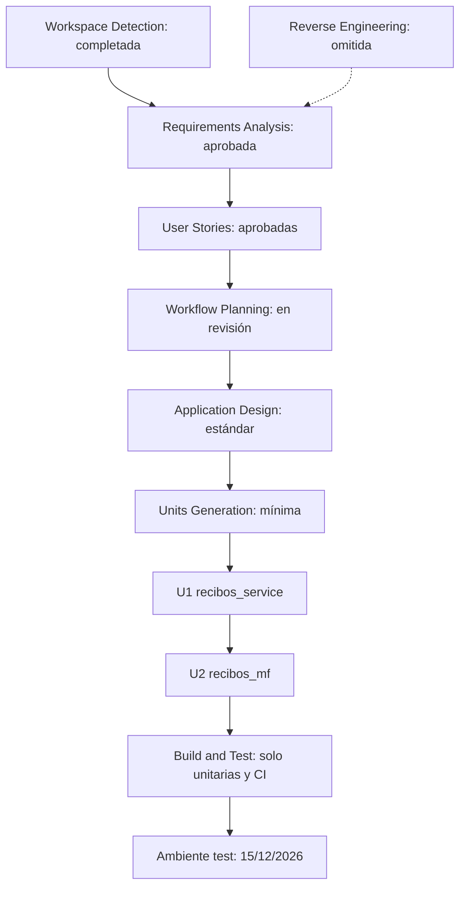
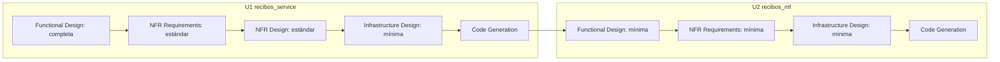

# Plan de ejecución — Workflow Planning

- Etapa: INCEPTION → Workflow Planning
- Fecha: 2026-11-24
- Entradas: `requirements.md` (aprobado), `user-stories/stories.md` (aprobadas), `Product-Definition/*`
- Estado: **pendiente de aprobación del usuario**
- Hito fijo: desplegado en el ambiente de pruebas (test) el 15/12/2026, listo para la revisión de Seguridad

Notas de método:
- Este plan sigue `.kiro/steering/core-workflow.md`. Hasta Application Design las reglas de detalle no estaban en el workspace; desde Units Generation se siguen las de `aws-aidlc-rule-details/`.
- Extensiones (decididas el 2026-11-24): seguridad activa y bloqueante; pruebas basadas en propiedades en modo parcial (bloqueantes PBT-02, 03, 07, 08 y 09); resiliencia no activa. Cada etapa incluye su resumen de cumplimiento.
- Modo de preguntas: conversacional. Las preguntas se hacen en el chat cuando la etapa las necesita (§4).

## 1. Etapas

| Etapa | Decisión | Profundidad | Motivo |
|---|---|---|---|
| Workspace Detection | Completada | — | Brownfield; Discovery completo |
| Reverse Engineering | Omitir | — | Discovery ya analizó el sistema actual (`existing-system-analysis.md`, `templates-analysis.md`, `utils-oas-analysis.md`, `institutional-guidelines-analysis.md`). El código PHP se lee de forma puntual cuando una regla lo requiere |
| Requirements Analysis | Completada | Completa | Aprobada 2026-11-24 |
| User Stories | Completada | Estándar | Aprobadas 2026-11-24 |
| Workflow Planning | En revisión | — | Este documento |
| Application Design | Ejecutar | Estándar | Componentes nuevos en dos repositorios; puertos y adaptadores (Oracle, MySQL, S3, WSO2, "parametros", lector xlrd); contrato OpenAPI que necesita `recibos_mf` |
| Units Generation | Ejecutar | Mínima | Las unidades ya están fijadas por C-5; solo se documentan su alcance, la asignación de historias y la dependencia por el contrato de la API |
| **U1 `recibos_service`** | | | |
| Functional Design | Ejecutar | Completa | Reglas de cuotas, exenciones, conceptos, fechas y validaciones; mapeo a las tablas MySQL. Concentra la mayoría de las preguntas pendientes |
| NFR Requirements | Ejecutar | Estándar | Lote síncrono de 1000 estudiantes (tiempos de espera), seguridad OAS, Ley 1581. El stack ya está fijado |
| NFR Design | Ejecutar | Estándar | Middlewares de autenticación, cabeceras y auditoría; transacción por solicitud; caché del token |
| Infrastructure Design | Ejecutar | Mínima | Especificación para el grupo de infraestructura: ECS, S3, SSM, CloudWatch Logs, X-Ray y tiempos de espera; `Dockerfile`, `docker-compose.yml`, `.drone.yml`. Sin CDK ni Terraform (fuera de alcance) |
| Code Generation | Ejecutar | — | Siempre. Incluye pruebas unitarias (≥80%; 100% en `app/domain/`) |
| **U2 `recibos_mf`** | | | |
| Functional Design | Ejecutar | Mínima | Tres vistas: carga, resumen e historial; estados de la pantalla |
| NFR Requirements | Ejecutar | Mínima | Fijar versiones de Angular, TypeScript y Node (OQ-T-1) |
| NFR Design | Omitir | — | Las reglas del frontend (sin `localStorage` para tokens, escape de Angular, sesión por el microcliente core) se aplican directamente con la plantilla `oas_cliente` |
| Infrastructure Design | Ejecutar | Mínima | `Dockerfile` y `.drone.yml` según `oas_cliente` y el lineamiento L43 |
| Code Generation | Ejecutar | — | Siempre. Incluye pruebas `*.spec.ts` |
| Build and Test | Ejecutar (ajustada) | — | Solo compilación, pruebas unitarias y controles de CI (SonarQube, escaneo de dependencias). No se planean pruebas de integración, carga, funcionales, de usuario, de equivalencia ni de seguridad: las hacen otros grupos (`technical-environment.md`, "Pruebas") |
| Operations | No aplica | — | Etapa reservada del workflow; el despliegue en test lo hacen Drone y el grupo de infraestructura |

## 2. Unidades y orden

| Orden | Unidad | Repositorio | Historias | Depende de |
|---|---|---|---|---|
| 1 | U1 | `recibos_service` (Flask, Clean Architecture) | US-01 a US-15 (lado servidor) | Insumos D1–D7 y P-n según §4 |
| 2 | U2 | `recibos_mf` (Angular, single-spa) | US-01, US-02, US-12, US-13 (interfaz) | Contrato OpenAPI de U1 (sale de Application Design) |

U1 va primero porque U2 consume su API. Con el contrato OpenAPI definido en Application Design, U2 puede construirse contra la especificación sin esperar a que U1 esté desplegado.

## 3. Diagramas

Flujo general (texto equivalente: tabla de §1):

Etapas por unidad (texto equivalente: filas U1 y U2 de §1):

## 4. Cuándo se pregunta cada pendiente (en el chat)

| Momento | Pregunta o insumo | Desbloquea | Quién puede responder |
|---|---|---|---|
| Workflow Planning (resuelto 2026-11-24) | P-12 → mayor porcentaje; P-13 → regla actual de la votación | US-07 desbloqueada; US-08 sigue bloqueada por D5 y D2 | Usuario |
| U1 Functional Design | D5: origen de los festivos y si sábados y domingos cuentan | US-08 | DBA / OATI |
| U1 Functional Design | D1: plantilla de pregrado de 13 columnas (A1, fila inicial, encabezados) | US-03 | ARC |
| U1 Functional Design | D2: plantilla de posgrado SMLV | US-05 y variante SMLV de US-08 | ARC |
| U1 Functional Design | D3: valor de `solicitudRecibo.cuota` en pregrado y demás estados | US-11 | DBA / dueño de "Solicitados" |
| U1 Functional Design | P-1, P-2, P-6, P-10, P-14 | US-02, US-06, US-07, US-08, US-12 | Usuario / ARC |
| U1 Functional Design (entrega) | D10: lista de parámetros de las reglas para crear en "parametros" (dev y test) | US-15 | OATI / ARC los crean |
| U1 NFR Requirements | Tiempo de respuesta objetivo para un lote de 1000 estudiantes (RNF-1) | — | Usuario |
| U1 Infrastructure Design | D7: rutas SSM, destino y retención de logs (mínimo 90 días), tamaño máximo y retención en S3; D11: orígenes de CORS; D12: throttling en WSO2 AM; requisitos de AD-28 | — | Infraestructura / Seguridad / Arquitectura |
| Antes de U1 Code Generation | Cómo correr las pruebas: en esta máquina no hay Python, Node ni Docker | Build and Test | Usuario |
| U1 Code Generation | D4: DDL real, prefijo de las tablas y llaves primarias; D6 (acotada): campo del valor de cada regla, ids por ambiente, URL y autenticación; D8: identificador del rol ARC | US-09 a US-11 | DBA; usuario / OATI; Arquitectura |
| U2 NFR Requirements | OQ-T-1: versiones de Angular, TypeScript y Node | — | Se verifican en `oas_cliente` (`feature/clientes_nuevos`) |

Regla: si un insumo no llega en su momento, la historia sigue bloqueada y el trabajo continúa con lo demás. No se inventan valores.

## 5. Riesgos del plan

| Riesgo | Impacto | Mitigación |
|---|---|---|
| D6 y D10 siguen en la ruta crítica: ya se conocen la consulta por id y el formato del sobre, pero falta el campo del valor de cada regla, sus ids y que los parámetros se creen en el servicio | Sin eso no se puede terminar el adaptador de reglas de U1 | El puerto aísla el dominio; el adaptador es lo último de U1. Si el formato no llega a tiempo, se decide en ese momento contigo cómo seguir |
| D3/D4 (DBA) llegan tarde | No se puede cerrar el adaptador de escritura MySQL | Las columnas ya se conocen por el código; solo faltan tipos exactos, el valor de `cuota` en pregrado y los demás estados |
| Los tiempos de espera de gunicorn, el balanceador y WSO2 AM no permiten 1000 estudiantes en una petición | El lote falla aunque el código esté bien | Se fija el objetivo en U1 NFR Requirements y se entrega a infraestructura en Infrastructure Design |
| Festivos sin origen conocido (D5) | No se puede cerrar la fecha extraordinaria de posgrado | Se pregunta al inicio de U1 Functional Design |
| En la máquina de desarrollo no hay Python, Node ni Docker | No se pueden correr las pruebas mientras se genera el código | Se pregunta antes de U1 Code Generation: instalar Python 3.12 y Node LTS, o correr las pruebas solo en Drone |
| `oas_cliente` trae una versión de Angular sin soporte (SECURITY-09) | Hay que actualizar la plantilla en U2 | Se revisa en U2 NFR Requirements |
