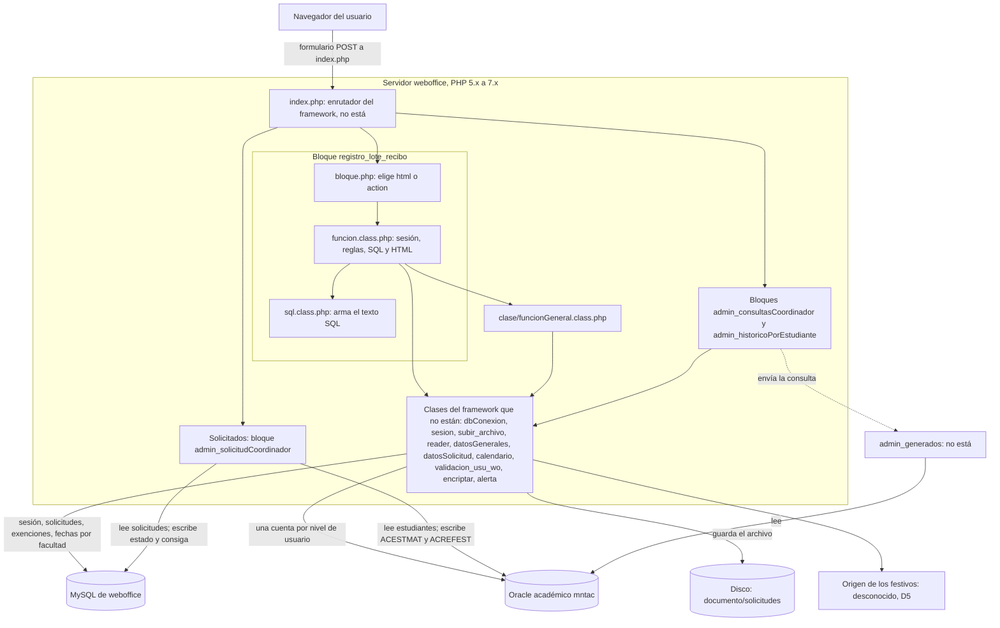
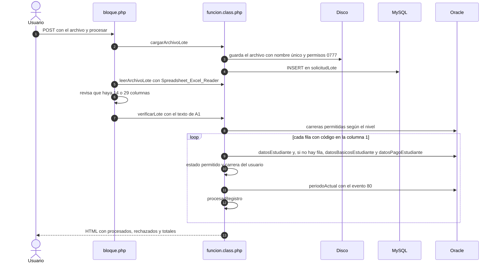
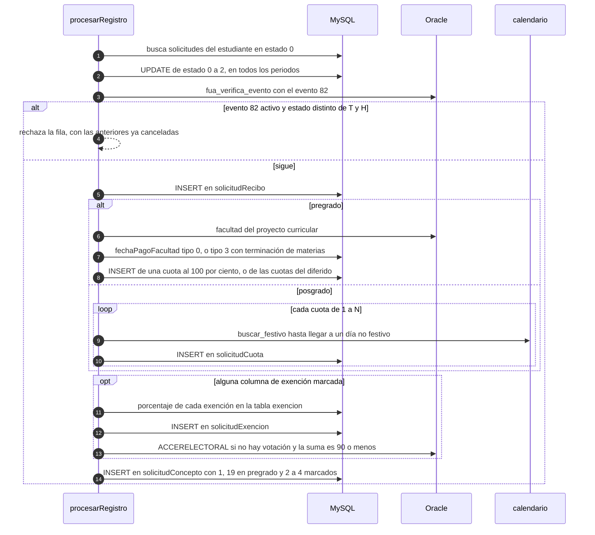

# Arquitectura del sistema actual

- Etapa: INCEPTION → Reverse Engineering (2026-11-25)
- Describe el sistema que se reemplaza (weboffice). El sistema nuevo está en `application-design/application-design.md`; la sección "Correspondencia con el diseño aprobado" une los dos
- Base: `existing-system-analysis.md` §1–§4 y lectura del código. Las partes que no están en el repositorio se marcan como "no está"

## Resumen del sistema

`registro_lote_recibo` es un bloque del framework propio de weboffice (PHP, 2005–2009). Es un monolito con renderizado en el servidor: el mismo archivo `funcion.class.php` lee la sesión, consulta Oracle y MySQL, aplica las reglas de negocio y escribe el HTML. No hay API, colas ni llamadas HTTP a otros sistemas. Se integra por datos: lee Oracle académico y escribe en MySQL, donde "Solicitados" toma las solicitudes.

El repositorio es un extracto. Faltan el enrutador `index.php`, las clases base del framework (sesión, conexión, carga de archivos, lector de Excel, calendario, datos generales) y los módulos vecinos ("Solicitados", `admin_generados`). Por eso el sistema no se puede ejecutar ni probar desde aquí (R16).

## Diagrama de arquitectura

Texto equivalente: el navegador envía un formulario a `index.php`, que entrega la petición al bloque. `bloque.php` llama a `html()` (formulario) o a `action()` (procesamiento). `funcion.class.php` usa `sql.class.php` para armar las consultas y las clases del framework para conectarse a MySQL y Oracle, leer la sesión, guardar el archivo en disco, leer el Excel y consultar festivos. Después, "Solicitados" (`admin_solicitudCoordinador`, otro bloque del mismo servidor) lee las solicitudes de MySQL, recalcula los valores, escribe los recibos en Oracle (`ACESTMAT`, `ACREFEST`) y deja la solicitud en estado 1. El histórico por estudiante envía la consulta a `admin_generados`, que no está.

## Componentes

### `index.php` (no está)
- **Propósito**: enrutar `index.php?pagina=...` al bloque y descifrar los parámetros de la URL.
- **Responsabilidades**: definir `$GLOBALS["autorizado"]` y `$configuracion` (rutas, prefijo de tablas, credenciales).
- **Dependencias**: framework.
- **Tipo**: aplicación (núcleo del framework).

### `bloque/registro_lote_recibo/bloque.php`
- **Propósito**: controlador del bloque.
- **Responsabilidades**: sin `procesar` en la petición muestra el formulario; con `procesar` carga el archivo, revisa que tenga 14 o 29 columnas y llama a `verificarLote`.
- **Dependencias**: `funcion.class.php`, `sql.class.php`, `bloque.class.php` (no está).
- **Tipo**: aplicación.

### `bloque/registro_lote_recibo/funcion.class.php`
- **Propósito**: lógica del bloque.
- **Responsabilidades**: leer la sesión y el nivel, abrir las conexiones, guardar y leer el archivo, validar estudiantes, cancelar solicitudes previas, calcular cuotas, exenciones y conceptos, escribir en MySQL y producir el HTML del resultado (BT-01 a BT-08 de `business-overview.md`).
- **Dependencias**: `funcionGeneral`, `validacion_usu_wo`, `datosSolicitud`, `calendario`, `reader`, `encriptar`, `alerta`, `tema.php`.
- **Tipo**: aplicación.

### `bloque/registro_lote_recibo/sql.class.php`
- **Propósito**: catálogo de sentencias SQL.
- **Responsabilidades**: un `switch` con 22 opciones que devuelve el texto SQL concatenado con los valores (R1). Seis opciones no se usan (`code-structure.md`).
- **Dependencias**: `sql.class.php` base (no está).
- **Tipo**: aplicación (acceso a datos).

### `bloque/registro_lote_recibo/action.php` y `html.php`
- **Propósito**: versión de 2008 del mismo bloque.
- **Responsabilidades**: ninguna en el flujo actual; `bloque.php` no los incluye (R15).
- **Tipo**: código muerto.

### `clase/funcionGeneral.class.php`
- **Propósito**: clase base de las funciones de los bloques.
- **Responsabilidades**: `ejecutarSQL`, `rescatarValorSesion`, `conectarDB`, `datosGenerales`, `revisarFormulario` (no la usa este bloque) y `cargarArchivoServidor`.
- **Dependencias**: `dbConexion`, `sesion`, `datosGenerales`, `subir_archivo` (no están).
- **Tipo**: compartido.

### `bloque/admin_consultasCoordinador` y `bloque/admin_historicoPorEstudiante`
- **Propósito**: consultas de notas de Admisiones, Registro y Control (el módulo se llama "coordinador" por error, RE-19) y formulario del histórico por estudiante.
- **Responsabilidades**: BT-11 y BT-12, fuera del alcance del MVP (BT-12 queda para la Fase 2, C5).
- **Dependencias**: framework; Oracle con la cuenta `coordinador` para todos los usuarios; módulos que no están: `admin_generados`, `adminReportesExcelCoordinador` (Excel), `registro_notasDocente` (reporte de notas del curso), `registro_cargarNovedadesNotasCurso` (novedades de notas) y `registro_plan_trabajo`.
- **Tipo**: aplicación.

### MySQL de weboffice
- **Propósito**: base del framework y de las solicitudes.
- **Responsabilidades**: sesión, `solicitudLote`, `solicitudRecibo`, `solicitudCuota`, `solicitudExencion`, `solicitudConcepto`, `exencion`, `fechaPagoFacultad`. Las tablas llevan el prefijo `$configuracion["prefijo"]`, que no se conoce (D4).
- **Tipo**: almacén de datos.

### Oracle académico (`mntac`)
- **Propósito**: datos académicos.
- **Responsabilidades**: estudiantes, carreras, periodos, eventos, certificado electoral, valor de matrícula. Se usa solo en lectura.
- **Tipo**: almacén de datos externo.

### "Solicitados" (`bloque/admin_solicitudCoordinador`)
- **Propósito**: revisar las solicitudes sin imprimir y generar el recibo (caso de uso "CONSULTAR SOLICITUD DE RECIBO DE PAGO"). Está en el workspace desde el 2026-11-25.
- **Responsabilidades**: lista por proyecto las solicitudes en estado 0 del periodo vigente; busca por estudiante; recalcula el valor de cada cuota; inserta los recibos en `ACESTMAT` y `ACREFEST`; guarda la cadena en `consiga`; pasa la solicitud a estado 1 (RE-20 a RE-26). Consume lo que escribe el lote y no cambia (RF-16).
- **Tipo**: otro bloque del mismo weboffice; no se migra.

### `utils_oas` y `lineamientos_oas`
- No forman parte del sistema actual. Son referencias institucionales del sistema nuevo (`component-inventory.md`).

## Flujo de datos

### Carga de un lote

Texto equivalente: el usuario envía el archivo. El bloque lo guarda en disco y registra el lote en MySQL antes de leerlo. Luego revisa el número de columnas y el texto de A1, consulta las carreras que el usuario puede manejar y recorre las filas. Por cada fila valida al estudiante en Oracle, toma el periodo de su carrera y llama a `procesarRegistro`. Al final escribe el resumen en HTML.

### Generación de la solicitud de un estudiante (`procesarRegistro`)

Texto equivalente: primero se cancelan las solicitudes sin imprimir del estudiante, de cualquier periodo. Si el evento 82 está activo y el estado no es T ni H, la fila se rechaza, pero las anteriores ya quedaron canceladas (RE-02). Si no, se inserta la solicitud y luego las cuotas: en pregrado con las fechas de la facultad; en posgrado con las fechas de la plantilla y la extraordinaria calculada saltando festivos. Solo si hay alguna exención marcada se registran las exenciones y se evalúa la votación automática (RE-01). Al final se insertan los conceptos. Ninguna de estas escrituras está en una transacción.

## Puntos de integración

- **APIs externas**: ninguna. El código no tiene llamadas HTTP, SOAP, colas ni correo.
- **Bases de datos**:
  - MySQL de weboffice: lectura y escritura de `solicitud*`; lectura de `exencion`, `fechaPagoFacultad` y de la sesión.
  - Oracle académico, solo lectura. Objetos que usa `registro_lote_recibo`: `ACEST`, `V_ACESTMATBRUTO`, `ACCRA`, `ACASPERI`, `ACASPERIEVENTOS`, `ACCERELECTORAL`; funciones `fua_verifica_evento` y `mntac.fua_verifica_diferido`. `validacion_usu_wo::consultarProyectosAsistente` consulta objetos que no se conocen. Los objetos del módulo de notas de ARC (`admin_consultasCoordinador`) están en `api-documentation.md`.
- **Servicios de terceros**: ninguno en ejecución. El portal Cóndor solo aparece como enlace a un manual en `admin_consultasCoordinador`.
- **Sistema de archivos**: `documento/solicitudes/` en el servidor.
- **Consumidor aguas abajo**: "Solicitados", por la base MySQL.

## Componentes de infraestructura

- **Pilas de CDK, Terraform o CloudFormation**: no hay.
- **Modelo de despliegue**: un servidor web con PHP y el framework de weboffice. El repositorio no trae Dockerfile, scripts de despliegue ni configuración; versión de PHP, servidor web y ubicación son desconocidos.
- **Red**: desconocida. Las credenciales de las cuatro cuentas de Oracle y de MySQL están en `$configuracion`, fuera del repositorio (R5).
- **Infraestructura del sistema nuevo**: la definen `technical-environment.md` (ECS, ECR, S3, SSM, CloudWatch Logs, X-Ray, WSO2) y los ejemplos de `lineamientos_oas/generacion_de_apis/cicd/` (`.drone.yml`, `Dockerfile`). Se detalla en Infrastructure Design de cada unidad.

## Correspondencia con el diseño aprobado

| Hoy | Sistema nuevo |
|---|---|
| Sesión y nivel en el constructor | WSO2, `middlewares/autenticacion` y `autorizar_usuario` (UC-03) |
| `nuevoRegistro` (formulario) | `recibos_mf`: `features/lotes/pages/carga-lote` |
| `cargarArchivoServidor` en disco | `s3/almacenamiento_s3` |
| `insertarLote` | `mysql/repositorio_solicitudes.registrar_lote` |
| `Spreadsheet_Excel_Reader` | `xls/lector_xlrd` |
| Control de columnas de `bloque.php` y texto de A1 de `verificarLote` | `domain/plantillas` |
| `verificarCodigo` y evento 82 | `domain/validacion_estudiante` y `oracle/repositorio_academico` |
| `cuotaPlantilla` y control de fechas de `procesarRegistro` | `domain/validacion_filas` |
| `guardarCuotas` y `guardarCuota` | `domain/cuotas`, `domain/fechas` y `festivos/fuente_festivos` |
| `guardarExencion` | `domain/exenciones` |
| `guardarConcepto` | `domain/conceptos` |
| `verificarSolicitudCodigo` y las inserciones | `mysql/repositorio_solicitudes`: `cancelar_sin_imprimir` y `guardar_solicitud`, cada una en su propia transacción (AD-30) |
| Literales del código y tablas `exencion` y `fechaPagoFacultad` | `parametros/fuente_reglas` |
| HTML del resumen | `ResumenLote` y `features/lotes/components/resumen-lote` |
| No existe | `consultar_lotes` (UC-02), `historial-lotes` y `middlewares/auditoria` |
