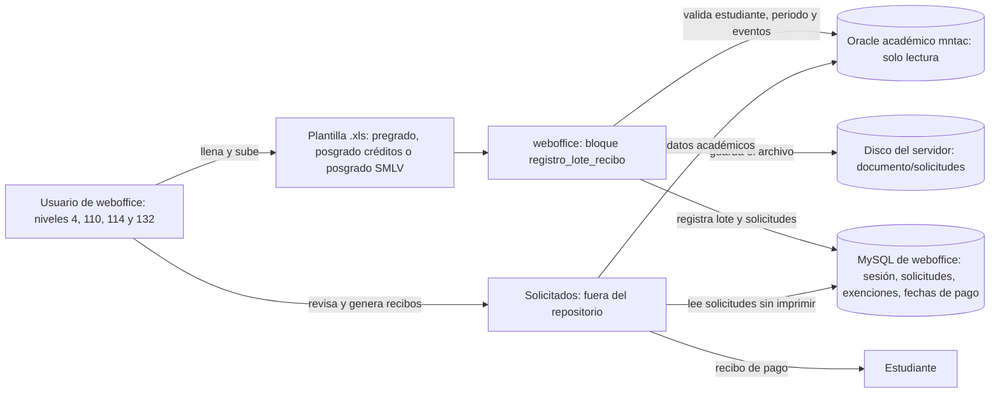

# Business Overview — Sistema actual de recibos por lote (weboffice)

- Etapa: INCEPTION → Reverse Engineering (agregada el 2026-11-25 a pedido del usuario; antes estaba omitida)
- Fuentes: código de `codigo-fuente/weboffice/`, `codigo-fuente/utils_oas/` y `codigo-fuente/lineamientos_oas/`; plantillas de `documentacion/plantillas-recibos/`; historias (`user-stories/stories.md`), casos de uso (`application-design/services.md`), requisitos (`requirements/requirements.md`) y los análisis de Discovery
- Relación con Discovery: `Product-Definition/interview/technical/existing-system-analysis.md` (riesgos R1–R18), `templates-analysis.md`, `utils-oas-analysis.md` e `institutional-guidelines-analysis.md` (L1–L50) se referencian; aquí no se repiten. Este documento agrega lo que el código hace hoy, regla por regla, y lo contrasta con las historias y los casos de uso
- Alcance: lectura estática. No se ejecutó nada: el repositorio no trae el núcleo del framework (R16) y en la máquina no hay PHP

## Diagrama de contexto de negocio

Texto equivalente: un usuario de weboffice llena una plantilla `.xls` y la sube al bloque `registro_lote_recibo`. El bloque guarda el archivo en el disco del servidor, valida cada estudiante en Oracle académico y escribe el lote y las solicitudes en MySQL. Después, el mismo usuario entra a "Solicitados", que lee esas solicitudes (y tablas de Oracle) y produce el recibo que recibe el estudiante.

## Descripción del negocio

- **Descripción**: la Universidad genera en bloque las solicitudes de recibo de pago de matrícula. Un usuario carga una plantilla con códigos de estudiantes; el sistema valida a cada estudiante en el sistema académico, cancela sus solicitudes anteriores sin imprimir y crea una solicitud nueva con sus cuotas, exenciones y conceptos. El recibo no se genera aquí: lo genera "Solicitados" a partir de esas solicitudes.
- **Transacciones de negocio**: ver la tabla siguiente.
- **Diccionario de negocio**: ver la sección siguiente.

### Transacciones de negocio

| ID | Transacción | Qué hace hoy | Código | Historias | Caso de uso | Alcance del MVP |
|---|---|---|---|---|---|---|
| BT-01 | Autenticar y autorizar | Lee de la sesión del framework `id_usuario`, `identificacion` y `nivelUsuario`. Según el nivel abre una cuenta de Oracle distinta; con otro nivel muestra "NO TIENE PERMISOS" | `funcion.class.php` `__construct` (28–60) | US-01 | UC-03 | IN-9 (rol único ARC) |
| BT-02 | Mostrar el formulario de carga | Formulario con un campo de archivo; los parámetros van cifrados en la URL | `bloque.php` `html()`; `funcion.class.php` `nuevoRegistro` (79–142) | US-02 | — (pantalla de `recibos_mf`) | IN-1 |
| BT-03 | Cargar y registrar el lote | Guarda el `.xls` en `documento/solicitudes/` con nombre único y registra el lote en `solicitudLote` (documento, nombre original, nombre interno, IP, fecha) | `cargarArchivoLote` (157–180); `funcionGeneral::cargarArchivoServidor` (100–168) | US-02 | UC-01 pasos 2–5 | IN-1, IN-8 |
| BT-04 | Identificar la plantilla y validar el formato | Acepta 14 o 29 columnas sin mirar el tipo; identifica el tipo por el texto de A1 | `bloque.php` `action()` (59–71); `verificarLote` (213–240) | US-03, US-04, US-05 | UC-01 paso 6 | IN-1 |
| BT-05 | Validar al estudiante | Existencia, valor de matrícula, estado, carrera del usuario y, si el evento 82 está activo, estado T o H | `verificarCodigo` (506–545); `procesarRegistro` (417–427) | US-06 | UC-01 pasos 9–12 | IN-2 |
| BT-06 | Cancelar las solicitudes sin imprimir | Pasa de estado 0 a 2 todas las solicitudes sin imprimir del estudiante, de cualquier periodo | `verificarSolicitudCodigo` (391–402); SQL `datosSolicitud`, `cancelarSolicitud` | US-09 | UC-01 paso 13 | IN-4 |
| BT-07 | Generar la solicitud de recibo | Inserta `solicitudRecibo` y luego cuotas, exenciones y conceptos, sin transacción | `procesarRegistro` (410–499); `guardarSolicitud`, `guardarCuotas`, `guardarCuota`, `guardarExencion`, `guardarConcepto` | US-07, US-08, US-10, US-11, US-15 | UC-01 pasos 12–13 | IN-3, IN-5, IN-6, IN-10 |
| BT-08 | Mostrar el resumen del lote | HTML con los códigos procesados, los rechazados con su motivo y los totales | `verificarLote` (310–379); `mensajeErrorCarga` (1089–1136) | US-12 | UC-01 paso 14 | IN-7 |
| BT-09 | Consultar el historial de lotes | **No existe en el código.** El PHP solo inserta en `solicitudLote` | — | US-13 | UC-02 | IN-8 (funcionalidad nueva, confirmada el 2026-11-25) |
| BT-10 | Auditar cada petición | **No existe.** Solo queda `solicitudLote` y un `error_log` de una consulta (`sql.class.php` 227) | — | US-14 | Transversal (`services.md`) | IN-8 (funcionalidad nueva, confirmada el 2026-11-25) |
| BT-11 | Consultar el histórico por estudiante | Formulario que envía el código a `admin_generados`, que no está en el repositorio | `admin_historicoPorEstudiante/bloque.php` | — | — | OUT (Fase 2) |
| BT-12 | Consultas de notas de ARC (el módulo se llama "coordinador" por error, RE-19) | Proyectos activos, selección de periodo, control de notas parciales con exportación a Excel, histórico de notas y carga de novedades de notas | `admin_consultasCoordinador/*` | — | — | Fase 2 (C5); no es de recibos |
| BT-13 | Generar e imprimir el recibo | Lo hace "Solicitados": lista las solicitudes en estado 0 del periodo vigente, recalcula los valores, inserta las cuotas en `ACESTMAT` y los conceptos en `ACREFEST`, guarda la cadena en `consiga` y pasa la solicitud a estado 1 | `admin_solicitudCoordinador/funcion.class.php` `generarRecibo` (165–557) | US-11 (entrega) | — | OUT (sigue sin cambios; RE-20 a RE-26) |

### Reglas tal como las ejecuta el código hoy

Esta tabla es la referencia para la comparación de equivalencia (métrica del 100%). Los números entre paréntesis son líneas de `registro_lote_recibo/funcion.class.php`, salvo que se indique otro archivo. La fila "En los requisitos" dice si la regla se conserva, cambia por acuerdo o tiene un hallazgo (RE-n, ver `story-code-traceability.md`).

| Tema | Comportamiento actual | En los requisitos |
|---|---|---|
| Formato | `bloque.php` acepta 14 o 29 columnas para cualquier tipo (64); el tipo sale del texto de A1 (216–239); solo se lee la primera hoja | Cambia: 13 columnas en pregrado, 29 en posgrado, validación de encabezados (RF-02) |
| Filas | Desde la fila 4 (pregrado) o 5 (posgrado); se omiten las filas sin código en la columna 1 (276) | Se conserva |
| Código de estudiante | Se concatena en el SQL sin validar (`sql.class.php` 103) | Cambia: código numérico (US-06 esc. 2); RE-16 |
| Existencia y matrícula | Consulta que une `ACEST`, `V_ACESTMATBRUTO` y `ACCRA`; si no hay fila, distingue "no registrado" de "sin información de matrícula" (530–541) | Se conserva; RE-14 |
| Estado | Permitidos V, J, T, A, Q, B (512–517) | Se conserva, parametrizado |
| Carrera | Nivel 132: carreras activas, sin 0 ni 999 (`sql.class.php` `carrerasTotales`); niveles 4, 110 y 114: carreras asignadas | Se conserva la regla del nivel 132 (rol único ARC) |
| Periodo | Año y periodo del proyecto curricular con el evento 80 (292–294); si no hay, se guarda vacío | Se conserva. Sin periodo vigente la fila no se sube y el mensaje pide reportarlo al área de sistemas (RE-05, cambio acordado 10) |
| Cancelación previa | Antes de validar terminación de materias y fechas de posgrado, en todos los periodos (414) | Se conserva en todos los periodos (C8, que revierte P-7). Cambia: todo estudiante rechazado con código registrado también cancela (RE-02, cambio acordado 9) |
| Terminación de materias | Si el evento 82 está activo para la carrera, solo estados T o H (417–427) | Se conserva |
| Cuotas de pregrado | Con diferido: según la celda "Seguro Estudiantil", 3 cuotas al 0%, o solo la cuota 1 o la 2 al 50% (910–942). Sin diferido: 1 cuota al 100% (961–963) | Cambia: siempre 1 cuota al 100% (Visión) |
| Fechas de pregrado | Tabla `fechaPagoFacultad` por facultad y tipo: tipo 0 normal, tipo 3 si la columna 8 está marcada (838–877) | Cambia: vienen de la plantilla y la columna 8 ya no cambia las fechas (C3); sin fechas la fila no se sube (RE-06); columnas en D1 |
| `solicitudRecibo.cuota` en pregrado | Valor de la celda "Seguro Estudiantil" si es 0, 1 o 2; si no, 0 (453–461) | Cambia: vale 1 (A15). "Solicitados" no lo lee en pregrado (RE-09, RE-21) |
| Cuotas de posgrado | Columna 3; vacía = 1 cuota (805–810); 0 o texto = solicitud sin cuotas; 4 o más = resultado imprevisible (439, 971) | Cambia: obligatorio, de 1 a 3; la fila que no cumple no se sube (RE-03, RE-04, cambio acordado 8) |
| Fechas de posgrado | Columnas 18–26; solo se revisa día ≤ 31 y mes ≤ 12 (447) | Cambia: fecha existente con año completo (cambio acordado 7) |
| Fecha extraordinaria de posgrado | Ordinaria + 8 días calendario; mientras sea festivo, +1 día (982–996) | Se conserva; festivos D5 |
| Porcentajes de posgrado | Columnas 27–29 si son numéricos y ≤ 100; si no, 100 / 60-40 / 40-30-30 por posición (999–1020); acepta negativos; no valida la suma | Cambia: 0 a 100 y suma 100 (P-5, cambio acordado 7) |
| Exenciones | Mapa columna → `id_exencion` fijo (552–605); se registran todas las marcadas cuyo porcentaje existe en la tabla `exencion` (616–634) | Cambia: como máximo un descuento más la votación; con más de un descuento la fila no se sube (P-3, C2); RE-12 |
| Votación marcada en pregrado | Se quita si la última columna marcada es ≥ 8 y distinta de 14 (611–614) | Cambia: se registra con cualquier descuento, también con las columnas 8 a 13, si la suma no pasa de 100%; si pasa, queda solo el descuento (C2, C7); RE-10 |
| Votación automática | Si no se registró la votación y la suma de exenciones es ≤ 90%, se busca un certificado activo en `ACCERELECTORAL` (638–646). **Solo se evalúa si la fila tiene al menos una columna de exención marcada** (477) | Se conserva: solo con un descuento marcado y si el descuento más la votación no pasa de 100%, que con la votación en 10% es el mismo tope de 90%; sin descuento marcado no se agrega (C1, C6, C7, A14) |
| Conceptos | 1 siempre; 19 solo en pregrado; 2, 3 y 4 si su columna está marcada (672–721) | Se conserva, parametrizado |
| Marcada | Celda con cualquier contenido (`isset`, 729–785) | Se conserva |
| `unidad` | Créditos o SMLV de la columna 2 en posgrado (284); `0` en pregrado (255) | Se conserva: `0` en pregrado (RE-07; US-11 corregida) |
| Atomicidad | Sin transacción; los errores de cuotas, exenciones y conceptos no se detectan (R6) | Cambia: una transacción por estudiante (RF-10) |
| Resumen | Procesados y rechazados con motivo, en HTML (310–379) | Se conserva: los que se subieron y los que no, con el motivo (RF-11 CA3); cambia el formato (JSON del API) |

## Diccionario de negocio

| Término | Significado en el sistema actual |
|---|---|
| Lote | Un archivo de plantilla cargado. Se registra en `solicitudLote` |
| Plantilla | Archivo `.xls` oficial. Su tipo (`tipoPlantilla`) sale del texto de A1: 1 pregrado, 2 posgrado por créditos, 3 posgrado en SMLV |
| Solicitud de recibo | Registro de `solicitudRecibo` que "Solicitados" convierte en recibo. Estado 0 = sin imprimir; 1 = recibo generado por "Solicitados"; 2 = cancelada por el lote (RE-21) |
| Solicitud sin imprimir | Solicitud en estado 0. Es la única que se cancela al cargar otra del mismo estudiante |
| Cuota | Parte del pago, con porcentaje y fechas ordinaria y extraordinaria (`solicitudCuota`) |
| Fecha ordinaria y extraordinaria | Las dos fechas límite de pago de una cuota. En pregrado salen de la tabla de la facultad; en posgrado la ordinaria viene en la plantilla y la extraordinaria se calcula |
| Exención | Beneficio registrado en `solicitudExencion` por `id_exencion`. Su porcentaje está hoy en la tabla MySQL `exencion` |
| Descuento | En los requisitos nuevos, toda exención distinta de la votación (P-3). El código actual no hace esa distinción |
| Votación (certificado electoral) | Exención `id_exencion` 1 (10%). Llega por la columna de la plantilla o por un certificado activo (`cer_estado = 'A'`) en `ACCERELECTORAL` |
| Concepto | Cobro asociado a la solicitud (`solicitudConcepto`): 1 matrícula, 2 seguro estudiantil, 3 carnet, 4 sistematización, 19 solo pregrado (su nombre no está en el código, P-4) |
| Proyecto curricular (carrera) | `ACCRA.cra_cod`. Activo si `cra_estado = 'A'`; los códigos 0 y 999 se excluyen |
| Facultad | `ACCRA.cra_dep_cod`. Define las fechas de pago de pregrado |
| Estado del estudiante | `ACEST.est_estado_est`. El código no documenta qué significa cada letra; solo que T y H se aceptan con el evento de terminación de materias |
| Evento de calendario | Evento académico por proyecto curricular. 80: el código lo usa para obtener el año y el periodo vigentes. 82: "fechas de generación de recibos de terminación de materias" (comentario en 416) |
| Eventos del módulo de notas | 71: cierre de semestre; 89: fechas de novedades de notas (`admin_consultasCoordinador`). No los usa recibos |
| Estado del periodo | `ACASPERI.ape_estado`. El módulo de notas usa 'A', 'X' y 'P' y supone un periodo por estado (RE-18). El código no dice qué significan 'X' y 'P'. El evento 80 de cada proyecto indica qué estado de periodo usa recibos |
| Novedad de notas | Cambio de una nota después del cierre de semestre. Lo registra `registro_cargarNovedadesNotasCurso`, que no está en el repositorio |
| Terminación de materias | Exención `id_exencion` 4 (columna 8 de pregrado). Además cambia las fechas de pago al tipo 3 de la facultad |
| Diferido | Pago de pregrado en partes cuando `ACEST.est_diferido = 'S'` y `fua_verifica_diferido` da 'S'. El comentario de 909 lo asocia a "excede 50 por ciento del salario mínimo mensual". Se elimina en el sistema nuevo |
| Unidad | Créditos (tipo 2) o SMLV (tipo 3) de la columna 2 de posgrado. En pregrado se guarda 0 |
| SMLV | Salario mínimo legal vigente; base de cobro de algunos posgrados |
| Nivel de usuario | Perfil de weboffice: 4 coordinador, 110 asistente, 114 secretario, 132 Admisiones, Registro y Control ("ORC" en el código), con acceso a todas las carreras activas |
| ARC | Admisiones, Registro y Control. Hoy es el nivel 132 de weboffice ("ORC"); en el sistema nuevo es el rol único |
| Solicitados | Módulo de weboffice donde se revisan las solicitudes y se generan los recibos (mensaje del resumen, `funcion.class.php` 342). No está en el repositorio |

## Descripción de negocio por componente

### `weboffice/bloque/registro_lote_recibo`
- **Propósito**: generar en bloque las solicitudes de recibo de matrícula a partir de una plantilla ("caso de uso: SOLICITAR RECIBO DE PAGO", `bloque.php`).
- **Responsabilidades**: BT-01 a BT-08.

### `weboffice/clase/funcionGeneral.class.php`
- **Propósito**: utilidades comunes de los bloques.
- **Responsabilidades**: ejecutar SQL, leer la sesión, conectar a las bases y cargar archivos en el servidor (con la IP del cliente).

### `weboffice/bloque/admin_historicoPorEstudiante`
- **Propósito**: consultar los recibos generados de un estudiante.
- **Responsabilidades**: solo muestra el formulario; la consulta la hace `admin_generados`, que no está (BT-11, fuera de alcance).

### `weboffice/bloque/admin_consultasCoordinador`
- **Propósito**: consultas de notas del usuario de Admisiones, Registro y Control (nivel 132, "ORC"). El nombre dice "coordinador" por error (usuario, 2026-11-25); el código conserva ramas para coordinador y decano.
- **Responsabilidades**: BT-12: proyectos activos, selección de periodo, control de notas parciales con exportación a Excel, histórico de notas y carga de novedades de notas. No tiene relación con recibos; queda para la Fase 2 (C5, RE-19).

### `weboffice/bloque/admin_solicitudCoordinador` ("Solicitados")
- **Propósito**: convertir en recibos las solicitudes sin imprimir ("caso de uso: CONSULTAR SOLICITUD DE RECIBO DE PAGO"). Lo usan ARC (nivel 132), los coordinadores y los asistentes.
- **Responsabilidades**: BT-13. Recalcula los valores con sus propias reglas (RE-22) y escribe en Oracle. No se migra: el sistema nuevo le entrega las mismas solicitudes (RF-16).
### `utils_oas` (Go, Beego)
- **Propósito**: librerías institucionales de la OAS para las APIs en Beego.
- **Responsabilidades para este proyecto**: definen los contratos que `recibos_service` reimplementa en Python: sobre de respuesta, cabeceras de seguridad, auditoría, validación del token, health check, SSM y X-Ray (`utils-oas-analysis.md`). No forman parte del sistema actual.

### `lineamientos_oas`
- **Propósito**: lineamientos de desarrollo de la OAS/OATI.
- **Responsabilidades para este proyecto**: restricciones del sistema nuevo (L1–L50). No forman parte del sistema actual.

### `documentacion/plantillas-recibos`
- **Propósito**: plantillas oficiales que llenan los usuarios.
- **Responsabilidades**: definen las columnas que lee el código (`templates-analysis.md`). Falta la de SMLV (D2) y la de pregrado de 13 columnas (D1).

## Contraste con historias y casos de uso

El detalle está en `story-code-traceability.md`: cada historia y cada caso de uso contra el código, y los hallazgos RE-01 a RE-26. Resumen:

- **Decididas por el usuario el 2026-11-25** (sección 4 de `story-code-traceability.md`): RE-02, RE-03, RE-04, RE-05 y RE-06 pasan a ser los cambios acordados 8 a 11 de `requirements.md` §12.3 (en RE-02, un rechazado también pierde sus solicitudes sin imprimir); RE-07 conserva el `0`; RE-13 toma la IP de `X-Forwarded-For` (AD-29); el resumen lista los que se subieron y los que no.
- **Aclaraciones resueltas el 2026-11-25** (`reverse-engineering-clarification-questions.md`): C1 a (sin votación automática en filas sin exenciones marcadas), C2 b (más de un descuento: la fila no se sube; votación marcada con cualquier descuento), C3 b (fechas de pregrado desde la plantilla), C4 a (versiones actualizadas) y C5 b (módulo de notas de ARC en la Fase 2).
- **Insumos para etapas siguientes**: RE-08 (fechas de la facultad, para D10), RE-09 y RE-21 (valor de `cuota` en pregrado; D3 resuelta, A15), RE-25 (fecha extraordinaria de pregrado, para D1) y D13 (proxies de confianza, para U1 Infrastructure Design).
- **Funcionalidades nuevas**: el historial de lotes (US-13) y la auditoría (US-14) no existen en el sistema actual y quedan registradas en `requirements.md` §12.7.
- **Módulo de notas de ARC** (RE-18, RE-19, 2026-11-25): `admin_consultasCoordinador` es de Admisiones, Registro y Control, no del coordinador. Confirma que el nivel 132 es ARC y que hay un periodo por estado (supuesto A13). Queda para la Fase 2 (C5).
- **Confirmaciones sin cambio**: RE-10, RE-11, RE-12, RE-14, RE-15, RE-16 y RE-17.
