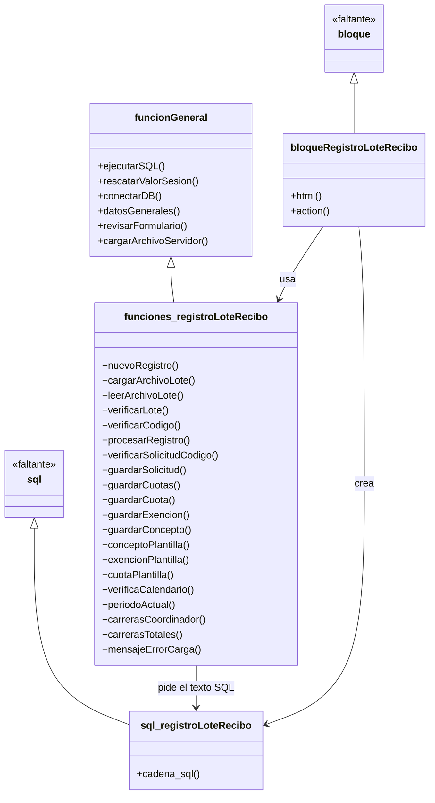

# Estructura del código

- Etapa: INCEPTION → Reverse Engineering (2026-11-25)
- Alcance: `codigo-fuente/weboffice/` (sistema actual), `codigo-fuente/utils_oas/` y `codigo-fuente/lineamientos_oas/` (referencias institucionales) y `documentacion/plantillas-recibos/`

## Sistema de construcción

| Paquete | Tipo | Configuración |
|---|---|---|
| `weboffice` | Ninguno | Sin `composer.json`, Makefile ni scripts. Los archivos se copian al servidor y se incluyen con `include_once` usando rutas de `$configuracion` |
| `utils_oas` | Go modules | `go.mod`: módulo `github.com/udistrital/utils_oas`, `go 1.26.0`; `go.sum` con las sumas de verificación |
| `lineamientos_oas` | Ninguno | Documentación. Trae ejemplos de `.drone.yml` y `Dockerfile` en `generacion_de_apis/cicd/` |

## Clases y módulos principales



Texto equivalente: `bloqueRegistroLoteRecibo` hereda de `bloque` (clase del framework que no está), crea un `sql_registroLoteRecibo` y un `funciones_registroLoteRecibo` y les delega el trabajo. `funciones_registroLoteRecibo` hereda las utilidades de `funcionGeneral` y pide a `sql_registroLoteRecibo` el texto de cada consulta. `admin_consultasCoordinador` sigue la misma estructura con sus clases `bloque_admin_consultasCoordinador`, `funciones_admin_consultasCoordinador` y `sql_admin_consultasCoordinador`.

### Llamadas dentro de `funciones_registroLoteRecibo` en una carga

```text
action() en bloque.php
  +-- cargarArchivoLote
  |     +-- cargarArchivoServidor (funcionGeneral)
  |     +-- SQL insertarLote
  +-- leerArchivoLote
  +-- verificarLote
        +-- carrerasCoordinador | consultarProyectosAsistente | carrerasTotales
        +-- por cada fila:
              +-- verificarCodigo
              |     +-- SQL datosEstudiante, datosBasicosEstudiante, datosPagoEstudiante
              +-- periodoActual
              +-- procesarRegistro
                    +-- verificarSolicitudCodigo (SQL datosSolicitud, cancelarSolicitud)
                    +-- verificaCalendario (evento 82) y SQL datosBasicosEstudiante
                    +-- conceptoPlantilla, exencionPlantilla, cuotaPlantilla
                    +-- guardarSolicitud (SQL insertarSolicitud)
                    +-- guardarCuotas
                    |     +-- guardarCuota (SQL facultadCarrera, fechaPagoFacultad, insertarCuota)
                    +-- guardarExencion (SQL porcentajeExencion, insertarExencion, certificadoElectoral)
                    +-- guardarConcepto (SQL insertarConcepto)
        +-- HTML del resumen
```

### Opciones de `sql_registroLoteRecibo::cadena_sql`

| Opción | Base | ¿Se usa? |
|---|---|---|
| `verificaCalendario`, `periodoActual`, `datosEstudiante`, `datosBasicosEstudiante`, `datosPagoEstudiante`, `certificadoElectoral`, `carrerasCoordinador`, `carrerasTotales`, `facultadCarrera` | Oracle | Sí |
| `insertarSolicitud`, `insertarConcepto`, `insertarExencion`, `insertarCuota`, `insertarLote`, `datosSolicitud`, `cancelarSolicitud`, `porcentajeExencion` | MySQL | Sí |
| `diferidoPregrado`, `exencionAnterior`, `numeroCuotas` (`ACRANGOSPAGO`) | Oracle | No |
| `exencionActual`, `exencion` | MySQL | No |

La consulta `fechaPagoFacultad` no está en este archivo: la arma `datosSolicitud.class.php`, que no está en el repositorio.

### Opciones de `sql_admin_consultasCoordinador` (módulo de notas de ARC)

| Opción | Para qué | ¿Se usa? |
|---|---|---|
| `anioper` | Año y periodo de un estado de `ACASPERI` ('A', 'X' o 'P') | Sí |
| `listaProyectosORC` | Proyectos activos para el nivel 132 (ARC) | Sí |
| `listaProyectos`, `listaDecanos`, `listaProyectosDecano` | Proyectos del coordinador o de la facultad del decano | Sí, cuando el nivel no es 132 |
| `controlnotas` | Notas parciales por proyecto y periodo, con los datos del docente | Sí |
| `cierreSemestre` | Evento 71 del proyecto en el periodo | Sí |
| `novedadesORC` | Para ARC: el proyecto tiene un periodo activo | Sí |
| `fechasNovedades` | Para los demás: el evento 89 está dentro de sus fechas | Sí |
| `fechaactual`, `controlporcentaje`, `verificaEstudianteCoordinador` | Fecha del servidor, porcentajes de notas, estudiante del usuario (`GEUSUCRA`) | No |

Además, `seleccionarPeriodo` arma una consulta de periodos dentro de la vista (`funcion.class.php` 449–456), y `verificarUsuario` pide una opción `datosUsuario` que el catálogo no tiene (698, 707).
### Opciones de `sql_adminSolicitudCoordinador` ("Solicitados")
| Opción | Para qué | ¿Se usa? |
|---|---|---|
| `periodoActual` | Año y periodo vigentes del proyecto (evento 80), igual que en el lote | Sí |
| `totalSolicitud`, `solicitud`, `reciboEstudiante` | Solicitudes en estado 0 por proyecto y periodo (paginadas) o por estudiante, sin filtrar el periodo | Sí |
| `datosSolicitud`, `cuotasSolicitud`, `exencionSolicitud`, `conceptoSolicitud` | Una solicitud con sus cuotas, sus exenciones (con el catálogo `exencion`) y sus conceptos (con `referenciaPago`) | Sí |
| `datosEstudiante`, `valoresPecuniarios`, `deudaEstudiante` | Estudiante con `V_ACESTMATBRUTO` y `ACCRA`; valores de seguro, carnet y sistematización (`ACVLRSCS`); deudas (`acdeudores`) | Sí |
| `verificapago`, `verificapagoCuota` | Pago ya registrado del periodo o de la cuota en `ACESTMAT` | Sí |
| `secuencia`, `actualizaracestmat`, `insertarCuota`, `insertarConcepto` | Secuencia del recibo; desactivar las cuotas sin pagar; insertar en `ACESTMAT` y `ACREFEST` | Sí |
| `insertarConsiga`, `actualizarSolicitud` | Cadena del recibo en `consiga`; solicitud a estado 1 con secuencia y observación | Sí |
| `carreraCoordinador`, `carrerasTotales`, `verificaEstudianteCoordinador`, `consultarCarreraEstudiante`, `verificaCalendario`, `historicoEstudiante` | Proyectos del usuario (todos los activos para ARC), estudiante del usuario, calendario (`fua_fecha_recibo`) e histórico de `ACESTMAT` | Sí |
| `certificadoElectoral`, `detalleDiferido`, `diferidoPregrado`, `exencionActual`, `exencionAnterior`, `exencion`, `numeroCuotas`, `clausulaInsertarSecuencia`, `fechaPago` | Consultas antiguas | No |

## Inventario de archivos

En este proyecto **ningún archivo existente se modifica**: el sistema PHP se retira y el código nuevo va en `recibos_service/` y `recibos_mf/` (Units Generation, Q1 = A). El inventario sirve para ubicar las reglas que se migran.

### `codigo-fuente/weboffice/` (17 archivos PHP, 7096 líneas)

- `clase/funcionGeneral.class.php` (171) — Clase base: SQL, sesión, conexiones, saneo de `$_REQUEST`, carga de archivos e IP del cliente.
- `bloque/registro_lote_recibo/bloque.php` (96) — Controlador: formulario o procesamiento; control de 14 o 29 columnas.
- `bloque/registro_lote_recibo/funcion.class.php` (1140) — Lógica de negocio y HTML del bloque. Contiene todas las reglas que se migran.
- `bloque/registro_lote_recibo/sql.class.php` (327) — 22 sentencias SQL concatenadas.
- `bloque/registro_lote_recibo/action.php` (1312) — Versión procedural de 2008; no se usa (conceptos 42 y 43, año 2008 fijo, "PLANTILLA SIMPLE").
- `bloque/registro_lote_recibo/html.php` (101) — Formulario antiguo; no se usa.
- `bloque/registro_lote_recibo/index.php` (3) — Redirige a `../index.php`.
- `bloque/admin_consultasCoordinador/bloque.php` (151) — Controlador del módulo de notas de Admisiones, Registro y Control (el nombre dice "coordinador" por error, RE-19).
- `bloque/admin_consultasCoordinador/funcion.class.php` (765) — Proyectos activos, selección de periodo, control de notas parciales, histórico de notas y enlace a la carga de novedades; reglas propias del nivel 132 ("ORC").
- `bloque/admin_consultasCoordinador/sql.class.php` (250) — 12 consultas Oracle de proyectos, periodos, notas y eventos; 3 sin uso (`fechaactual`, `controlporcentaje`, `verificaEstudianteCoordinador`).
- `bloque/admin_consultasCoordinador/index.php` (3) — Redirige a `../index.php`.
- `bloque/admin_historicoPorEstudiante/bloque.php` (54) — Formulario que envía el código a `admin_generados`.
- `bloque/admin_historicoPorEstudiante/index.php` (3) — Redirige a `../index.php`.
- `bloque/admin_solicitudCoordinador/bloque.php` (216) — Controlador de "Solicitados" (página `admin_recibo`): lista por proyecto, búsqueda por estudiante, histórico y generación.
- `bloque/admin_solicitudCoordinador/funcion.class.php` (1901) — Recalcula los valores y genera los recibos en Oracle (`generarRecibo`); vistas de solicitudes por proyecto y por estudiante; histórico de recibos.
- `bloque/admin_solicitudCoordinador/sql.class.php` (600) — 34 sentencias SQL concatenadas, de MySQL y Oracle; 9 sin uso.
- `bloque/admin_solicitudCoordinador/index.php` (3) — Redirige a `../index.php`.

### `codigo-fuente/utils_oas/` (29 archivos Go, 3722 líneas)

- `apiStatusLib/apistatus.go` — `GET /` responde `{"status": "ok"}`.
- `apiStatusLib/apistatus_test.go` — Prueba de `Init`.
- `auditoria/auditoria.go` — Filtro de Beego: valida el token en `/oauth2/userinfo` con caché y escribe el log JSON de auditoría.
- `customerror/custom_error.go` — Controlador de errores v1.
- `customerrorv2/custom_errorv2.go` — Controlador de errores v2 con el sobre `{Success, Status, Message, Data}`.
- `database/oracle.go` — Cadena de conexión a Oracle con credenciales de SSM o variables locales.
- `database/postgres.go` — Lo mismo para PostgreSQL.
- `errorctrl/errorctrl.go` — Control de errores en controladores y funciones.
- `errorctrlPrueba/errorctrl.go` — Copia idéntica de `errorctrl/errorctrl.go`.
- `errorhandler/errorHandler.go` — Errores 404 y pánicos de un MID.
- `formatdata/FillStruct.go`, `formatdata/json_tools.go` — Conversión de mapas a estructuras y utilidades JSON.
- `optimize/digester.go`, `optimize/jobWorker.go` — Procesamiento concurrente con goroutines.
- `planeacion/planeacion.go` — Formato de moneda y números (dominio de planeación).
- `request/request.go` — Cliente HTTP con contexto (`GetWithContext`, `PostWithContext`...).
- `request/request_tools.go` — `SendJson`, `GetJson`, `GetJsonWSO2` y cabecera de autorización.
- `request/transaction_tools.go` — `SendRequestNew`, `ExtractData` (saca `Data` del sobre) y utilidades de fechas y números.
- `requestmanager/requestmanager.go` — Lee el cuerpo de la petición en una estructura.
- `requestresponse/requests.go` — `Get`, `Post`, `Put`, `Delete` con un analizador de respuesta.
- `requestresponse/responses_format.go` — `APIResponseDTO`, `APIResponseMetadataDTO` y analizadores de respuesta.
- `responseformat/response_format.go` — Formato alterno `{Type, Code, Body}`.
- `ruler/ruler_tools.go` — Cliente de reglas Prolog (`golog`).
- `security/security_headers.go` — Las 10 cabeceras de seguridad.
- `ssm/ssm.go` — `GetValueFromParameterStore`.
- `time_bogota/time_bogota.go` — Hora de America/Bogota.
- `xlsx2pdf/xlsx2pdf.go` — Conversión de `.xlsx` a PDF.
- `xray/xray.go`, `xray/xray_test.go` — Segmentos y subsegmentos de X-Ray, con pruebas.
- Otros: `go.mod`, `go.sum`, `README.md`, `apiStatusLib/README.md`, `responseformat/README.md`, `LICENSE` (GPL-3.0), `.gitignore`.

### `codigo-fuente/lineamientos_oas/` (158 archivos)

Documentación (71 `.md`) e imágenes. Archivos que no son documentos:
- `generacion_de_apis/cicd/.drone.yml`, `generacion_de_apis/cicd/Dockerfile` — Ejemplo de pipeline y de imagen (Go, `distroless`).
- `generacion_de_apis/bd/usuario.sql`, `usuario_rol.sql`, `*.dbm` — Ejemplo de modelo en PostgreSQL (no aplica: L22–L29).
- `generacion_de_apis/src/*.jmx` — Planes de JMeter de ejemplo.
- `metodologias/formatos/Plantilla_Historias_Usuario-OAS*.xls(x)` — Plantilla institucional de historias.
- `instalacion_de_herramientas/Fuentes/pgmodeler-0.9.1.tar.gz` — Instalador.
- `modelo_de_datos/SQL vs NoSQL.pptx`, `SQL_vs_NoSQL.pdf` — Presentación.

### `documentacion/plantillas-recibos/` (3 archivos)

- `plantilla_general_pregrados(1).xls` — Pregrado, 14 columnas (la vigente tendrá 13, D1).
- `plantilla_general_postgrados_creditos.xls` y `... (1).xls` — Posgrado por créditos, 29 columnas; el segundo parece duplicado.

## Patrones de diseño

### Bloque (controlador de página)
- **Ubicación**: `bloque.php` de cada bloque.
- **Propósito**: un módulo por funcionalidad, enrutado por `index.php?pagina=`.
- **Implementación**: si la petición trae `procesar` (o `action`), se llama a `action()`; si no, a `html()`.

### Utilidades por herencia
- **Ubicación**: `funcionGeneral` y sus subclases.
- **Propósito**: reutilizar SQL, sesión, conexiones y carga de archivos.
- **Implementación**: `funciones_registroLoteRecibo extends funcionGeneral`.

### Catálogo de SQL
- **Ubicación**: `sql.class.php` de cada bloque.
- **Propósito**: concentrar las consultas.
- **Implementación**: `cadena_sql($configuracion, $conexion, $opcion, $variable)` con un `switch` que concatena los valores. Antes llama a `verificar_variables`, cuyo código no está.

### Guardia de inclusión
- **Ubicación**: todos los archivos PHP.
- **Propósito**: impedir el acceso directo a un archivo.
- **Implementación**: si no existe `$GLOBALS["autorizado"]`, incluye `../index.php` y termina.

### Sesión en base de datos y cuenta de Oracle por perfil
- **Ubicación**: constructor de `funciones_registroLoteRecibo`.
- **Propósito**: autorización por nivel.
- **Implementación**: lee `nivelUsuario` de la sesión en MySQL y abre la cuenta `coordinador`, `asistente` o `secretario`.

### Estado compartido en el objeto
- **Ubicación**: `$this->solicitud` y `$this->errorProceso` en `funciones_registroLoteRecibo`.
- **Propósito**: pasar los datos de la fila entre métodos.
- **Implementación**: un arreglo que se reescribe en cada fila. Produce RE-14 (motivo heredado de la fila anterior).

### Filtros de Beego (en `utils_oas`)
- **Ubicación**: `auditoria`, `security`, `xray`, `apiStatusLib`.
- **Propósito**: comportamiento transversal en todas las peticiones.
- **Implementación**: `beego.InsertFilter` antes y después de la ejecución. El sistema nuevo lo replica con `before_request` y `after_request` de Flask (`components.md`, middlewares).

## Dependencias críticas

### Núcleo del framework weboffice
- **Versión**: desconocida; no está versionado.
- **Uso**: enrutador, sesión, conexiones, carga de archivos, lector de Excel, calendario, datos generales y de solicitud.
- **Propósito**: el bloque no funciona sin él. Su ausencia impide ejecutar el sistema y deja sin resolver el origen de los festivos (D5) y la consulta exacta de `fechaPagoFacultad` (D4).

### `Spreadsheet_Excel_Reader` (php-excel-reader)
- **Versión**: desconocida (`reader.class.php` no está).
- **Uso**: `leerArchivoLote`; expone `sheets[0]['cells'][fila][columna]` solo con las celdas que tienen contenido, más `numRows` y `numCols`.
- **Propósito**: leer el `.xls` binario (BIFF). No lee `.xlsx` (R14).

### Funciones PL/SQL de Oracle
- **Versión**: no aplica.
- **Uso**: `fua_verifica_evento(carrera, evento)` en `verificaCalendario`; `mntac.fua_verifica_diferido(est_cod)` en `datosEstudiante`.
- **Propósito**: evento de terminación de materias (82) y diferido. El sistema nuevo usa solo `fua_verifica_evento` (`component-dependency.md` §4).

### Beego (en `utils_oas`)
- **Versión**: v1.12.3.
- **Uso**: todos los paquetes salvo `ssm`, `optimize`, `planeacion` y `xlsx2pdf`.
- **Propósito**: por esto `utils_oas` no se puede usar desde Python; sus contratos se reimplementan (OQ-T-2).
