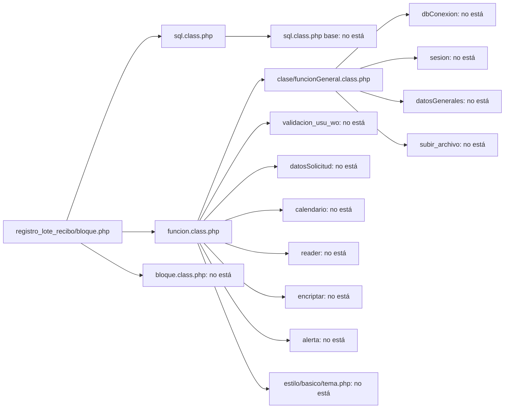
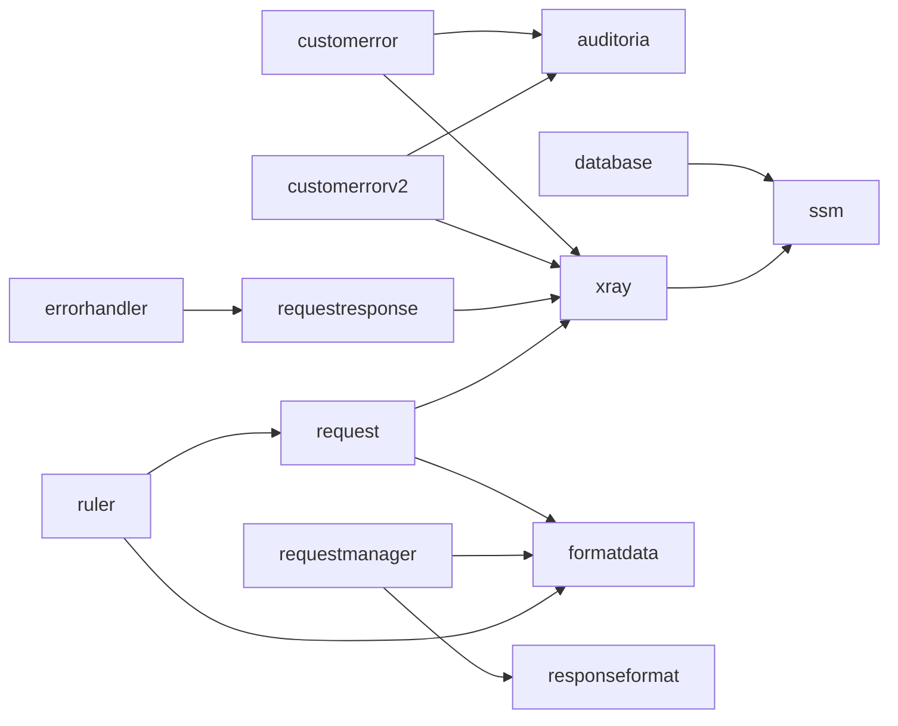

# Dependencias

- Etapa: INCEPTION → Reverse Engineering (2026-11-25)

## Dependencias internas

### weboffice

Texto equivalente: `bloque.php` incluye `funcion.class.php`, `sql.class.php` y la clase base `bloque.class.php`. `funcion.class.php` hereda de `funcionGeneral` e incluye seis clases del framework y el tema. `funcionGeneral` incluye las clases de conexión, sesión, datos generales y carga de archivos. Todas las del framework faltan en el repositorio.

#### `registro_lote_recibo` depende de `funcionGeneral`
- **Tipo**: ejecución (`include_once` y herencia).
- **Motivo**: SQL, sesión, conexiones y carga de archivos.

#### `registro_lote_recibo` depende de las clases del framework
- **Tipo**: ejecución.
- **Motivo**: conexión a las bases, lectura del Excel, festivos, fechas de la facultad, proyectos del asistente, cifrado de URL y mensajes. Sin ellas el bloque no corre (R16).

#### `admin_consultasCoordinador`, `admin_historicoPorEstudiante` y `admin_solicitudCoordinador` dependen del framework
- **Tipo**: ejecución.
- **Motivo**: igual que el anterior. No comparten código con `registro_lote_recibo` salvo `funcionGeneral`. `admin_solicitudCoordinador` usa además `datosGenerales` para el nivel del proyecto y el salario mínimo por nivel, y `navegacion` para paginar.

### Dependencias por datos

| Productor | Consumidor | Contrato |
|---|---|---|
| Oracle `mntac` | `registro_lote_recibo` | Objetos y columnas de `api-documentation.md`; solo lectura |
| `registro_lote_recibo` | "Solicitados" (`admin_solicitudCoordinador`) | Columnas de `solicitudRecibo`, `solicitudCuota`, `solicitudExencion` y `solicitudConcepto`. "Solicitados" lee solo el estado 0 y pasa la solicitud a 1 al generar; el 2 lo escribe la cancelación; `cuota` solo se lee en posgrado (RE-20, RE-21) |
| "Solicitados" | Oracle `mntac` y el estudiante | Escribe las cuotas del recibo en `ACESTMAT` y sus conceptos en `ACREFEST`, con valores que calcula él mismo (RE-22) |
| Tablas `exencion` y `fechaPagoFacultad` | `registro_lote_recibo`; "Solicitados" usa `exencion` (porcentaje y etiqueta, RE-22) | Porcentajes y fechas. En el sistema nuevo pasan a "parametros" (P-15) y la tabla `exencion` se sigue usando en "Solicitados" (riesgo aceptado en `application-design.md` §7) |

### utils_oas

Texto equivalente: los controladores de errores dependen de `auditoria` y `xray`; `database` y `xray` leen de `ssm`; `request`, `requestmanager` y `ruler` usan `formatdata`; `ruler` usa `request`; `requestresponse` y `request` usan `xray`. Los demás paquetes no dependen de otros paquetes de `utils_oas`.

#### `customerrorv2` depende de `auditoria` y `xray`
- **Tipo**: compilación (import de Go).
- **Motivo**: registrar el error en la auditoría y cerrar el segmento de X-Ray.

#### `database` y `xray` dependen de `ssm`
- **Tipo**: compilación.
- **Motivo**: leer credenciales y la dirección del daemon de X-Ray en Parameter Store.

## Dependencias externas

### weboffice

| Dependencia | Versión | Propósito | Licencia |
|---|---|---|---|
| `Spreadsheet_Excel_Reader` (php-excel-reader) | Desconocida | Leer `.xls` | Desconocida (el archivo no está) |
| Funciones PL/SQL `fua_verifica_evento` y `mntac.fua_verifica_diferido` | — | Evento de calendario y diferido | Institucional |
| Núcleo del framework weboffice | Sin versión | Todo el bloque | Institucional; los encabezados remiten a `LICENCIA.txt` y `EULA.txt`, que no están |

### utils_oas (dependencias directas de `go.mod`)

La licencia de `utils_oas` es GPL-3.0 (`LICENSE`, verificado). Las de sus dependencias no se pudieron verificar: no están en el workspace ni en la caché local de módulos de Go. La columna indica la licencia que publica cada proyecto, como referencia.

| Dependencia | Versión | Propósito | Licencia (sin verificar) |
|---|---|---|---|
| `github.com/astaxie/beego` | v1.12.3 | Framework web | Apache-2.0 |
| `github.com/aws/aws-sdk-go-v2`, `config`, `service/ssm` | v1.48.0, v1.33.21, v1.83.0 | Parameter Store | Apache-2.0 |
| `github.com/aws/aws-xray-sdk-go/v2` | v2.0.5 | Trazas | Apache-2.0 |
| `github.com/go-playground/validator/v10` | v10.30.6 | Validación de estructuras | MIT |
| `github.com/lib/pq` | v1.12.3 | Driver de PostgreSQL | MIT |
| `github.com/mndrix/golog` | v0.0.0-20170330170653-a28e2a269775 | Prolog para `ruler` | MIT |
| `github.com/phpdave11/gofpdf` | v1.4.3 | PDF en `xlsx2pdf` | MIT |
| `github.com/xuri/excelize/v2` | v2.10.1 | `.xlsx` en `xlsx2pdf` | BSD-3-Clause |
| `go.mongodb.org/mongo-driver/v2` | v2.10.1 | BSON y MongoDB | Apache-2.0 |

Nota de licencia: el sistema nuevo no importa `utils_oas`; reimplementa sus contratos (formato de respuesta, nombres de campos, cabeceras). Si alguien copia código literal de `utils_oas` en `recibos_service`, ese código queda bajo la GPL-3.0. Conviene confirmarlo con la OATI antes de Code Generation.

### Sistema nuevo
Las dependencias de `recibos_service` y `recibos_mf` (versiones exactas, hashes y SBOM) se fijan en Construction (AD-26, SECURITY-10). No forman parte de esta etapa.
